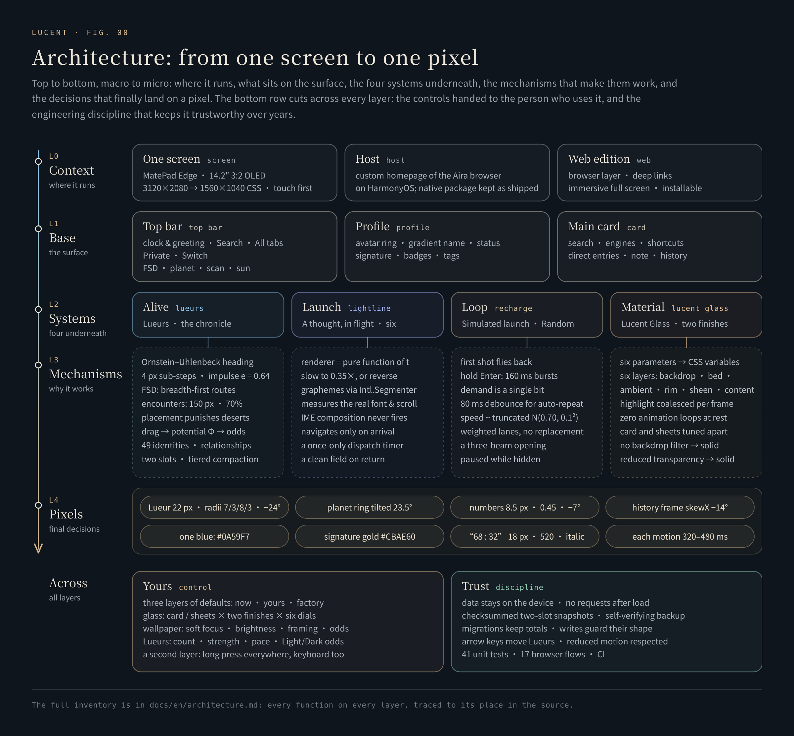
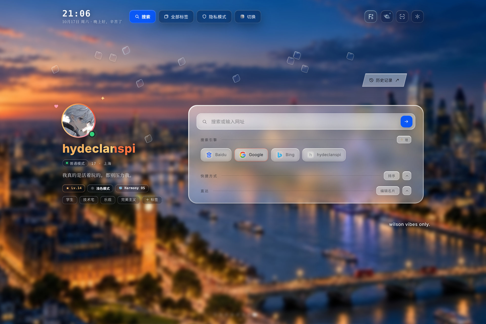
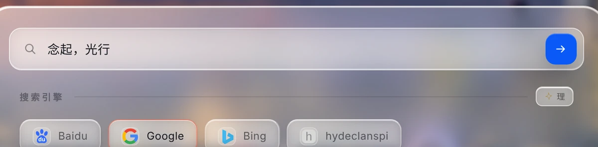
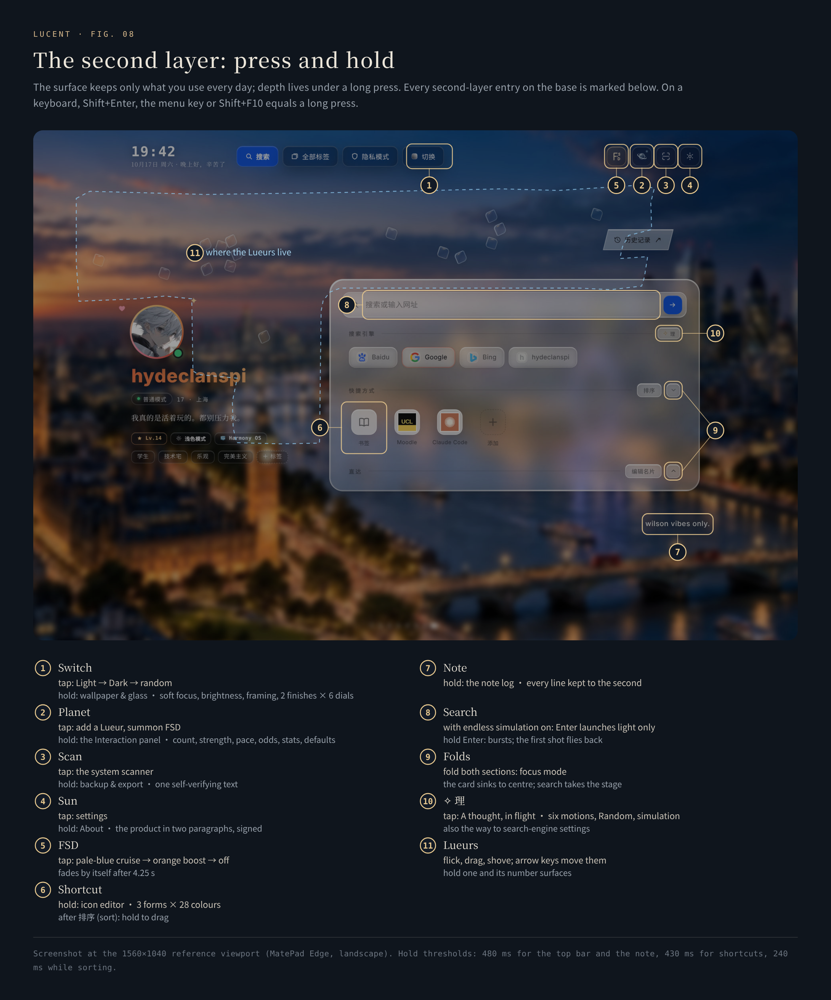

<p align="center">
  
</p>

<h1 align="center">Lucent · 灵感台</h1>

<p align="center">
  <b>The inspiration launcher</b><br>
  Launch from here. Stay for the light.
</p>

<p align="center">
  <a href="https://hydeclanspi.github.io/Lucent-Next/"><b>Live</b></a> &nbsp;·&nbsp;
  <a href="https://hydeclanspi.github.io/Lucent-Next/atelier/">Motion atelier — 16 studies</a> &nbsp;·&nbsp;
  <a href="docs/en/architecture.md">Architecture</a> &nbsp;·&nbsp;
  <a href="README.md">中文</a>
</p>

<p align="center">
  <a href="https://github.com/hydeclanspi/Lucent-Next/actions/workflows/check.yml"></a>
  
  
  
</p>

---

A homepage is a page you pass through. Lucent is a place you start from.

It was made for one screen: a Huawei MatePad Edge, 14.2 inches, 3:2, touch. The working day starts here, and every search lifts off from here. On days you would rather go nowhere, it is still worth staying — forty-nine glass residents go about their lives in the open space, and the light plays on, in place.

The 台 (*tái*) in its Chinese name, 灵感台, is a workbench, a launch pad, a stage and a console. Residents live on it.

One standard runs through all of it — in Chinese, **灵感与犀利并存**: inspired, and incisive. Light, clear, never in the way; yet every response lands at the exact moment it happens.

| | The 台 | What you feel | What is underneath |
|:-:|---|---|---|
| 01 | [**Workbench**](#01--workbench-everything-in-place) | Clock and greeting, profile, search, shortcuts, direct entries and a one-line note, each in its place, held by one clear pane of glass | A layout set on 1560×1040, pixel-matched to a 3120×2080 wallpaper; a short-screen guard; focus mode |
| 02 | [**Residents**](#02--residents-a-back-garden-that-gathers-stories) | Forty-nine numbered glass Lueurs drift, meet and chase in the open space; flick them and the next wallpaper changes; each one's history is kept | Ornstein–Uhlenbeck heading · 4 px sub-stepped impulse physics · breadth-first autonomous Drive · 70% encounters · weighted placement · checksummed files |
| 03 | [**Launch&nbsp;pad**](#03--launch-pad-a-thought-in-flight) | The words you wrote turn into light, reach the arrow, and only then does the search depart | Six motions chosen from sixteen studies · every frame a pure function of progress · grapheme-aware text |
| 04 | [**Stage**](#04--stage-light-without-leaving) | Go nowhere and the light still plays: a first shot that flies back, bursts while you hold Enter, blue-white lasers racing through platinum conduits | Reversal as rebound · one-bit demand · truncated-normal pacing · lanes without replacement |
| 05 | [**Console**](#05--console-every-dial-is-yours) | From six glass parameters to a long press on every control, the depth is handed to you | Three layers of defaults · two surfaces × two finishes × six dials · a second layer under long press |

---

## Architecture: from one screen to one pixel

<p align="center"></p>

Five layers, macro to micro: **context** (where it runs) → **base** (what sits on the surface) → **systems** (the four underneath) → **mechanisms** (why they work) → **pixels** (the numbers it all lands on). **Control** and **trust** run across every layer.

→ [The full inventory: every function on every layer, traced to source](docs/en/architecture.md)

## 01 · Workbench: everything in place

<p align="center"></p>
<p align="center"><sub>Focus mode: fold shortcuts and direct entries, and the card sinks to the centre with only search left.</sub></p>

A day should not begin with a feed. The surface holds only what is used every day, each thing in a fixed place:

- **Top bar.** The greeting changes with the hour — good morning, take it slow; good afternoon, stay sharp; good evening, well done today. Of the four pills, only Search is blue; on the right, four line icons — FSD, the planet, scan and the sun — the last three each hiding a second layer.
- **Profile.** A conic ring turns around the avatar every 14 seconds, and the name carries a 9-second sheen; below them sit the status, a one-line signature, badges and tags. Every signature you have ever written is kept.
- **Main card.** Search with four engines (one of them a custom template); shortcuts in three forms — automatic, framed, or an initial tile; direct entries to bookmarks, downloads, saved pages, tabs, search settings, user scripts and settings. In the lower right, a one-line note: long-press to rewrite it, archived to the second.
- **Focus mode.** Fold both sections and the card sinks to the visual centre; search becomes the only focus.
- **Laid out for one screen.** The 1560×1040 reference is exactly half of the MatePad Edge's 3120×2080 pixels, and the London wallpaper is 3120×2080 too — one bitmap pixel to one screen pixel.

## 02 · Residents: a back garden that gathers stories

<p align="center"></p>

The Lueurs are what make the base alive. They began as a red circle drawn on a screenshot: put two tiny panes of glass in the empty space — nothing that demands attention, but something worth reaching out to flick. They grew into an ecosystem: forty-nine residents with fixed numbers, every one of their histories kept. Like the cat and the dog in a back garden, they need no looking after; but each time you come back they are there, with a little more of a story.

- **Space.** The circled area became a 35-vertex polygon that keeps 30 px clear of every piece of content. Sampled on a grid, only its largest connected chamber is kept — 325 safe sites at 1560×1040 — so resizing the window never strands Lueurs in two separate pockets.
- **Motion.** The heading follows an Ornstein–Uhlenbeck mean-reverting process: direction has memory and turns are unhurried. Velocity relaxes toward the heading; at a wall a lens slides along it. A damped, correlated random walk, not a direction re-rolled every frame.
- **Contact.** Each frame's motion is split into steps of at most 4 px, so nothing tunnels at any frame rate. Equal-mass impulses with restitution 0.64. A lens in your hand pushes but never yields; natural meetings top up separation only for slow contacts, so chains of collisions are never amplified.
- **Autonomy.** Drive (FSD) runs breadth-first search over the grid of safe sites, straightens the route by line of sight, and cycles through roam, chase, charge and coast, aiming 0.18 s ahead of its target. One tap for pale-blue cruise, another for warm-orange boost.
- **Encounters.** When two freely drifting Lueurs enter a 150 px circle, 70% of meetings become an event, then a coin flip: one rams the other, or one turns away.
- **Stones and constellations.** Each time the base opens, the Lueurs are placed one by one by weighted lottery that punishes only deserts and crowding and never rewards tidiness. Every glance is a new constellation.
- **Probability.** Dragging a Lueur is walking an invisible potential field: the height you travel (62%), the change in distance to a reference lens (20%), the angle wound around it (13%) and how far the lens you hit was pushed (5%) rewrite the Light/Dark odds of the next wallpaper, by at most 35 points per gesture. Driving and encounters never write the odds and never count as human interaction.

<p align="center"></p>

### The chronicle: every story, kept

<p align="center"></p>

- **Identity.** #01–#49 are a fixed cast; each visit draws who is present. Pick one up and its number surfaces, faintly.
- **Files.** Each resident keeps its appearances, time present, hits, times hit, dodges, turns at the wheel and relays; the relationship table keeps each pair's contacts, bumps, dodges and minutes spent close; the terrain map keeps the paths they wore themselves.
- **Trustworthy.** Two slots written in turn, FNV-1a checksums, and a failed read never overwrites history with an empty table. Statistics compact hour → day → month → year, coarser with age, with totals exact; when the bins of a histogram changed, old counts were re-projected by interval overlap and settled by the largest-remainder method.
- **Portable.** The `AIRAPC1` backup text — compressed, encoded, CRC-32 — is read back in its own format and verified before it is copied. Nothing is uploaded, nothing is tracked.

→ Deep dives: [the Lueurs engine](docs/en/lueurs.md) · [the chronicle](docs/en/chronicle.md)

## 03 · Launch pad: a thought, in flight

<p align="center"></p>

A base needs a way out. The moment of a search is usually nothing at all: press Enter and the page is gone. Here, the words you wrote become a beam of light first; only when it reaches the blue arrow does the search depart — out of the base, into the world's interfaces: Google, Bing, Baidu, or an engine template of your own.

- **Six from sixteen.** First came a standalone [atelier](https://hydeclanspi.github.io/Lucent-Next/atelier/): the speed of light, the order of letters, the breath of materials, the spirit of the Lueurs — sixteen studies you can scrub frame by frame or watch at 0.35×. Six made it into the product and kept their atelier numbers: 01 Lightline · 03 Microprism · 04 Shutter · 09 Platinum filament · 10 Through the eye · 14 Near orbit.
- **Every frame is a pure function of progress.** The same t always draws the same frame, so a motion can be slowed, reversed, and tested frame by frame: across 21,618 progress states the six renderers keep finite coordinates, balanced drawing state and identical output on a second pass.
- **Respect for the words.** Chinese and emoji are split by grapheme, so combined characters never break; Enter during IME composition does nothing; navigation waits for the light, and the field is clean when you come back. Even if the host pauses frame callbacks, the search is sent exactly once.

→ Deep dive: [A thought, in flight](docs/en/motion.md)

## 04 · Stage: light, without leaving

<p align="center"></p>

A launcher that only sends you away is a door. A launcher you want to stay in is a place. Turn on the endless simulated-launch loop and the search field launches light and never a search — the base closes the loop on itself:

- **The first shot flies back.** It is a rehearsal: out along its path, then played in reverse, every character landing exactly where it was — the dividend of renderers being pure functions. Every shot after it takes the words away with the light.
- **Hold for bursts.** Hold Enter for more than 280 ms and light fires shot after shot, 160 ms each, path only, no text — one canvas and one frame loop, with no re-measuring mid-burst.
- **Demand is one bit.** Pressing again mid-flight records only "one more", never an ever-growing queue. Some keyboards send pairs of key-down and key-up while auto-repeating, so a key-up waits 80 ms before counting as a release.
- **Platinum rings, blue-white lasers.** Turn Random on and the gaps between the cards become champagne-platinum conduits with blue-white lasers racing through them. Each beam's speed is drawn from a truncated normal N(0.70, 0.10²); lanes are drawn by weight without replacement, so two beams never meet head-on in one channel; the opening sends three at once.

<p align="center"></p>

On days you would rather do nothing, the light plays for you, in place. Recharge, then set off again.

→ Deep dives: [simulated launch](docs/en/motion.md#7-simulated-launch) · [how Random schedules its lasers](docs/en/motion.md#6-random-platinum-rings-and-blue-white-lasers)

## 05 · Console: every dial is yours

<p align="center"></p>
<p align="center"><sub>The same main card: Warm Clear on the left, Classic Frost on the right.</sub></p>

Quiet is the default, not the ceiling. The more restrained the surface, the more depth it owes you underneath:

- **Glass, down to the parameter.** Lucent Glass — the material the product is named after — has a setting for the main card and another for the sheets: Classic Frost or Warm Clear, then six dials from 0 to 100: clarity, softness, warmth, edge, colour and touch. They feed six optical layers: backdrop, bed, ambient light, rim, touch sheen and an independent foreground. Filters touch only the decorative layers, so text stays sharp; at rest, nothing animates.
- **Wallpaper.** Light, Dark, or a random draw weighted by the odds the Lueurs set; soft focus 0–20%, brightness 50–100%, and a separate frame for each wallpaper.
- **Lueurs.** Count 0–49, collision strength 1–24× (or redrawn at every launch), natural pace 0.25–16×, the Light/Dark odds, and cruise on arrival.
- **Motion.** Any of the six, Random, or none at all, so the search simply departs.
- **Profile and shortcuts.** Name, one-liner, signature, tags, level and grip label are all yours to rewrite; every shortcut can take any of three forms and 28 colours.
- **Three layers of defaults.** Try anything now, keep the combinations you like as defaults, and return to the factory baseline in one tap.

### The second layer: press and hold

<p align="center"></p>

The surface keeps what you use every day; the depth lives under a long press:

| Entry | Tap | Hold |
|---|---|---|
| 切换 Switch | Light → Dark → random | Wallpaper and glass: soft focus, brightness, framing, two finishes × six dials |
| Planet | Add a Lueur, summon FSD | The Interaction panel: count, strength, pace, odds, Drive, statistics, defaults |
| Scan | The system scanner | Backup and export |
| Sun | Settings | About: the product in two paragraphs, signed by hand |
| Shortcut | Open | Icon editor: three forms × 28 colours; after 排序 (sort), hold to drag |
| Note | — | The note log, every line kept to the second |
| FSD | Pale-blue cruise → warm-orange boost → off | — |
| Search field (simulation on) | Launch one beam | Hold Enter: bursts |
| Lueurs | Flick, drag, shove; arrow keys move them | Its number surfaces while held |

On a keyboard, a long press on the planet, scan or sun is Shift+Enter, the menu key or Shift+F10; Switch and the note open their second layer on Enter.

→ Deep dives: [Lucent Glass and the design language](docs/en/glass.md) · [the full interaction table](docs/en/architecture.md#the-full-interaction-table)

## Built for one screen

Lucent runs every day on a Huawei MatePad Edge: a 14.2-inch OLED, 3:2, 3120×2080, 120 Hz, touch. The whole layout is set on its 1560×1040 CSS pixels, and every version was signed off on that screen.

- **Touch first.** A Lueur is 22 px to the eye and 44 px to the finger; the second layer belongs to the long press; flicks, drags and shoves all have physics.
- **On a computer.** On large screens (≥ 900 px) the first click anywhere goes full screen; F toggles it and Esc leaves — and once you leave, it will not return by itself during that visit. Install it from the browser as an app and it opens full screen, like a launcher should. On shorter landscape screens, the card makes room for the top bar by itself.

## Intellectual inspirations

Nothing here was invented from nothing; every part has a specific origin:

- **The gradient-descent picture → the potential field.** In a statistical-learning class, a ball rolls down the contour lines toward a valley. Here your hand is the ball: the height you travel decides the next wallpaper.
- **Bumper cars and the catfish → Drive (FSD).** The chosen Lueurs ram about like bumper cars — the catfish that keeps the whole pond alive. The name is borrowed from self-driving.
- **Go and the night sky → stones and constellations.** Placed one at a time, never tidily, so that every glance is a new constellation.
- **Earth's axial tilt → 23.5°.** The planet's ring tilts like Earth's axis; the half behind the sphere is dimmed and the half in front is lit.
- **A camera, a needle, a spectrum → the six motions.** Shutter, Through the eye, Platinum filament, Microprism, Near orbit — each motion borrows a gesture from the physical world.
- **The black box → a box you can partly see into.** "I don't need a model I fully understand; a black box is fine." So the panel carries a card that explains each layer in seven restrained paragraphs.
- **The back garden → the ecosystem.** They need no looking after; but each time you come back they are there, with a little more of a story.

## Design language

| Principle | In the product |
|---|---|
| **Light** | Lueurs are 22 px with 44 px touch targets; key actions share one glass toolbar instead of each button glowing on its own |
| **Clear** | The background takes part in the material while text stays in its own foreground; wallpaper blur and glass softness are separate parameters |
| **Sharp** | A collision springs apart on the frame of contact; numbers appear only when a lens is held; each search motion lasts 320–480 ms |
| **Restrained** | Automation never poses as a person's choice: driving and encounters never write odds or count as interaction |
| **Exact** | The planet's ring tilts 23.5°; natural speed was raised 16.4%; the FSD line-up is redrawn every 11.5 s; the signature was made "2.35 points brighter" |
| **Relative over absolute** | Terrain and roster shades are computed by quantile — with time every cell darkens, and only relative depth stays readable |

- **Icons are drawn, not typed.** A glass planet with a ring; an FSD lettermark with a tall F on the left, S and D staggered on the right and a single spark at the end of the F's crossbar; a line glyph for each motion; a history tag whose frame is skewed while its icon and text stay upright; the one-stroke cap over a resident's number.
- **Every colour has one job.** HarmonyOS blue `#0A59F7` belongs to the single primary action; warm gold belongs to identity (the name gradient, avatar ring, gilded signature); ice blue to the environment and the lasers; platinum appears only with Random on; warm orange belongs to boosted Drive alone.
- **A division of type.** Song serif for titles and poetic names (念起，光行, 落子与星座), monospace for numbers and readouts, Georgia italic for Latin names, HarmonyOS Sans for the interface.

## Engineering

| Aspect | Detail |
|---|---|
| **Size** | About 9,300 lines of JavaScript and 3,800 of CSS; no runtime dependency, no framework |
| **Rendering** | DOM, Canvas 2D and hand-written SVG charts; no chart or animation library |
| **Privacy** | Zero network requests after load; data stays on the device and leaves only through the clipboard |
| **Accessibility** | Lueurs move with the arrow keys (Shift for long steps); every long press has a keyboard equivalent; reduced motion and reduced transparency are honoured; sheets trap focus and return it on close |
| **Performance discipline** | One frame loop for the whole engine: every frame while dragging or driving, about 30 Hz when idle, fully paused in the background, under a sheet, or when the page is hidden |
| **Verification** | 41 unit tests (engine invariants, renderer determinism, storage integrity) and 17 browser flows, run in CI on every push |
| **Reproducibility** | The algorithm figures are drawn by the engine's own functions; the screenshots and animations are rendered frame by frame under a fake clock, not screen-recorded |

## Evolution

22 days, 109 versions, from 2.0.0 to 5.0.0.

| Phase | Dates | Versions | What happened |
|---|---|---|---|
| A profile homepage | Sep&nbsp;26–27 | 2.0 → 2.8 | Card, search and shortcuts; the clear-glass visual language; a daily note and signature archive; two wallpapers with blur |
| Codename: Interaction | Oct&nbsp;7–9 | 2.9 → 4.0.5 | Two Lueurs and the potential field; collisions, statistics and Drive; stones and constellations; encounters; 49 numbered residents and the chronicle |
| Chronicle and roster | Oct&nbsp;9–10 | 4.0.6 → 4.5.3 | Number badges, the About window, the chart family, the relationship web, backup and export, a handwritten signature, histogram migration |
| Material and motion | Oct&nbsp;10–16 | 4.7 → 5.0 | Warm Clear glass; six motions chosen from sixteen studies; simulated launch and sustained beams; Random's platinum rings and blue-white lasers |
| Web edition | Oct&nbsp;17 | 5.0 | Browser demonstration layer, deep links, immersive full screen and installation, engine and renderer tests, live deployment |

I defined the product, designed it, and signed off every version; the implementation was written with AI coding agents.

→ [Deep dive: evolution](docs/en/evolution.md)

## Deep links

Best on a large screen (≥ 900 px). The first click goes full screen; F toggles it any time. The links only press the product's own buttons, and the parameters are removed from the address bar once applied.

| To see | Link |
|---|---|
| 16 Lueurs with boosted Drive | [`?lueurs=16&fsd=rage`](https://hydeclanspi.github.io/Lucent-Next/?lueurs=16&fsd=rage) |
| 念起，光行 with Random on | [`?open=random`](https://hydeclanspi.github.io/Lucent-Next/?open=random) |
| The Interaction panel | [`?open=lueurs`](https://hydeclanspi.github.io/Lucent-Next/?open=lueurs) |
| The chronicle (let the Lueurs run for a while first) | [`?lueurs=12&fsd=rage&open=chronicle`](https://hydeclanspi.github.io/Lucent-Next/?lueurs=12&fsd=rage&open=chronicle) |
| Wallpaper and glass | [`?open=glass`](https://hydeclanspi.github.io/Lucent-Next/?open=glass) |
| About and the signature | [`?open=about`](https://hydeclanspi.github.io/Lucent-Next/?open=about) |
| Backup and export | [`?open=backup`](https://hydeclanspi.github.io/Lucent-Next/?open=backup) |

## Run it locally

Node.js 22 or later. Build and preview use only the Node standard library.

```sh
npm start            # build dist/ and preview at http://127.0.0.1:4173
npm run check        # syntax, release identity, native package digest
npm test             # 41 unit tests
npm install && npm run test:browser   # 17 browser flows (Playwright)
```

`dist/` can be served by any static host; pushes to `main` deploy to GitHub Pages.

## Layout

```text
index.html                  the base
assets/
  interaction.js            the Lueurs engine: geometry, physics, stochastic processes, FSD, encounters, placement, identity
  field-store.js            the chronicle: residents, relationships, residency, driving and events
  stats-store.js            aggregate statistics for probability and interaction
  stats-panel.js            the history and chronicle panel (hand-written SVG charts)
  glass-material.{js,css}   Lucent Glass
  search-motion*.{js,css}   念起，光行: renderers, player, panel and the Random lasers
  search-simulation.js      simulated launch and sustained beams
  app.js / app.css          profile, search, shortcuts, wallpaper, panels, backup, the short-screen guard
web/                        the web edition: browser layer, deep links, immersive full screen, app manifest and icons
atelier/                    the sixteen-study motion atelier
native/                     the original Aira package for HarmonyOS (5.0, kept byte for byte)
scripts/                    build, preview, checks, figures, media capture, the app icon and the social card
tests/                      engine, renderer, storage and browser tests
docs/                       deep dives, figures and screenshots (English in docs/en/)
```

## Documentation

- [Architecture: from one screen to one pixel](docs/en/architecture.md)
- [Lueurs — the engine](docs/en/lueurs.md)
- [Lucent Glass and the design language](docs/en/glass.md)
- [念起，光行 — search motion, simulated launch and Random](docs/en/motion.md)
- [The field chronicle — the local data layer](docs/en/chronicle.md)
- [Evolution — 109 versions in 22 days](docs/en/evolution.md)
- [Verification](docs/VERIFICATION.md) · [Deployment](docs/DEPLOYMENT.md) · [Maintaining](docs/MAINTAINING.md) · [Assets and attribution](docs/ASSETS.md)

---

<sub>Lucent · 灵感台 is designed by hydeclanspi. An independent personal project, not affiliated with Aira or Huawei. Code and interface: all rights reserved. The wallpapers, avatar and other artwork are not licensed for redistribution; see <a href="docs/ASSETS.md">Assets and attribution</a>.</sub>
