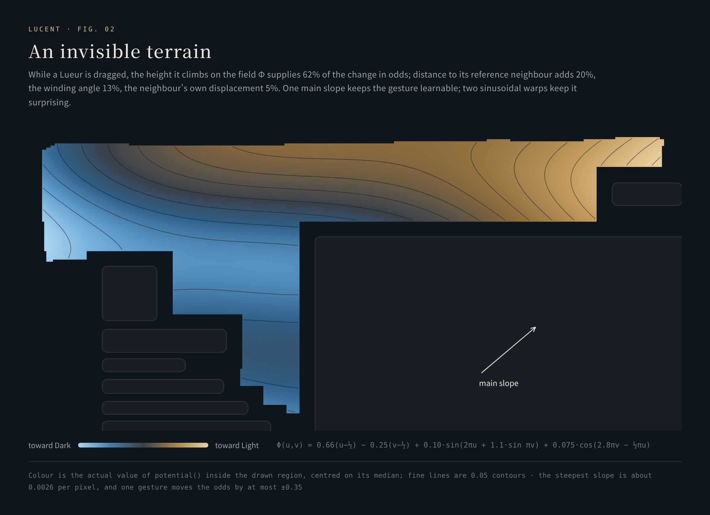

<p align="center">
  
</p>

<h1 align="center">Lucent · 灵感台</h1>

<p align="center">
  <b>Light as a thought, sharp as an edge.</b><br>
  Beneath a quiet homepage, a small world that moves, meets, and keeps a record.
</p>

<p align="center">
  <a href="https://hydeclanspi.github.io/lucent/"><b>Live demo</b></a> &nbsp;·&nbsp;
  <a href="https://hydeclanspi.github.io/lucent/atelier/">Motion atelier — 16 studies</a> &nbsp;·&nbsp;
  <a href="docs/en/lueurs.md">Engine deep dive</a> &nbsp;·&nbsp;
  <a href="README.md">中文</a>
</p>

<p align="center">
  <a href="https://github.com/hydeclanspi/lucent/actions/workflows/check.yml"></a>
  
  
  
</p>

---

Lucent is the custom homepage I designed for the Aira browser on HarmonyOS. This is its web edition.

The surface is deliberately quiet: a clock and a greeting, a profile card, a one-line note, a clear glass card and one blue arrow. Underneath run four systems held to a single standard — in Chinese, **灵感与犀利并存**, inspiration and sharpness at once: light, translucent and unobtrusive, yet every response arrives exactly when it should.

| | System | What it does | What is underneath |
|:-:|---|---|---|
| 01 | [**Lueurs · 小浮光**](#01--lueurs--小浮光) | 49 numbered glass residents drift, collide and chase inside a hand-drawn open space; dragging them shifts the odds of the next wallpaper | Ornstein–Uhlenbeck heading process · 4 px sub-stepped impulse physics · a breadth-first-routed Drive (FSD) state machine · 70% encounter adjudication · desert-punishing weighted placement |
| 02 | [**Liquid glass**](#02--liquid-glass) | The material of the card and every sheet: tunable, switchable, tinted by the wallpaper | A six-parameter material model · six optical layers · a pointer highlight coalesced to one write per frame · zero animation loops at rest |
| 03 | [**念起，光行 · A thought, in flight**](#03--a-thought-in-flight) | A search becomes a beam of light: the words turn to light, reach the arrow, and only then depart | Six motions chosen from sixteen studies · every frame a pure function of progress · blue-white current paced by a truncated normal |
| 04 | [**The field chronicle · 场志**](#04--the-field-chronicle) | Long use, kept as statistics, terrain, relationships and files you can look back on | Dual-slot checksummed snapshots · hour → day → month → year compaction · largest-remainder re-binning · a self-verifying backup format |

---

## 01 · Lueurs · 小浮光

<p align="center"></p>

Codename 代号：交互 (Interaction). It began as a red circle drawn on a screenshot: put two tiny floating panes of glass in the empty space of the homepage — nothing that demands attention, but something worth reaching out to flick. It grew into a small world with physics, autonomy and identity.

- **Space.** The circled area became a 35-vertex polygon that keeps 30 px clear of every piece of content. Sampled on a grid, only its largest connected chamber is kept — 325 safe sites at 1560×1040 — so resizing the window can never strand Lueurs in two separate pockets.
- **Motion.** The heading follows an Ornstein–Uhlenbeck mean-reverting process: direction has memory and turns are unhurried. Velocity relaxes toward the heading; at a wall a lens slides along it and the reversed component is damped by 0.65. A damped, correlated random walk, not a direction re-rolled every frame.
- **Contact.** Each frame's motion is split into steps of at most 4 px, so nothing tunnels at any frame rate. Equal-mass impulses with restitution 0.64. A lens held in your hand is kinematic — it pushes but never yields. Natural meetings top up separation only for slow contacts, so chain collisions are never amplified.
- **Autonomy.** Drive (FSD) runs breadth-first search on the four-connected grid of safe sites, straightens the route by line of sight, and cycles through roam → chase → charge → coast, aiming 0.18 s ahead of its target. One tap for pale-blue cruise, another for warm-orange boost.
- **Encounters.** When two freely drifting Lueurs enter a 150 px circle, 70% of meetings become an event, then a coin flip: one speeds up and bumps the other, or one turns away. Driving and encounters never touch the wallpaper odds and never count as human interaction.
- **Placement — 落子与星座, stones and constellations.** Each time the homepage opens, the Lueurs are placed one by one by weighted lottery that punishes only deserts and crowding, and never rewards tidiness. Every glance is a new constellation, never an evenly spread board.
- **Probability.** As you drag, four terms set the Light/Dark weight of the next wallpaper: the height travelled on an invisible potential field (62%), the change in distance to a reference lens (20%), the angle wound around it (13%), and how far the lens you hit was pushed (5%). One gesture moves the odds by at most 35 points.
- **Identity.** #01–#49 are fixed residents; each visit draws who is present. Who hit whom, who dodged whom, who drove for whom — all of it goes into each one's file. Pick one up and its number surfaces, faintly.

<p align="center"></p>

→ [Deep dive: the Lueurs engine](docs/en/lueurs.md) — formulas, the state machine, placement weights, parameter curves and tests, each anchored to source lines.

## 02 · Liquid glass

<p align="center"></p>

One glass does three jobs — reading, operating, decorating. The card and the sheets each keep their own settings and can be **classic frosted** or **warm liquid clear**.

- **Six parameters.** Transparency, softness, warmth, edge, colour and touch, each 0–100, mapped to a set of CSS variables.
- **Six optical layers.** Backdrop sampling (one necessary blur) → base tint → ambient light (warm upper-left, cool lower-right, toned to the wallpaper) → a 1.5 px gradient rim hollowed out with `mask-composite` plus four inner edge lines → the pointer highlight → an independent foreground. Filters touch only the decorative layers; text and data stay sharp.
- **Restraint.** The highlight is event-driven and writes at most once per frame; at rest there is no animation loop at all. Without backdrop filters, or with reduced transparency or reduced motion, each layer has a fallback.

→ [Deep dive: liquid glass and the design language](docs/en/glass.md)

## 03 · A thought, in flight

<p align="center"></p>

念起，光行 — a line of text becomes a beam of light. A search does not just jump away: the words you wrote turn into light and reach the arrow first, and only then does the search depart.

- **Six from sixteen.** First came a standalone [atelier](https://hydeclanspi.github.io/lucent/atelier/): four families — the speed of light, the order of letters, the breath of materials, the spirit of the Lueurs — sixteen studies you can scrub frame by frame or watch at 0.35×. Six made it into the product and kept their atelier numbers: 01 · 03 · 04 · 09 · 10 · 14.
- **Every frame is a pure function of progress.** The same t always draws the same frame. So the motions can be slowed, reversed (the first simulated shot flies back to where it started), and tested frame by frame: across 21,618 progress states the six renderers keep finite coordinates, balanced drawing state and identical output on a second pass.
- **Respect for the words.** Chinese and emoji are split by grapheme (`Intl.Segmenter`), so combined characters never break apart. Enter during IME composition does nothing; the search leaves only after the light arrives, and the field is clean when you come back.

<p align="center"></p>

- **Random: platinum rings, blue-white current.** Turn Random on and the gaps between the cards become conduits of champagne platinum, with blue-white current running through them. Each beam's speed is drawn from a truncated normal N(0.70, 0.10²). Each wave is a single beam 73% of the time, two 20%, three 7%; lanes are drawn by weight without replacement, so two beams never meet head-on in one channel, and the next wave waits for the slowest beam of the last to land. It opens with choreography: the vertical gap top to bottom, the second horizontal gap right to left, the first left to right — all three at once.

→ [Deep dive: 念起，光行](docs/en/motion.md)

## 04 · The field chronicle

<p align="center"></p>

The Lueurs are not nameless. Forty-nine fixed residents; each visit draws who is present. Who they hit, who they dodged, who they drove for — it all goes into their files. Here is the roster; this is where the stories start.

- **Two layers of data.** Probability statistics keep aggregates only: 28 integers per time bucket — never the moment, coordinates or details of a drag. The chronicle keeps a file for each of the 49 residents: an upper-triangular relationship table, a 200-event ring, a 26×12 residency grid.
- **Trustworthy.** Two slots written in turn, FNV-1a checksums; reads take the newest valid snapshot, and a failed read never overwrites history with an empty one. Statistics compact hour → day → month → year, coarser with age, within a 160 KiB budget; the chronicle prunes and quantizes to stay within 96 KiB. When a histogram's bins changed, old counts were re-projected by interval overlap and rounded by the largest-remainder method — not one count lost.
- **Portable.** The `AIRAPC1` backup text: deflate-raw → base64url → CRC-32, with its length and checksum written into the text itself. Before copying, it is read back in the same format and verified; long backups are split into segments. Every failure is a plain sentence with a next step. Nothing is uploaded, nothing is tracked.
- **A family of charts.** All hand-written SVG: Light tendency, interaction counts, a probability-distribution heat strip, relative collision speed in 14 non-linear bins, the residency terrain with A–Z, A2… coordinates, the relationship web (Bézier strokes that stop short of each circle, a random starting angle every time), and triangles computed on read.

→ [Deep dive: the field chronicle](docs/en/chronicle.md)

---

## Design language

| Principle | In the product |
|---|---|
| **Light** | Lueurs are 22 px with 44 px touch targets; key actions share one glass toolbar instead of each button glowing on its own |
| **Clear** | The background takes part in the material while text stays in its own foreground; wallpaper blur and glass softness are separate parameters |
| **Sharp** | A collision springs apart on the frame of contact; numbers appear only when a lens is held; search motions last 320–480 ms |
| **Restrained** | Automation never poses as a person's choice: driving and encounters never write odds or count as interaction |
| **Exact** | The planet's ring tilts 23.5°; natural speed was raised 16.4%; the FSD line-up is redrawn every 11.5 s; the signature was made "2.35 points brighter" |
| **Relative over absolute** | Terrain and roster shades are computed by quantile — with time every cell darkens, and only relative depth stays readable |

- **Icons are drawn, not typed.** A glass planet with a ring; an FSD lettermark with a tall F on the left, S and D staggered on the right, and a single spark at the end of the F's crossbar; a line glyph for each motion; a history tag whose frame is skewed while its icon and text stay upright; the one-stroke cap over a resident's number.
- **Every colour has one job.** HarmonyOS blue `#0A59F7` belongs to the single primary action; warm gold belongs to identity (the name gradient, avatar ring, gilded signature); ice blue to the environment and the current; platinum appears only with Random on; warm orange belongs to boosted Drive alone.
- **A division of type.** Song serif for titles and poetic names (念起，光行, 落子与星座), monospace for numbers and readouts, Georgia italic for Latin names, HarmonyOS Sans for the interface.

## Engineering

| Aspect | Detail |
|---|---|
| **Size** | About 9,200 lines of JavaScript and 3,700 of CSS; no runtime dependency, no framework |
| **Rendering** | DOM, Canvas 2D and hand-written SVG charts; no chart or animation library |
| **Privacy** | Zero network requests after load; data stays on the device and leaves only through the clipboard |
| **Accessibility** | Lueurs move with the arrow keys (Shift for long steps); reduced motion and reduced transparency are honoured; sheets trap focus and return it on close |
| **Performance discipline** | One frame loop for the whole engine: every frame while dragging or driving, about 30 Hz when idle, fully paused in the background, under a sheet, or when the page is hidden |
| **Verification** | 41 unit tests (engine invariants, renderer determinism, storage integrity) and 15 browser flows, run in CI on every push |

## Evolution

22 days, 109 versions, from 2.0.0 to 5.0.0.

| Phase | Dates | Versions | What happened |
|---|---|---|---|
| A profile homepage | Sep&nbsp;26–27 | 2.0 → 2.8 | Card, search and shortcuts; the clear-glass visual language; a daily note and signature archive; two wallpapers with blur |
| Codename: Interaction | Oct&nbsp;7–9 | 2.9 → 4.0.5 | Two Lueurs and the potential field; collisions, statistics and Drive; stones and constellations; encounters; 49 numbered residents and the chronicle |
| Chronicle and roster | Oct&nbsp;9–10 | 4.0.6 → 4.5.3 | Number badges, the About window, the chart family, the relationship web, backup and export, a handwritten signature, histogram migration |
| Material and motion | Oct&nbsp;10–16 | 4.7 → 5.0 | Warm liquid clear glass; six motions chosen from sixteen studies; simulated launch and sustained beams; Random's platinum rings and blue-white current |
| Web edition | Oct&nbsp;17 | 5.0 | Browser demonstration layer, deep links, engine and renderer tests, live deployment |

I defined the product, designed it, and signed off every version; the implementation was written with AI coding agents.

→ [Deep dive: evolution](docs/en/evolution.md)

## Deep links

Best on a desktop browser (Lueurs need at least 900 px of width). The links only press the product's own buttons, and the parameters are removed from the address bar once applied.

| To see | Link |
|---|---|
| 16 Lueurs with boosted Drive | [`?lueurs=16&fsd=rage`](https://hydeclanspi.github.io/lucent/?lueurs=16&fsd=rage) |
| 念起，光行 with Random on | [`?open=random`](https://hydeclanspi.github.io/lucent/?open=random) |
| The Interaction panel | [`?open=lueurs`](https://hydeclanspi.github.io/lucent/?open=lueurs) |
| The chronicle (let the Lueurs run for a while first) | [`?lueurs=12&fsd=rage&open=chronicle`](https://hydeclanspi.github.io/lucent/?lueurs=12&fsd=rage&open=chronicle) |
| Glass material and wallpaper | [`?open=glass`](https://hydeclanspi.github.io/lucent/?open=glass) |
| About and the signature | [`?open=about`](https://hydeclanspi.github.io/lucent/?open=about) |
| Backup and export | [`?open=backup`](https://hydeclanspi.github.io/lucent/?open=backup) |

Gestures: tap the planet to add a Lueur and summon FSD; long-press the planet for the Interaction panel; long-press 切换 (Switch) for wallpaper and glass; long-press the sun at top right for About; long-press the scan icon for backup and export.

## Run it locally

Node.js 22 or later. Build and preview use only the Node standard library.

```sh
npm start            # build dist/ and preview at http://127.0.0.1:4173
npm run check        # syntax, release identity, native package digest
npm test             # 41 unit tests
npm install && npm run test:browser   # 15 browser flows (Playwright)
```

`dist/` can be served by any static host; pushes to `main` deploy to GitHub Pages.

## Layout

```text
index.html                  the homepage
assets/
  interaction.js            the Lueurs engine: geometry, physics, stochastic processes, FSD, encounters, placement, identity
  field-store.js            the chronicle: residents, relationships, residency, driving and events
  stats-store.js            aggregate statistics for probability and interaction
  stats-panel.js            the history and chronicle panel (hand-written SVG charts)
  glass-material.{js,css}   the glass material
  search-motion*.{js,css}   念起，光行: renderers, player, panel and the Random current
  search-simulation.js      simulated launch and sustained beams
  app.js / app.css          profile card, search, shortcuts, wallpaper, panels, backup and export
web/                        the web edition's browser layer and deep links
atelier/                    the sixteen-study motion atelier
native/                     the original Aira package for HarmonyOS (5.0, kept byte for byte)
scripts/                    build, preview, checks, figure rendering and media capture
tests/                      engine, renderer, storage and browser tests
docs/                       deep dives, figures and screenshots (English in docs/en/)
```

## Documentation

- [Lueurs — the engine](docs/en/lueurs.md)
- [Liquid glass and the design language](docs/en/glass.md)
- [念起，光行 — search motion](docs/en/motion.md)
- [The field chronicle — the local data layer](docs/en/chronicle.md)
- [Evolution — 109 versions in 22 days](docs/en/evolution.md)
- [Verification](docs/VERIFICATION.md) · [Deployment](docs/DEPLOYMENT.md) · [Maintaining](docs/MAINTAINING.md) · [Assets and attribution](docs/ASSETS.md)

---

<sub>Lucent · 灵感台 is designed by hydeclanspi. An independent personal project, not affiliated with Aira or Huawei. Code and interface: all rights reserved. The wallpapers, avatar and other artwork are not licensed for redistribution; see <a href="docs/ASSETS.md">Assets and attribution</a>.</sub>
