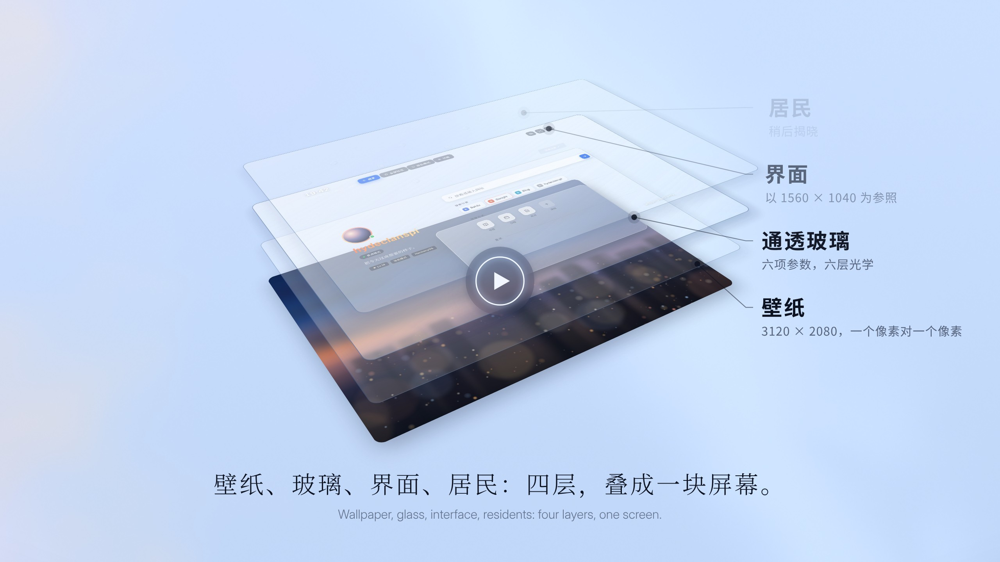
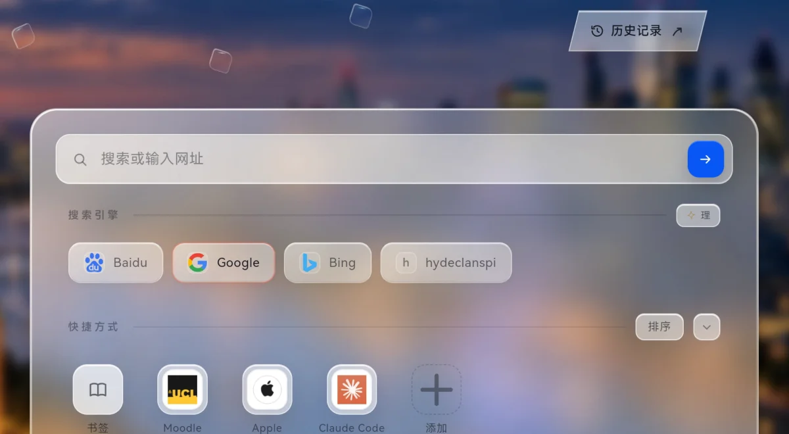

<p align="center">
  <a href="https://hydeclanspi.github.io/Lucent-Next/film/"></a>
</p>

<h1 align="center">Lucent · 灵感台</h1>

<p align="center">
  <b>The inspiration launcher</b><br>
  Launch from here. Stay for the light.
</p>

<p align="center">
  <a href="https://hydeclanspi.github.io/Lucent-Next/"><b>Live</b></a> &nbsp;·&nbsp;
  <a href="https://hydeclanspi.github.io/Lucent-Next/film/">Watch the film</a> &nbsp;·&nbsp;
  <a href="demo/">All demos</a> &nbsp;·&nbsp;
  <a href="docs/en/architecture.md">Architecture</a> &nbsp;·&nbsp;
  <a href="README.md">中文</a>
</p>

<p align="center">
  <a href="https://github.com/hydeclanspi/Lucent-Next/actions/workflows/check.yml"></a>
  
  
  
</p>

<br>

<p align="center">There was once a button below the screen.</p>

<h3 align="center">Everyone called it the Home button.</h3>

<p align="center">
  Press it, and however far you had gone, however much you had opened, you were back where you began.<br>
  Home was a promise: there is always a place that waits for you.
</p>

<p align="center">Today, we have made that promise into a place.</p>

<p align="center"></p>

<h3 align="center">Today, we're introducing four things.</h3>

<p align="center">
  <b>The first is a workbench.</b><br>
  Clock and greeting, profile, search, shortcuts, direct entries and a one-line note, each in its place;<br>
  one clear pane of glass holds them all.
</p>

<p align="center">
  <b>The second is a launch pad.</b><br>
  The words you write become a beam of light; only when it reaches the blue arrow does the search depart,<br>
  out to Google, Bing, Baidu, or an engine of your own.
</p>

<p align="center">
  <b>The third is a stage.</b><br>
  Stay, and the light performs for you: the first shot flies back along its path, and holding Enter fires shot after shot;<br>
  through rings of platinum, blue-white lasers keep running.
</p>

<p align="center">
  <b>The fourth is a console.</b><br>
  Six settings for the glass, and a second layer under every button.
</p>

<p align="center">
  A workbench. A launch pad. A stage. A console.<br>
  In Chinese, all four end in the same character: 台.
</p>

<h3 align="center">They are one place. We call it Lucent.</h3>

<p align="center"><sub>灵感台 in Chinese: 灵感 is inspiration, and 台 is all four places at once.</sub></p>

<br>

<h3 align="center">One more thing.</h3>

<p align="center">
  Residents live here.<br>
  Forty-nine numbered panes of glass drift, meet and chase in the open space, and every one of their stories is written down.<br>
  Like the cat and the dog in a back garden, they live their own lives. Each time you come back, they are there, with a little more of a story.
</p>

<p align="center"></p>

---

## The film

<p align="center"><a href="https://hydeclanspi.github.io/Lucent-Next/film/"></a></p>

**A concept film**, one minute forty-eight seconds, with sound. In the dark, a beam of light draws the button; pressed, the camera dives to its rim until it is a great arc of light, with the Home button as everyone knew it inside and its name, Home 键. In a flash of white, the promise it made becomes a place. Four layers stack into one screen; the words you write become light and rush into the arrow; a door edged in every colour opens on the surface of a chip, a wave of light sweeps it, every core it strikes lifts off as a window onto the world, and the camera jumps into a tunnel of a thousand windows; stage lights rise, and lasers run through rings of platinum; over an aurora, the glass's six settings turn one by one; the four places stand as four pillars of light, close into a line, then a point, and 灵感台 rises from it; forty-nine residents move into the open space, form constellations and settle into a back garden; then it comes to rest on the screen it was made for, where three wallpapers turn to glass, one on each beat, hang in the air, and settle into its screen, and night falls on the one that is chosen.

Every frame and every sound is made in code: one timeline, with WebGL for the sky and the light, Canvas for the beams, the arc and the world beyond the door, CSS and SVG for the interface and the type; the score and the sound effects are synthesized with numpy from the same timetable — a piano and a marimba with the tune, hands, a whistle and a ukulele beside them, strings, taiko and voices under every reveal, at 120 beats a minute — so every press, flash and door lands on a downbeat, and the music is loud where the film is and quiet where it is. Pause or scrub any moment, or render it frame by frame to video.

→ [Watch in the browser](https://hydeclanspi.github.io/Lucent-Next/film/) · [Download the MP4 (1440p, 60 fps, with sound)](demo/media/lucent-film.mp4)

### On the device

<p align="center"><a href="https://hydeclanspi.github.io/Lucent-Next/device/"></a></p>

Recorded on a HUAWEI MatePad Edge, forty-six seconds, with sound: a search and its Lightline, the six ways to arrive, the Lueurs' settings and their history, the wallpapers, the card and the backup. The quiet stretches run faster, each marked with its speed in the top right corner; the music is the second half of the concept film's score.

→ [Watch in the browser](https://hydeclanspi.github.io/Lucent-Next/device/) · [Download the MP4 (1440p, 60 fps, with sound)](demo/device/lucent-on-device.mp4)

## Made for one screen

Lucent is designed for the **HUAWEI MatePad Edge**: a 14.2-inch OLED, 3:2, 3120 × 2080, 120 Hz, touch. The layout is set on its 1560 × 1040 logical pixels, and the London night wallpaper is 3120 × 2080 too — one pixel to one pixel. Every iteration was signed off on this screen.

- **Touch first.** A Lueur is 22 px to the eye and 44 px to the finger; the second layer belongs to the long press; flicks, drags and shoves all have physics.
- **On the MatePad Edge**, it is the place you set out from and come back to every day: every gap, every beam of light, every touch, exactly as designed.
- **On a computer**, full screen is a faithful simulation of that screen: out of full screen a pill says it looks best in full screen and offers a button for it; tap anywhere to go full screen, F toggles it, Esc leaves; in full screen the lower left notes that this is the web simulation and the flagship is the tablet's touch. Every panel standing in for the browser's own interface says so under its title; install it as an app and it opens full screen. The web edition draws the tablet's status bar from a screenshot of the device, and in full screen Aira's toolbar and the gesture bar too, at its sizes and spacing; out of full screen, every click goes full screen, and Esc leaves; shorter landscape screens leave them out, and the card makes room for the top bar by itself. Every visit opens on the showcase defaults: six Lueurs, the wallpaper on Random at Light 99 : 1.
- **Phones and small screens** are outside its scope, and are not recommended.

## Five parts

The surface is what you feel; underneath is what makes it hold.

| | The 台 | What you feel | What is underneath |
|:-:|---|---|---|
| 01 | [**Workbench**](#01--workbench-everything-in-place) | Clock and greeting, profile, search, shortcuts, direct entries and a one-line note, each in its place, held by one clear pane of glass | A layout set on 1560×1040, pixel-matched to a 3120×2080 wallpaper; a short-screen guard; focus mode |
| 02 | [**Residents**](#02--residents-a-back-garden-that-gathers-stories) | Forty-nine numbered glass Lueurs drift, meet and chase in the open space; flick them and the next wallpaper changes; each one's history is kept | Ornstein–Uhlenbeck heading · 4 px sub-stepped impulse physics · breadth-first autonomous Drive · 70% encounters · weighted placement · checksummed files |
| 03 | [**Launch&nbsp;pad**](#03--launch-pad-a-thought-in-flight) | The words you wrote turn into light, reach the arrow, and only then does the search depart | Six motions chosen from sixteen studies · every frame a pure function of progress · grapheme-aware text |
| 04 | [**Stage**](#04--stage-stay-and-the-light-performs-for-you) | Stay, and the light stays too: a first shot that flies back, bursts while you hold Enter, blue-white lasers racing through platinum conduits, gold silk and motes flowing round the search field | Reversal as rebound · one-bit demand · truncated-normal pacing · lanes without replacement · silk paced by arc length |
| 05 | [**Console**](#05--console-every-dial-is-yours) | From six glass parameters to a long press on every control, the depth is handed to you | Three layers of defaults · two surfaces × two finishes × six dials · a second layer under long press |

## Architecture: from one screen to one pixel

<p align="center"></p>

Five layers, macro to micro: **context** (where it runs) → **base** (what sits on the surface) → **systems** (the four underneath) → **mechanisms** (why they work) → **pixels** (the numbers it all lands on). **Control** and **trust** run across every layer.

→ [The full inventory: every function on every layer, traced to source](docs/en/architecture.md)

## 01 · Workbench: everything in place

<p align="center"></p>
<p align="center"><sub>Focus mode: fold shortcuts and direct entries, and the card sinks to the centre with only search left.</sub></p>

A day begins on a quiet surface. It holds only what you use every day, each thing in a fixed place:

- **Top bar.** The greeting changes with the hour — good morning, take it slow; good afternoon, stay sharp; good evening, well done today. Of the four pills, only Search is blue. On the right sit three line icons — the planet, scan and the sun — each hiding a second layer; while Drive runs, the FSD lettermark appears before them.
- **Profile.** A conic ring turns around the avatar every 14 seconds, and the name carries a 9-second sheen; below them sit the status, a one-line signature, badges and tags. Every signature you have ever written is kept.
- **Main card.** Search with four engines (one of them a custom template); shortcuts in three forms — automatic, framed, or an initial tile; direct entries to bookmarks, downloads, saved pages, tabs, search settings, user scripts and settings. In the lower right, a one-line note: long-press to rewrite it, archived to the second.
- **Focus mode.** Fold both sections and the card sinks to the visual centre; search becomes the only focus.

## 02 · Residents: a back garden that gathers stories

The Lueurs are what bring the base to life. They began as a red circle drawn on a screenshot: two tiny panes of glass in the open space, quiet, and worth reaching out to flick. They grew into an ecosystem: forty-nine residents with fixed numbers, every one of their histories kept.

- **Space.** The circled area became a 35-vertex polygon that keeps 30 px clear of every piece of content. Sampled on a grid, only its largest connected chamber is kept — 325 safe sites at 1560×1040 — so when the window resizes, the Lueurs stay in one chamber.
- **Motion.** The heading follows an Ornstein–Uhlenbeck mean-reverting process, velocity relaxes toward it, and at a wall a lens slides along it: a damped, correlated random walk, with a memory for direction and unhurried turns.
- **Contact.** Each frame's motion is split into steps of at most 4 px, so every contact is caught at any frame rate. Equal-mass impulses with restitution 0.64. A lens in your hand pushes and holds its ground; natural meetings top up separation only for slow contacts, so chains of collisions always settle.
- **Autonomy.** Drive (FSD) runs breadth-first search over the grid of safe sites, straightens the route by line of sight, and cycles through roam, chase, charge and coast, aiming 0.18 s ahead of its target. One tap for pale-blue cruise, another for warm-orange boost.
- **Encounters.** When two freely drifting Lueurs enter a 150 px circle, 70% of meetings become an event, then a coin flip: one rams the other, or one turns away.
- **Stones and constellations.** Each time the base opens, the Lueurs are placed one by one by weighted lottery, penalising deserts and crowding, so that every glance is a new constellation.
- **Probability.** Dragging a Lueur is walking an invisible potential field: the height you travel (62%), the change in distance to a reference lens (20%), the angle wound around it (13%) and how far the lens you hit was pushed (5%) rewrite the Light/Dark odds of the next wallpaper, by at most 35 points per gesture. The odds listen only to a human hand: driving and encounters neither write them nor count as interaction.

<p align="center"></p>

### The chronicle: every story, kept

<p align="center"></p>

- **Identity.** #01–#49 are a fixed cast; each visit draws who is present. Pick one up and its number surfaces, faintly.
- **Files.** Each resident keeps its appearances, time present, hits, times hit, dodges, turns at the wheel and relays; the relationship table keeps each pair's contacts, bumps, dodges and minutes spent close; the terrain map keeps the paths they wore themselves.
- **Trustworthy.** Two slots written in turn, FNV-1a checksums; when a read fails, history stays exactly as it was. Statistics compact hour → day → month → year, coarser with age, with totals exact; when the bins of a histogram changed, old counts were re-projected by interval overlap and settled by the largest-remainder method.
- **Portable.** The `AIRAPC1` backup text — compressed, encoded, CRC-32 — is read back in its own format and verified before it is copied. Everything stays on the device, and you decide where it goes.

→ Deep dives: [the Lueurs engine](docs/en/lueurs.md) · [the chronicle](docs/en/chronicle.md)

## 03 · Launch pad: a thought, in flight

<p align="center"></p>

Every search lifts off from here. The words you wrote become a beam of light first; when it reaches the blue arrow, the search departs — out of the base, into the world's interfaces: Google, Bing, Baidu, or an engine template of your own.

- **Six from sixteen.** First came a standalone [atelier](https://hydeclanspi.github.io/Lucent-Next/atelier/): the speed of light, the order of letters, the breath of materials, the spirit of the Lueurs — sixteen studies you can scrub frame by frame or watch at 0.35×. Six made it into the product and kept their atelier numbers: 01 Lightline · 03 Microprism · 04 Shutter · 09 Platinum filament · 10 Through the eye · 14 Near orbit.
- **Every frame is a pure function of progress.** The same t always draws the same frame, so a motion can be slowed, reversed, and tested frame by frame: across 21,618 progress states the six renderers keep finite coordinates, balanced drawing state and identical output on a second pass.
- **Respect for the words.** Chinese and emoji are split by grapheme, so combined characters stay whole; Enter during IME composition belongs to the IME; navigation waits for the light, and the field is clean when you come back. Even if the host pauses frame callbacks, the search is sent exactly once.

→ Deep dive: [A thought, in flight](docs/en/motion.md)

## 04 · Stage: stay, and the light performs for you

<p align="center"></p>

Lucent is also a place you want to stay. Turn on the endless simulated-launch loop, and the search field launches light and keeps the search at home — the base closes the loop on itself:

- **The first shot flies back.** It is a rehearsal: out along its path, then played in reverse, every character landing exactly where it was — the dividend of renderers being pure functions. Every shot after it takes the words away with the light.
- **Hold for bursts.** Hold Enter for more than 280 ms and light fires shot after shot, 160 ms each, drawing the path alone — one canvas, one frame loop, one measurement for the whole burst.
- **Demand is one bit.** Pressing again mid-flight records only "one more", so the queue always holds a single slot. Some keyboards send pairs of key-down and key-up while auto-repeating, so a key-up waits 80 ms before counting as a release.
- **Platinum rings, blue-white lasers.** Turn Random on and the gaps between the cards become champagne-platinum conduits with blue-white lasers racing through them. Each beam's speed is drawn from a truncated normal N(0.70, 0.10²); lanes are drawn by weight without replacement, so the beams in one channel always run the same way; the opening sends three at once.

<p align="center"></p>

**Silk light and gold motes.** Turn the loop on and the search field takes on a rim of gold. Two ribbons of gold silk travel its outline at an even pace by arc length, one lap in ten seconds, the top edge and the bottom alike; gold motes rise slowly from the top edge and sink gently from the bottom, 12–22 at a time, redrawn every 4–7.65 s, most of them lifting from where the silk is passing. Each launch swells them to 1.25–1.6× their number, and they settle back slowly. It reads only signals the search field already carries; not one line of the launch logic changed.

<p align="center"></p>
<p align="center"><sub>Recorded on the HUAWEI MatePad Edge: tap ✧ 理, switch the loop on at the top right of 念起，光行, and back to the search field.</sub></p>

On days you would rather do nothing, the light plays for you, in place. Recharge, then set off again.

→ Deep dives: [simulated launch](docs/en/motion.md#7-simulated-launch) · [how Random schedules its lasers](docs/en/motion.md#6-random-platinum-rings-and-blue-white-lasers)

## 05 · Console: every dial is yours

<p align="center"></p>
<p align="center"><sub>The same main card: Warm Clear on the left, Classic Frost on the right.</sub></p>

The surface stays quiet, and all of the depth is yours:

- **Glass, down to the parameter.** Lucent Glass has a setting for the main card and another for the sheets: Classic Frost or Warm Clear, then six dials from 0 to 100 — clarity, softness, warmth, edge, colour and touch. They feed six optical layers: backdrop, bed, ambient light, rim, touch sheen and an independent foreground. Filters touch only the decorative layers, so text stays sharp; at rest, nothing animates.
- **Wallpaper.** Light, Dark, or a random draw weighted by the odds the Lueurs set; soft focus 0–20%, brightness 50–100%, and a separate frame for each wallpaper.
- **Lueurs.** Count 0–49, collision strength 1–24× (or redrawn at every launch), natural pace 0.25–16×, the Light/Dark odds, and cruise on arrival.
- **Motion.** Any of the six, Random alongside, or motion off, so the search departs at once.
- **Profile and shortcuts.** Name, one-liner, signature, tags, level and grip label are all yours to rewrite; every shortcut can take any of three forms and 28 colours.
- **Three layers of defaults.** Try anything now, keep the combinations you like as defaults, and return to the factory baseline in one tap.

### The second layer: press and hold

<p align="center"></p>

The surface keeps what you use every day; the depth lives under a long press:

| Entry | Tap | Hold |
|---|---|---|
| 切换 Switch | Light → Dark → random | Wallpaper and glass: soft focus, brightness, framing, two finishes × six dials |
| Planet | Add a Lueur, summon FSD | The Interaction panel: count, strength, pace, odds, Drive, statistics, defaults |
| Scan | The system scanner | Backup and export |
| Sun | Settings | About: the product in two paragraphs, signed by hand |
| Shortcut | Open | Icon editor: three forms × 28 colours; after 排序 (sort), hold to drag |
| Note | — | The note log, every line kept to the second |
| FSD | Pale-blue cruise → warm-orange boost → off | — |
| Search field (simulation on) | Launch one beam | Hold Enter: bursts |
| Lueurs | Flick, drag, shove; arrow keys move them | Its number surfaces while held |

On a keyboard, a long press on the planet, scan or sun is Shift+Enter, the menu key or Shift+F10; Switch and the note open their second layer on Enter.

→ Deep dives: [Lucent Glass and the design language](docs/en/glass.md) · [the full interaction table](docs/en/architecture.md#the-full-interaction-table)

## Where it came from

Every part has a specific origin:

- **The gradient-descent picture → the potential field.** In a statistical-learning class, a ball rolls down the contour lines toward a valley. Here your hand is the ball: the height you travel decides the next wallpaper.
- **Bumper cars and the catfish → Drive (FSD).** The chosen Lueurs ram about like bumper cars — the catfish that keeps the whole pond alive. The name is borrowed from self-driving.
- **Go and the night sky → stones and constellations.** Placed one at a time, so that every glance is a new constellation.
- **Earth's axial tilt → 23.5°.** The planet's ring tilts like Earth's axis; the half behind the sphere is dimmed and the half in front is lit.
- **A camera, a needle, a spectrum → the six motions.** Shutter, Through the eye, Platinum filament, Microprism, Near orbit — each motion borrows a gesture from the physical world.
- **The black box → a box you can partly see into.** "I don't need a model I fully understand; a black box is fine." So the panel carries a card that explains each layer in seven restrained paragraphs.
- **The back garden → the ecosystem.** They live their own lives; each time you come back they are there, with a little more of a story.

## Design language

Lucent keeps one standard: **inspired, and incisive** — 灵感与犀利并存. Light, clear and quiet; every response lands at the exact moment it happens.

| Principle | In the product |
|---|---|
| **Light** | Lueurs are 22 px with 44 px touch targets; key actions share one glass toolbar, so the light stays with what matters |
| **Clear** | The background takes part in the material while text stays in its own foreground; wallpaper blur and glass softness are separate parameters |
| **Sharp** | A collision springs apart on the frame of contact; numbers appear only when a lens is held; each search motion lasts 320–480 ms |
| **Restrained** | Automation keeps to its own work: driving and encounters neither write odds nor count as interaction |
| **Exact** | The planet's ring tilts 23.5°; natural speed was raised 16.4%; the FSD line-up is redrawn every 11.5 s; the signature was made "2.35 points brighter" |
| **Relative over absolute** | Terrain and roster shades are computed by quantile, so relative depth stays readable however long the history grows |

- **Every icon is drawn.** A glass planet with a ring; an FSD lettermark with a tall F on the left, S and D staggered on the right and a single spark at the end of the F's crossbar; a line glyph for each motion; a history tag whose frame is skewed while its icon and text stay upright; the one-stroke cap over a resident's number.
- **Every colour has one job.** HarmonyOS blue `#0A59F7` belongs to the single primary action; warm gold belongs to identity (the name gradient, avatar ring, gilded signature); ice blue to the environment and the lasers; platinum appears only with Random on; warm orange belongs to boosted Drive alone.
- **A division of type.** Song serif for titles and poetic names (念起，光行, 落子与星座), monospace for numbers and readouts, Georgia italic for Latin names, HarmonyOS Sans for the interface.

## Engineering

| Aspect | Detail |
|---|---|
| **Size** | About 9,300 lines of JavaScript and 3,800 of CSS; zero runtime dependencies, no framework |
| **Rendering** | DOM, Canvas 2D and hand-written SVG charts; every chart and animation is drawn by hand |
| **Privacy** | No request to any other site after load (the one exception: the first time a rare character appears, its small slice of the typeface comes from this site); data stays on the device and leaves only through the clipboard |
| **Accessibility** | Lueurs move with the arrow keys (Shift for long steps); every long press has a keyboard equivalent; reduced motion and reduced transparency are honoured; sheets trap focus and return it on close |
| **Performance discipline** | One frame loop for the whole engine: every frame while dragging or driving, about 30 Hz when idle, fully paused in the background, under a sheet, or when the page is hidden |
| **Verification** | 41 unit tests (engine invariants, renderer determinism, storage integrity) and 22 browser flows, run in CI on every push |
| **Reproducibility** | The algorithm figures are drawn by the engine's own functions; the screenshots, animations and the film are rendered frame by frame under a fake clock, and come out the same on any machine |

## Evolution

25 days, 111 versions, from 2.0.0 to 5.1.3.

| Phase | Dates | Versions | What happened |
|---|---|---|---|
| A profile homepage | Sep&nbsp;26–27 | 2.0 → 2.8 | Card, search and shortcuts; the clear-glass visual language; a daily note and signature archive; two wallpapers with blur |
| Codename: Interaction | Oct&nbsp;7–9 | 2.9 → 4.0.5 | Two Lueurs and the potential field; collisions, statistics and Drive; stones and constellations; encounters; 49 numbered residents and the chronicle |
| Chronicle and roster | Oct&nbsp;9–10 | 4.0.6 → 4.5.3 | Number badges, the About window, the chart family, the relationship web, backup and export, a handwritten signature, histogram migration |
| Material and motion | Oct&nbsp;10–16 | 4.7 → 5.0 | Warm Clear glass; six motions chosen from sixteen studies; simulated launch and sustained beams; Random's platinum rings and blue-white lasers |
| Web edition | Oct&nbsp;17–18 | 5.0 | Browser demonstration layer, deep links, immersive full screen and installation, the concept film, engine and renderer tests, live deployment |
| Silk light and gold motes | Oct&nbsp;20 | 5.0 → 5.1.3 | Silk light and gold motes around the search box while the launch loop is on, swelling with each launch; Manual strikes in the roster; new About copy; the folded layout re-centred; the package renamed Lucent Next |

I defined the product, designed it, and signed off every version; the implementation was written with AI coding agents.

→ [Deep dive: evolution](docs/en/evolution.md)

## Ways in

| | |
|---|---|
| **Live** | [hydeclanspi.github.io/Lucent-Next](https://hydeclanspi.github.io/Lucent-Next/): use it on the MatePad Edge; on a computer, the first tap goes full screen |
| **The concept film** | [Watch in the browser](https://hydeclanspi.github.io/Lucent-Next/film/) · [MP4](demo/media/lucent-film.mp4) |
| **On the device** | [Watch in the browser](https://hydeclanspi.github.io/Lucent-Next/device/) · [MP4](demo/device/lucent-on-device.mp4) |
| **Sixteen motion studies** | [hydeclanspi.github.io/Lucent-Next/atelier](https://hydeclanspi.github.io/Lucent-Next/atelier/) |
| **Deep links** | Seven links that open a state directly — boosted Drive, Random's platinum rings, the chronicle, wallpaper and glass… all on the [demo page](demo/) |

## Run it locally

Node.js 22 or later. Build and preview use only the Node standard library.

```sh
npm start            # build dist/ and preview at http://127.0.0.1:4173 (the film is at /film/)
npm run check        # syntax, release identity, native package digest
npm test             # 41 unit tests
npm install && npm run test:browser   # 22 browser flows (Playwright)
```

`dist/` can be served by any static host; pushes to `main` deploy to GitHub Pages.

## Layout

```text
src/                        the source: Lucent itself
  index.html                the base
  assets/                   the Lueurs engine, the chronicle, Lucent Glass, 念起光行, simulated launch, profile and panels
  web/                      the web edition: demonstration layer, deep links, immersive full screen, manifest and icons
demo/                       demonstrations
  film/                     the concept film (a web page that plays on open)
  device/                   the on-device recording, edited, and its player page
  atelier/                  the sixteen search-motion studies
  media/                    screenshots, animations and the film
native/                     the HarmonyOS Aira package (5.0, preserved as shipped)
docs/                       deep documentation and figures (English in docs/en/)
scripts/                    build, checks, figures, capture, film rendering, icons and the share card
tests/                      engine, renderer, storage and browser tests
```

## Documentation

- [Architecture: from one screen to one pixel](docs/en/architecture.md)
- [The Lueurs engine](docs/en/lueurs.md)
- [Lucent Glass and the design language](docs/en/glass.md)
- [A thought, in flight: search motion, simulated launch and Random](docs/en/motion.md)
- [The chronicle: the local data layer](docs/en/chronicle.md)
- [Evolution: 22 days, 109 versions](docs/en/evolution.md)
- [Verification](docs/VERIFICATION.md) · [Deployment](docs/DEPLOYMENT.md) · [Maintaining](docs/MAINTAINING.md) · [Assets and credits](docs/ASSETS.md)

---

<sub>Lucent · 灵感台 is designed by hydeclanspi. An independent personal project, not affiliated with Aira or Huawei; HUAWEI and MatePad are trademarks of their respective owner. Code and interface are copyright reserved; image assets such as the wallpapers and avatar are not licensed for redistribution — see <a href="docs/ASSETS.md">Assets and credits</a>.</sub>
