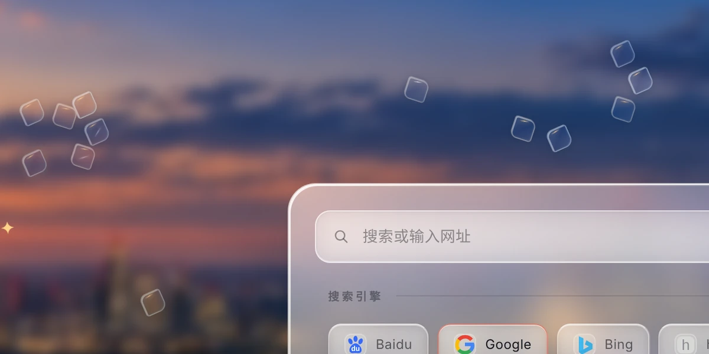
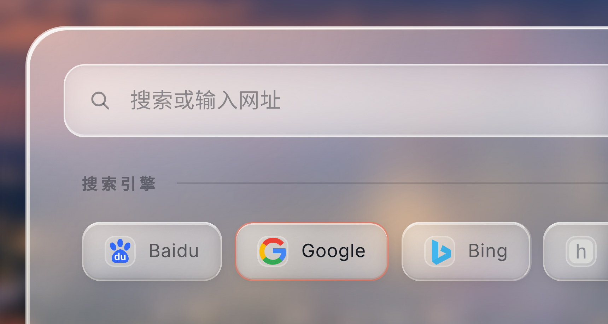
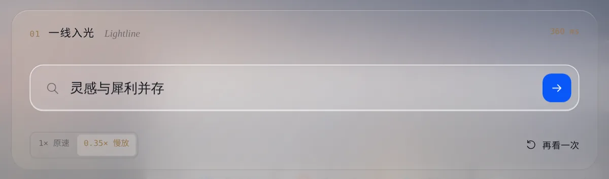
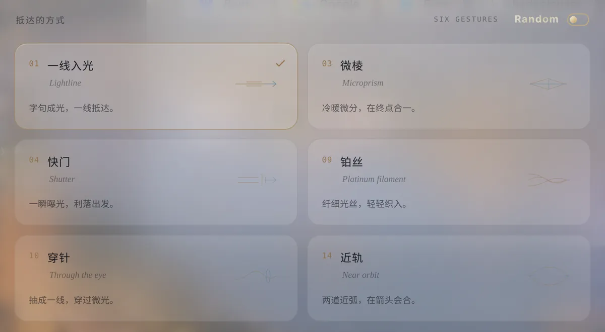

<p align="center">
  
</p>

<h1 align="center">Lucent · 灵感台</h1>

<p align="center">
  <b>灵感与犀利并存。</b><br>
  一张主页的表面之下，是一座会运动、会相遇、会留下记录的小世界。
</p>

<p align="center">
  <a href="https://hydeclanspi.github.io/lucent/"><b>在线体验</b></a> &nbsp;·&nbsp;
  <a href="https://hydeclanspi.github.io/lucent/atelier/">十六款动效品鉴</a> &nbsp;·&nbsp;
  <a href="docs/lueurs.md">引擎深读</a> &nbsp;·&nbsp;
  <a href="README.en.md">English</a>
</p>

<p align="center">
  <a href="https://github.com/hydeclanspi/lucent/actions/workflows/check.yml"></a>
  
  
  
</p>

---

灵感台是我为鸿蒙 Aira 浏览器做的自定义主页，这里是它的网页版。

它的表面刻意安静：时钟与问候、一张名片、一行签名、一块通透的玻璃卡片和一枚蓝色箭头。表面之下运行着四套系统，共享同一个判断标准——**灵感与犀利并存**：轻、通透、不打扰；但每一次反馈，都要在发生的那一刻准确到达。

| | 系统 | 它在做什么 | 底下是什么 |
|:-:|---|---|---|
| 01 | [**小浮光 · Lueurs**](#01--小浮光--lueurs) | 49 位有编号的玻璃居民在手绘的留白里游动、碰撞、追逐；拖动它们，会改变下一张壁纸的明暗概率 | Ornstein–Uhlenbeck 航向过程 · 4 px 子步进冲量物理 · 广度优先寻路的 FSD 状态机 · 70% 邂逅判定 · 「落子与星座」加权采样 |
| 02 | [**通透玻璃**](#02--通透玻璃) | 主卡片与弹窗的材质，可调、可换、随壁纸调色 | 六参数材质模型 · 六层光学 · 跟手高光按帧合并 · 静止时零动画循环 |
| 03 | [**念起，光行**](#03--念起光行) | 让一次搜索成为一道光：字句化光，抵达箭头，然后出发 | 十六款研究精选六款 · 每帧是进度的纯函数 · 截断正态调速的蓝白电流 |
| 04 | [**场志**](#04--场志) | 把长期使用沉淀为可回看的统计、地形、关系与档案 | 双槽校验快照 · 时→日→月→年分层压缩 · 最大余额法迁移 · 自检备份格式 |

---

## 01 · 小浮光 · Lueurs

<p align="center"></p>

代号：交互。它起于一张截图上的红笔圈：在主页的留白里放两枚很小的、会漂浮的玻璃——不夺目，但值得伸手拨一下。后来它长成了一座有物理、有自治、有身份的小世界。

- **空间。** 红笔圈出的留白被记录成 35 个顶点的多边形，避开所有内容 30 px；网格采样后只保留最大的连通腔室（1560×1040 下有 325 个安全落点），缩放窗口也不会把浮光隔断在两处。
- **运动。** 航向是 Ornstein–Uhlenbeck 均值回归过程：方向有记忆、转弯从容。速度向航向弛豫，遇墙切向滑行，反向分量衰减 ×0.65。这是一种带阻尼的相关随机游走，不是每帧重掷的随机方向。
- **碰撞。** 每帧位移按 4 px 细分，任何帧率下都不会穿透。等质量冲量、恢复系数 0.64；被手握住的浮光是运动学体，只推不退；自然相遇只给慢速接触补足分离速度，从不放大连锁碰撞。
- **自治。** Drive (FSD) 在安全落点的四邻接网格上做广度优先寻路、按视线拉直路径，在巡航 → 追逐 → 冲刺 → 滑行之间循环；冲刺时瞄准目标 0.18 秒后的位置。点一次淡蓝巡航，再点一次暖橙增强。
- **邂逅。** 两枚自然漂游的浮光进入 150 px 判定圈，70% 立案，再五五开：一方加速撞上去，或一方掉头回避。驾驶与邂逅从不改写壁纸概率，也不计入人的交互。
- **落子与星座。** 每次回到主页，浮光逐枚加权抽签落位——只惩罚「沙漠」与拥挤，不奖励整齐。每一次抬眼，都是一盘新的星座，而不是一张匀布的棋盘。
- **概率。** 拖动时，浮光在一张看不见的势场上走过的高度差（62%）、与参照浮光的距离（20%）、绕行角（13%）和对方被推动的位移（5%）共同决定下一张壁纸的明暗权重；单次手势最多改变 35 个百分点。
- **身份。** #01–#49 是固定编制，每次回到主页抽签决定谁在场。撞过谁、躲过谁、为谁出过击，都写进各自的档案。抓住一枚，它的编号才会轻轻浮现。

<p align="center"></p>

→ [深入：小浮光引擎](docs/lueurs.md) —— 公式、状态机、落位权重、参数曲线与测试，每一处都锚定到源码行。

## 02 · 通透玻璃

<p align="center"></p>

同一种玻璃承担阅读、操作与装饰三种用途；主卡片和弹窗各自一套参数，可选「经典磨砂」或「暖光液态清璃」。

- **六个参数。** 透明度、柔化、冷暖、边缘、色彩、触感，各 0–100，映射为一组 CSS 变量。
- **六层光学。** 背景采样（一次必要的柔化）→ 底色 → 环境冷暖（左上暖光、右下冷光，随壁纸调色）→ 1.5 px 渐变描边（`mask-composite` 挖空）与四道内缘线 → 跟手高光 → 独立前景。滤镜只作用在装饰层，文字与数据永远清晰。
- **克制。** 跟手高光由指针事件驱动、每帧最多写一次；静止时没有任何常驻动画循环。不支持背景滤镜、开启「减少透明度」或「减少动态」时，各有退路。

→ [深入：通透玻璃与设计语言](docs/glass.md)

## 03 · 念起，光行

<p align="center"></p>

一行文字，成为一道光。搜索不是瞬间跳走，而是先让写下的字句化成光、抵达箭头，再真正出发。

- **十六选六。** 先做了一个独立的[品鉴页](https://hydeclanspi.github.io/lucent/atelier/)：光的速度、字的秩序、材料的呼吸、浮光的灵性，四组十六款，可逐帧拖动、0.35× 慢看。最终精选六款进入产品，保留品鉴时的编号 01 · 03 · 04 · 09 · 10 · 14。
- **每一帧都是进度的纯函数。** 同一个 t 永远画出同一帧，所以能慢放、能倒放（首次发射会回弹到原处），也能逐帧测试：六款渲染器在 21,618 个进度状态下坐标有限、绘制状态平衡、两次绘制完全一致。
- **对文字的尊重。** 中文与 emoji 按字形簇切分（`Intl.Segmenter`），不会把组合字符拆碎；输入法组字时不触发；搜索在动画抵达之后才出发，返回时输入框干净如初。

<p align="center"></p>

- **Random：白金环与蓝白电流。** 开启后，卡片之间的通道亮起香槟铂金的导流环；蓝白电流沿通道奔跑，每一束的速度从截断正态分布 N(0.70, 0.10²) 中抽取。每一波 73% 单束、20% 双束、7% 三束，车道按权重不放回抽取——同一通道里永远不会对撞；下一波要等上一波最长的那一束落地。开场是一段编舞：竖缝自上而下、第二道横缝自右向左、第一道横缝自左向右，三束同时出发。

→ [深入：念起，光行](docs/motion.md)

## 04 · 场志

<p align="center"></p>

浮光不是无名的。四十九位固定居民，每次回到主页抽签决定谁在场；撞过谁、躲过谁、为谁出过击，都写进各自的档案。名册在此，故事开始。

- **两层数据。** 概率统计只存聚合：每个时间桶 28 个整数，不存每次拖动的时刻、坐标或事件明细。场志为 49 位居民建档：上三角存储的关系谱、200 条事件环、26×12 驻留网格。
- **可信。** 双槽轮写、FNV-1a 校验；读取取最新的有效快照，读失败绝不拿空数据覆盖历史。统计按 时 → 日 → 月 → 年 分层合并，在 160 KiB 预算之内越老越粗；场志按保留期修剪并量化，守住 96 KiB。改变分档时，旧分布按区间重叠重投影、用最大余额法补足取整差，总量一分不差。
- **可带走。** 备份文本 `AIRAPC1`：deflate-raw 压缩 → base64url → CRC-32，长度与校验都写在文字里，复制前按同一格式回读自检，超长时分段；每一种失败都写成一句人话，并给出下一步。不上传、不追踪，一切只留在悄然之间。
- **图表家族。** 全部手写 SVG：Light 倾向、交互次数、概率分布热力、碰撞相对速度（14 档非线性分档）、地形图（A–Z、A2… 字母坐标）、关系网（贝塞尔收笔、每次随机起角）、三角关系即时计算。

→ [深入：场志数据层](docs/chronicle.md)

---

## 设计语言

| 原则 | 在产品里的样子 |
|---|---|
| **轻盈** | 浮光 22 px，触控 44 px；关键操作收进一条共享的玻璃操作栏，不让每个按钮各自发亮 |
| **通透** | 背景参与材质，文字留在独立前景；壁纸柔焦与玻璃柔化是两个独立参数 |
| **犀利** | 碰撞在接触的那一帧弹开；编号只在抓住时浮现；搜索动效 320–480 ms |
| **克制** | 自动行为从不冒充人的选择：驾驶与邂逅不写概率、不计交互 |
| **精确** | 星球入口的光环倾斜 23.5°；自然速度上调 16.4%；FSD 阵容每 11.5 秒重抽；落款「再亮 2.35 个点」 |
| **相对优于绝对** | 地形图与名册的深浅按分位计算——日子久了每个格子都会被踩深，只有相对深度一直读得出来 |

- **图标是画出来的，不是打出来的。** 带光环的玻璃星球；高 F 居左、S 与 D 错落于右、F 的中横末端点一粒火星的 FSD 字标；六款动效各自的线描字形；只倾斜框体、内容保持直立的历史记录菱形标签；编号右上角那顶一笔画成的小帽。
- **颜色各司其职。** 鸿蒙蓝 `#0A59F7` 只给唯一的主操作；暖金属于身份（名字渐变、头像光环、烫金落款）；冰蓝属于环境与电流；铂金只在 Random 开启时出现；暖橙只属于增强驾驶。
- **字体分工。** 宋体写标题与诗意的名字（「念起，光行」「落子与星座」），等宽体写编号与读数，Georgia 斜体写拉丁名，HarmonyOS Sans 承担界面。

## 工程

| 方面 | 说明 |
|---|---|
| **规模** | 约 9,200 行 JavaScript、3,700 行 CSS；零运行时依赖，没有框架 |
| **渲染** | DOM + Canvas 2D + 手写 SVG 图表；不调用任何图表或动画库 |
| **隐私** | 页面加载后零网络请求；数据只在本地，备份只经由剪贴板离开 |
| **无障碍** | 浮光可用方向键移动（Shift 为大步）；尊重「减少动态」与「减少透明度」；弹窗有焦点陷阱，关闭后焦点归位 |
| **性能纪律** | 浮光引擎只有一个帧循环：拖动或驾驶时逐帧，空闲时降到约 30 Hz；后台、弹窗打开或页面隐藏时整体暂停 |
| **验证** | 41 项单元测试（引擎不变量、渲染确定性、存储完整性）+ 15 组浏览器流程，每次推送在 CI 运行 |

## 演进

22 天，109 个版本，从 2.0.0 到 5.0.0。

| 阶段 | 日期 | 版本 | 发生了什么 |
|---|---|---|---|
| 名片主页 | 9.26–9.27 | 2.0 → 2.8 | 名片、搜索、快捷方式；确立通透玻璃的视觉语言；日志与签名留档；两张壁纸与柔焦 |
| 代号：交互 | 10.7–10.9 | 2.9 → 4.0.5 | 两枚浮光与势场；碰撞、统计、自动驾驶；落子与星座；邂逅；49 位编号居民与场志 |
| 场志与名册 | 10.9–10.10 | 4.0.6 → 4.5.3 | 编号徽章、关于窗口、图表家族、关系网、备份与导出、亲笔落款、分档迁移 |
| 材质与动效 | 10.10–10.16 | 4.7 → 5.0 | 暖光液态清璃；十六款动效品鉴后精选六款；模拟发射与持续光束；Random 的白金环与蓝白电流 |
| 网页版 | 10.17 | 5.0 | 浏览器演示层、一键直达链接、引擎与渲染测试、在线部署 |

产品定义、视觉与每一版的验收由我完成，实现借助 AI 编程代理完成。

→ [深入：演进](docs/evolution.md)

## 一键直达

建议在桌面浏览器打开（小浮光需要不少于 900 px 的宽度）。链接只调用产品自己的按钮，打开后参数会从地址栏移除。

| 想看什么 | 链接 |
|---|---|
| 16 枚小浮光 + 增强驾驶 | [`?lueurs=16&fsd=rage`](https://hydeclanspi.github.io/lucent/?lueurs=16&fsd=rage) |
| 念起，光行 · Random 白金环 | [`?open=random`](https://hydeclanspi.github.io/lucent/?open=random) |
| 代号：交互 面板 | [`?open=lueurs`](https://hydeclanspi.github.io/lucent/?open=lueurs) |
| 场志（先让浮光跑一会儿） | [`?lueurs=12&fsd=rage&open=chronicle`](https://hydeclanspi.github.io/lucent/?lueurs=12&fsd=rage&open=chronicle) |
| 玻璃材质与壁纸 | [`?open=glass`](https://hydeclanspi.github.io/lucent/?open=glass) |
| 关于 · 落款 | [`?open=about`](https://hydeclanspi.github.io/lucent/?open=about) |
| 备份与导出 | [`?open=backup`](https://hydeclanspi.github.io/lucent/?open=backup) |

手势：点星球添加一枚浮光并唤出 FSD，长按星球打开「代号：交互」；长按「切换」调壁纸与玻璃；长按右上角太阳看「关于」；长按扫一扫进入备份与导出。

## 本地运行

需要 Node.js 22 或更高版本。构建与预览只用 Node 标准库。

```sh
npm start            # 构建 dist/ 并在 http://127.0.0.1:4173 预览
npm run check        # 语法检查、版本身份、原生安装包摘要
npm test             # 41 项单元测试
npm install && npm run test:browser   # 15 组浏览器流程（Playwright）
```

`dist/` 可以部署到任何静态主机；推送到 `main` 会通过 GitHub Pages 自动部署。

## 目录

```text
index.html                  主页
assets/
  interaction.js            小浮光引擎：几何、物理、随机过程、FSD、邂逅、落位、身份
  field-store.js            场志：个体、关系、驻留、驾驶与事件
  stats-store.js            概率与交互的聚合统计
  stats-panel.js            历史统计与场志面板（手写 SVG 图表）
  glass-material.{js,css}   通透玻璃材质
  search-motion*.{js,css}   念起，光行：渲染器、播放器、面板与 Random 电流
  search-simulation.js      模拟发射与持续光束
  app.js / app.css          名片、搜索、快捷方式、壁纸、面板与备份导出
web/                        网页版的浏览器演示层与一键直达链接
atelier/                    十六款搜索动效品鉴页
native/                     鸿蒙 Aira 原生安装包（5.0，原样保存）
scripts/                    构建、预览、检查、文档图表与媒体录制
tests/                      引擎、渲染器、存储与浏览器测试
docs/                       深度文档、图表与截图
```

## 文档

- [小浮光 · Lueurs 引擎](docs/lueurs.md)
- [通透玻璃与设计语言](docs/glass.md)
- [念起，光行：搜索动效](docs/motion.md)
- [场志：本地数据层](docs/chronicle.md)
- [演进：22 天，109 个版本](docs/evolution.md)
- [验证](docs/VERIFICATION.md) · [部署](docs/DEPLOYMENT.md) · [维护](docs/MAINTAINING.md) · [资源与署名](docs/ASSETS.md)

---

<sub>Lucent · 灵感台 由 hydeclanspi 设计。独立个人项目，与 Aira、华为无关联。代码与界面版权所有；壁纸与头像等图像资源不授予再分发许可，详见 <a href="docs/ASSETS.md">资源与署名</a>。</sub>
