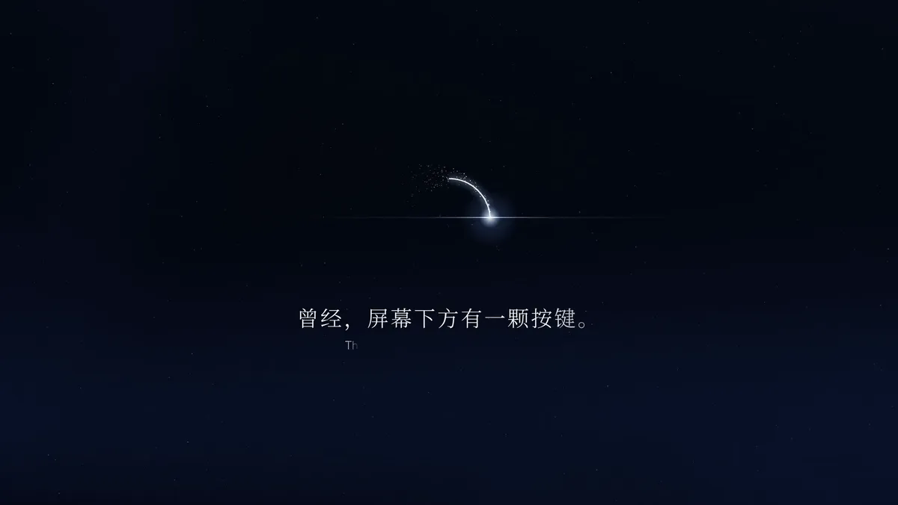
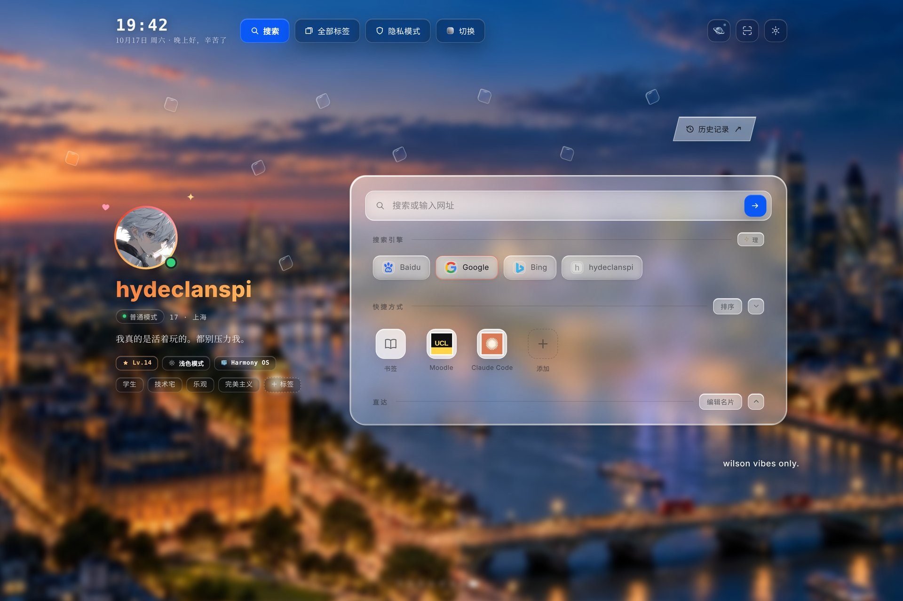
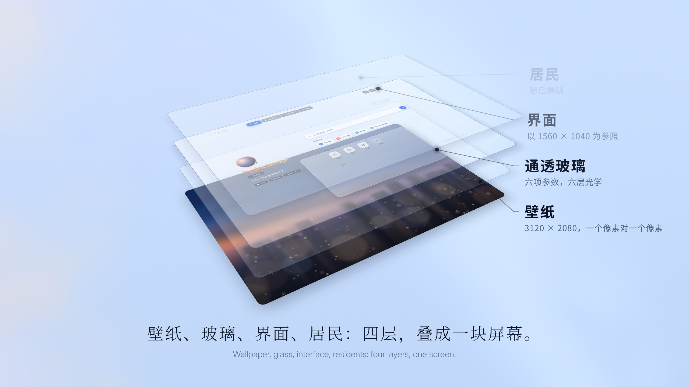
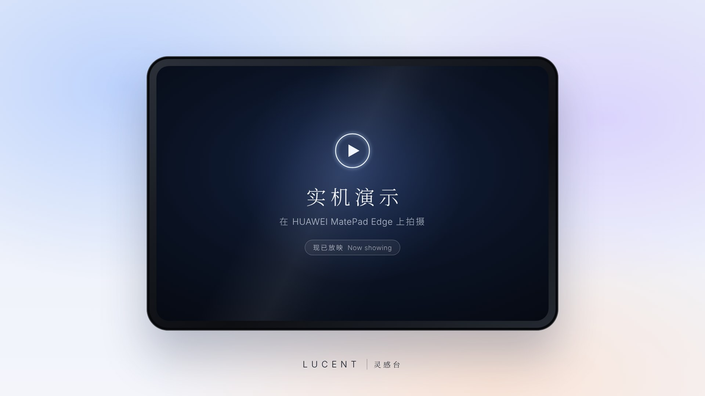
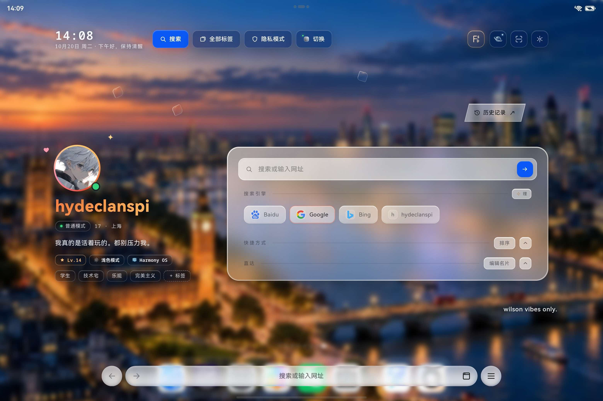
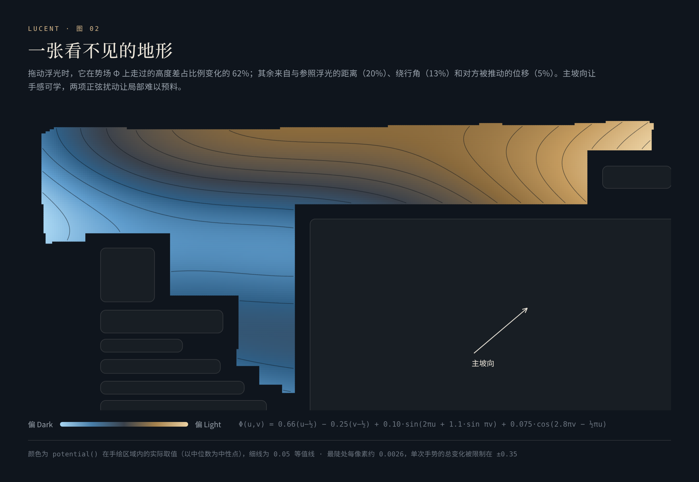
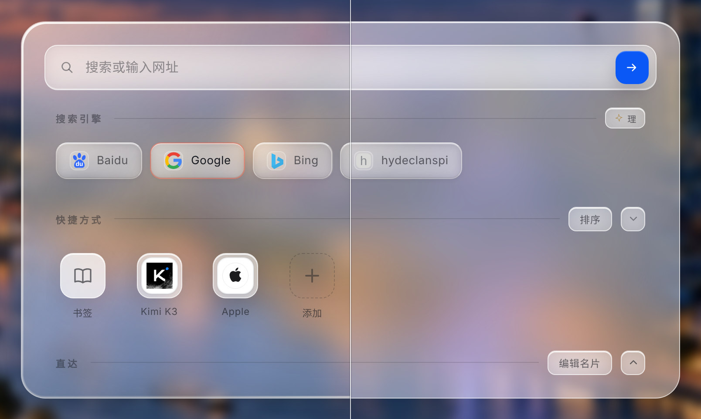
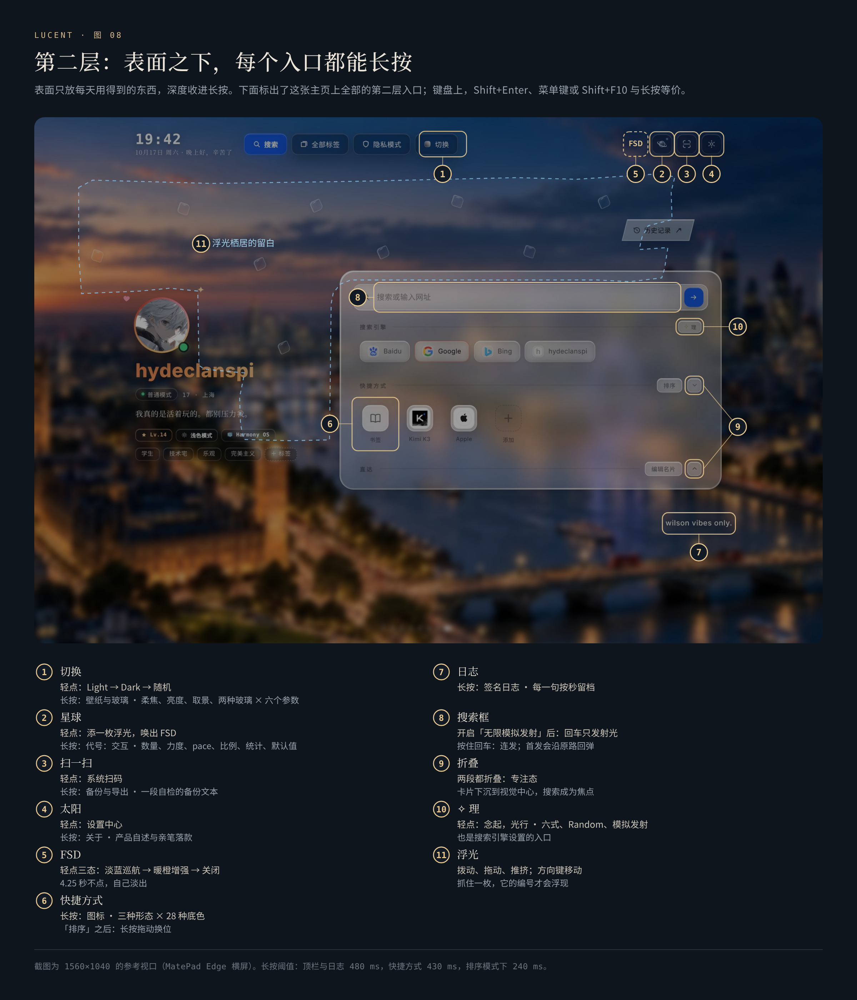

<p align="center">
  <a href="https://hydeclanspi.github.io/Lucent-Next/film/"></a>
</p>

<h1 align="center">Lucent · 灵感台</h1>

<p align="center">
  <b>灵感启动台</b><br>
  由此出发，为光停留。
</p>

<p align="center">
  <a href="https://hydeclanspi.github.io/Lucent-Next/"><b>在线体验试用 💎</b></a> &nbsp;·&nbsp;
  <a href="https://hydeclanspi.github.io/Lucent-Next/film/"><b>观看旗舰影片 🎞️   (推荐)</b></a> &nbsp;·&nbsp;
  <a href="https://hydeclanspi.github.io/Lucent-Next/film/">真的很推荐点击左边 ⭐</a> &nbsp;

<p align="center">
  <a href="demo/">全部演示</a> &nbsp;·&nbsp;
  <a href="docs/architecture.md">产品架构</a> &nbsp;·&nbsp;
  <a href="README.en.md">English</a>
</p>

<p align="center">
  <a href="https://github.com/hydeclanspi/Lucent-Next/actions/workflows/check.yml"></a>
</p>

<br>

<p align="center">曾经，屏幕下方有一颗按键。</p>

<h3 align="center">人们叫它，Home 键。</h3>

<p align="center">
  按下它，无论走得多远、打开了多少东西，都会回到起点。<br>
  Home 是一个承诺：总有一个地方，等你回来。
</p>

<p align="center">今天，我们把这个承诺，做成了一个地方。</p>

<p align="center"></p>

<h3 align="center">今天，我们带来四样东西。</h3>

<p align="center">
  <b>第一样，是一张工作台。</b><br>
  时钟与问候、名片、搜索、快捷方式、直达、一行日志，各就各位；<br>
  一整块通透的玻璃，把它们稳稳托住。
</p>

<p align="center">
  <b>第二样，是一座发射台。</b><br>
  写下的字化作一道光，抵达那枚蓝色箭头，搜索才出发，<br>
  去往 Google、Bing、百度，或你自己写下的引擎。
</p>

<p align="center">
  <b>第三样，是一方舞台。</b><br>
  留在这里，光为你演一遍：首发沿原路飞回，按住回车一发接一发；<br>
  白金导流环里，蓝白激光奔跑不息。
</p>

<p align="center">
  <b>第四样，是一面控制台。</b><br>
  玻璃开放六项参数；每一颗按钮底下，都藏着一层长按。
</p>

<p align="center">
  工作台。发射台。舞台。控制台。<br>
  四个名字，同一个「台」。
</p>

<h3 align="center">它们，是同一个地方。我们叫它，灵感台。</h3>

<br>

<h3 align="center">还有一件事。</h3>

<p align="center">
  台上，住着居民。<br>
  四十九枚有编号的玻璃浮光，在留白里游动、相遇、追逐；每一位的经历，都被一笔一笔记下。<br>
  像后花园里的猫和狗，它们过着自己的日子。每次回来，它们都在，又多了一点故事。
</p>

<p align="center"></p>

---

## 影片

<p align="center"><a href="https://hydeclanspi.github.io/Lucent-Next/film/"></a></p>

**概念影片**，一分四十八秒，有声。暗场里，一束光画出那颗按键；按下去，镜头扑向它的边缘，近到只剩一道光弧，弧里是那颗熟悉的 Home 键，和它的名字「Home 键」。它许下的承诺，在一道白光之后成了一个地方。四层叠成一块屏幕；写下的字化作光，冲进箭头；一扇彩虹色的门打开，门外是一块芯片，一道光波扫过，每一颗被击中的核心都升起，化作一扇通往世界的窗，镜头一跃，冲进千窗的隧道；舞台灯亮起，白金导流环里激光奔跑；极光之上，玻璃的六项参数逐一调动；四个台并肩成四根光柱，收成一线、一点，生出「灵感台」；四十九位居民住进留白，连成星座，又在后花园里安顿下来；然后，落在那块为它而生的屏幕上：三张壁纸化作玻璃，一拍一张，悬在空中，再落进它的屏幕，选中的那一张入夜。

每一帧画面、每一个声音，都由代码生成：一条时间轴，WebGL 画天色与光，Canvas 画光束、光弧和门外的世界，CSS 与 SVG 画界面和字；配乐与音效由 numpy 合成，读同一张时间表：钢琴与马林巴唱旋律，拍手、口哨与尤克里里同行，弦乐、太鼓与人声托住每一次揭晓，每分钟 120 拍，每一次按下、每一道闪光、每一扇门都落在重拍上；该响的地方响，该静的地方静。任意时刻都可以暂停、拖动，也可以逐帧渲染成视频。

→ [在浏览器中观看](https://hydeclanspi.github.io/Lucent-Next/film/) · [下载 MP4（2K，2560×1440，60 帧，有声）](demo/media/lucent-film.mp4)

### 实机

<p align="center"><a href="https://hydeclanspi.github.io/Lucent-Next/device/"></a></p>

在 HUAWEI MatePad Edge 上录下的实机演示，四十六秒，有声：一次搜索和它的一线入光，念起光行，浮光的设置与历史统计，壁纸，名片与备份。安静的段落加速播放，右上角标着倍速；配乐取自概念影片的后半段。

→ [在浏览器中观看](https://hydeclanspi.github.io/Lucent-Next/device/) · [下载 MP4（2K，2560×1440，60 帧，有声）](demo/device/lucent-on-device.mp4)

## 为一块屏幕而生

灵感台专为 **HUAWEI MatePad Edge** 设计：14.2 英寸 OLED，3:2，3120 × 2080，120 Hz，触控。版面以它的 1560 × 1040 逻辑像素为准；伦敦夜景壁纸同样是 3120 × 2080，一个像素，对应一个像素。每一次迭代，都在这块屏幕上完成验收。

- **触控优先。** 浮光看上去 22 px，指尖可触的范围是 44 px；第二层交给长按；拨动、拖动、推挤都有物理。
- **在 MatePad Edge 上**，它是你每天出发、也每天回来的地方：每一处间距、每一道光、每一次触碰，都按设计呈现。
- **在电脑上**，全屏是对那块屏幕的忠实模拟：轻点任意处进入全屏，F 切换，Esc 退出；也可以把它安装为应用，以全屏启动。网页版照着平板的截图画出了它的状态栏、Aira 的底栏与手势条，尺寸与留白都与实机相同；矮一些的横屏上不画它们，卡片也会自动为顶栏让出空间。每次打开都从展示用的默认值开始：六枚浮光，壁纸为随机，明暗比例 99 : 1。
- **手机与小尺寸屏幕**不在适配范围内，不建议使用。

## 五个部分

表面是你感受到的；底下，是让它成立的东西。

| | 这座台 | 你感受到的 | 底下是什么 |
|:-:|---|---|---|
| 01 | [**工作台**](#01--工作台一切就位)<br><sub>Workbench</sub> | 时钟与问候、名片、搜索、快捷方式、直达、一行日志，各就各位；一整块通透的玻璃把它们托住 | 以 1560×1040 为参照的版面，与 3120×2080 的壁纸逐像素对应；短屏守卫；专注态 |
| 02 | [**居民**](#02--居民一座越住越有故事的后花园)<br><sub>Residents</sub> | 四十九枚有编号的玻璃浮光在留白里游动、相遇、追逐；拨动它们，下一张壁纸随之改变；每一位的经历都被记下 | Ornstein–Uhlenbeck 航向 · 4 px 子步进冲量物理 · 广度优先寻路的自动驾驶 · 70% 邂逅 · 加权落子 · 双槽校验的档案 |
| 03 | [**发射台**](#03--发射台念起光行)<br><sub>Launch&nbsp;pad</sub> | 写下的字化成一道光，抵达箭头，搜索才出发 | 十六款研究精选六款 · 每一帧都是进度的纯函数 · 字形簇切分 |
| 04 | [**舞台**](#04--舞台留下来光为你演一遍)<br><sub>Stage</sub> | 留在这里，光也在：首发回弹、按住回车连发、白金导流环里奔跑的蓝白激光 | 倒放即回弹 · 一比特需求 · 截断正态调速 · 不放回的车道 |
| 05 | [**控制台**](#05--控制台每个旋钮都交给你)<br><sub>Console</sub> | 从玻璃的六项参数到每个按钮的长按，深度全部交给你 | 三层默认 · 两处表面 × 两种玻璃 × 六项参数 · 长按第二层 |

## 架构：从一块屏幕，到一个像素

<p align="center"></p>

五层，由宏观到微观：**场景**（它在哪里运行）→ **基地**（表面摆着什么）→ **系统**（底下运转的四套）→ **机制**（它们为什么成立）→ **像素**（最后落定的那些数）。**主权**与**可信**贯穿所有层级。

→ [完整清单：每一层的每一个功能，都对应到源码](docs/architecture.md)

## 01 · 工作台：一切就位

<p align="center"></p>
<p align="center"><sub>专注态：把快捷方式与直达都折起来，卡片沉到视觉中心，只剩搜索。</sub></p>

一天从一个安静的台面开始。表面只放每天真正用得到的东西，各自待在固定的位置上：

- **顶栏。** 时钟与问候按时段换一句话——上午好，慢慢来；下午好，保持清醒；晚上好，辛苦了。四枚胶囊里只有「搜索」是蓝色；右侧是星球、扫一扫、太阳三枚线描图标，各藏着一层长按；自动驾驶运行时，FSD 字标出现在它们之前。
- **名片。** 头像外一圈 14 秒旋转一周的锥形光环，名字带一道 9 秒的流光；下面依次是状态、一行签名、徽章与标签。改过的每一句签名都留档。
- **主卡片。** 搜索框与四个搜索引擎（其中一个是自定义模板）；快捷方式有自动、装框、首字母牌三种形态；直达收着书签、下载、我的网页、标签后台、搜索设置、用户脚本与设置。右下角一行日志，长按改写，按秒留档。
- **专注态。** 两段都折叠时，卡片下沉到视觉中心，搜索成为唯一的焦点。

## 02 · 居民：一座越住越有故事的后花园

浮光，是让这座基地活起来的东西。它起于一张截图上的红笔圈：在留白里放两枚很小的玻璃，安安静静，值得伸手拨一下。后来它长成了一套生态：四十九位居民，固定编号，每一位的经历都被完整记下。

- **空间。** 红笔圈出的留白被记成 35 个顶点的多边形，与所有内容保持 30 px 的距离；网格采样后只保留最大的连通腔室（1560×1040 下 325 个安全落点），缩放窗口时，浮光始终在同一片腔室里。
- **运动。** 航向是 Ornstein–Uhlenbeck 均值回归过程，速度向航向弛豫，遇墙切向滑行：一种带阻尼的相关随机游走，方向有记忆，转弯从容。
- **碰撞。** 每帧位移按 4 px 细分，任何帧率下都稳稳接住每一次接触；等质量冲量，恢复系数 0.64。被手握住的那一枚只推不退；自然相遇只给慢速接触补足分离速度，连锁碰撞始终收敛。
- **自治。** Drive (FSD) 在安全落点的网格上做广度优先寻路、按视线拉直路径，在巡航、追逐、冲刺、滑行之间循环；冲刺时瞄准目标 0.18 秒后的位置。点一次是淡蓝巡航，再点一次是暖橙增强。
- **邂逅。** 两枚自然漂游的浮光进入 150 px 判定圈，70% 立案，再五五开：一方撞上去，或一方掉头回避。
- **落子与星座。** 每次回到主页，浮光逐枚加权抽签落位：惩罚「沙漠」与拥挤，让每一次抬眼都是一盘新的星座。
- **概率。** 拖动浮光，就是在一张看不见的势场上行走：走过的高度差（62%）、与参照浮光的距离（20%）、绕行角（13%）、对方被推动的位移（5%），共同改写下一张壁纸的明暗权重，单次手势最多 35 个百分点。概率只听人的手：驾驶与邂逅既不改写它，也不计入交互。

<p align="center"></p>

### 场志：每一位的故事，都被记下

<p align="center"></p>

- **身份。** #01–#49 是固定编制，每次回来抽签决定谁在场。抓住一枚，它的编号才轻轻浮现。
- **档案。** 每一位都有自己的出场、在场时长、撞击、被撞、回避、得舵与接力；关系谱记下每一对的接触、互撞、回避与亲近分钟；地形图记下它们自己走出来的路。
- **可信。** 双槽轮写、FNV-1a 校验，读取失败时历史原样保留。统计按 时 → 日 → 月 → 年 分层合并，越老越粗，总量分毫不差；改分档时，旧分布按区间重叠重投影，用最大余额法补足取整差。
- **可带走。** 备份文本 `AIRAPC1`：压缩、编码、CRC-32，复制前按同一格式回读自检。一切只留在本机，由你决定带去哪里。

→ 深入：[小浮光引擎](docs/lueurs.md) · [场志数据层](docs/chronicle.md)

## 03 · 发射台：念起，光行

<p align="center"></p>

每一次搜索，都从这里起飞。写下的字先化作一道光，抵达那枚蓝色箭头，搜索才真正出发：从基地，去往外部世界的接口，Google、Bing、百度，或者你自己写的引擎模板。

- **十六选六。** 先做了一个独立的[品鉴页](https://hydeclanspi.github.io/Lucent-Next/atelier/)：光的速度、字的秩序、材料的呼吸、浮光的灵性，四组十六款，可逐帧拖动、0.35× 慢看。六款进入产品，保留品鉴时的编号：01 一线入光 · 03 微棱 · 04 快门 · 09 铂丝 · 10 穿针 · 14 近轨。
- **每一帧都是进度的纯函数。** 同一个 t 永远画出同一帧，所以能慢放、能倒放，也能逐帧测试：六款渲染器在 21,618 个进度状态下坐标有限、绘制状态平衡、两次绘制完全一致。
- **对文字的尊重。** 中文与 emoji 按字形簇切分，组合字符完整如初；输入法组字时的回车留给输入法；光抵达之后才导航，返回时输入框干净如初；即使宿主暂停了帧回调，搜索也一定且只发出一次。

→ 深入：[念起，光行](docs/motion.md)

## 04 · 舞台：留下来，光为你演一遍

<p align="center"></p>

灵感台也是一个让人愿意停留的地方。打开「无限模拟发射循环」，搜索框只发射光、不发出搜索，灵感台在自己内部闭环：

- **首发回弹。** 第一发是一次彩排：沿原路飞出，再倒放回来，每一个字分毫不差地回到原处——这是渲染器为纯函数的回报。之后的每一发，字都随光离开。
- **按住即连发。** 按住回车超过 280 ms，光就一发接一发，每发 160 ms，只画光路；同一张画布、同一个帧循环，连发中沿用同一次测量。
- **需求只记一个比特。** 动画进行中再按，只记下「还要一发」，队列始终只有一格。有的键盘在自动重复时成对发出按下与抬起，所以抬起之后先等 80 ms，再判断是否真的松手。
- **白金环与蓝白激光。** 打开 Random，卡片之间的缝隙亮起香槟铂金的导流环，蓝白激光沿通道奔跑：每一束的速度从截断正态分布 N(0.70, 0.10²) 中抽取；车道按权重不放回抽取，同一通道里的光永远同向而行；开场三束同时出发。

<p align="center"></p>

什么都不想做的时候，这些光会在原地为你演一遍。充能，然后再出发。

→ 深入：[模拟发射](docs/motion.md#7-模拟发射) · [Random 的排班算法](docs/motion.md#6-random白金环与蓝白激光)

## 05 · 控制台：每个旋钮，都交给你

<p align="center"></p>
<p align="center"><sub>同一张主卡片：左为暖光液态清璃，右为经典磨砂玻璃。</sub></p>

表面安静，深度全部交给你：

- **玻璃，开放到参数。** 主卡片与弹窗各一套：经典磨砂或暖光液态清璃，再加六条 0–100 的滑杆——通透度、玻璃柔焦、暖意、边缘光泽、环境色彩、触光强度。它们映射到六层光学：背景采样、底色、环境冷暖、边缘厚度、跟手高光、独立前景。滤镜只作用在装饰层，文字始终清晰；静止时，动画循环为零。
- **壁纸。** Light、Dark，或按浮光调出的比例加权随机；柔焦 0–20%，亮度 50–100%，两张壁纸各有独立的取景框。
- **浮光。** 数量 0–49，碰撞力度 1–24×（可每次启动随机），自然 pace 0.25–16×，主图随机比例，进入主页时自动巡航。
- **动效。** 六式任选、Random 随行，或者关闭动效，让搜索直接出发。
- **名片与快捷方式。** 名字、简介、签名、标签、等级、握姿标签都可以改写；每个快捷方式都能换三种形态与 28 种底色。
- **三层默认。** 当下可以随手试，喜欢的组合存为默认，出厂基线一键可回。

### 第二层：长按

<p align="center"></p>

表面只放每天用得到的东西，深度收进长按：

| 入口 | 轻点 | 长按 |
|---|---|---|
| 切换 | Light → Dark → 随机 | 壁纸与玻璃：柔焦、亮度、取景、两种玻璃 × 六项参数 |
| 星球 | 添一枚浮光，唤出 FSD | 代号：交互：数量、力度、pace、比例、驾驶、统计、默认值 |
| 扫一扫 | 系统扫码 | 备份与导出 |
| 太阳 | 设置中心 | 关于：产品自述与亲笔落款 |
| 快捷方式 | 打开 | 图标编辑：三种形态 × 28 种底色；「排序」之后长按拖动换位 |
| 日志 | — | 签名日志：每一句按秒留档 |
| FSD | 淡蓝巡航 → 暖橙增强 → 关闭 | — |
| 搜索框（模拟发射开启时） | 发射一道光 | 按住回车：连发 |
| 浮光 | 拨动、拖动、推挤；方向键移动 | 抓住时浮现编号 |

键盘上，星球、扫一扫、太阳的长按等价于 Shift+Enter、菜单键或 Shift+F10；切换与日志按回车即打开第二层。

→ 深入：[通透玻璃与设计语言](docs/glass.md) · [完整交互表](docs/architecture.md#交互全表)

## 灵感的来处

每一个功能，都有一个具体的来处：

- **梯度下降的那张图 → 势场。** 统计学习课上，一颗小球沿着等高线滚向谷底。在这里，你的手就是那颗小球：走过的高度差，决定下一张壁纸。
- **碰碰车与鲶鱼 → Drive (FSD)。** 被选中的浮光像碰碰车一样横冲直撞，成为场上的鲶鱼，让一整池水活起来；名字借自自动驾驶。
- **围棋与星空 → 落子与星座。** 一枚一枚落下，只求每一次抬眼，都是一盘新的星座。
- **地轴倾角 → 23.5°。** 星球入口的光环与地轴同样倾斜；球后的半圈压暗，球前的半圈提亮。
- **相机、针线与光谱 → 六式。** 快门、穿针、铂丝、微棱、近轨——每一款动效，都借一种物理世界里的姿态。
- **黑箱 → 一点可知的黑箱。** 「我并没有打算要一个我彻底理解的模型，是个 black box 也无妨。」于是面板里有一张说明卡，用七段克制的文字，把每一层讲清楚。
- **后花园 → 生态。** 它们过着自己的日子；每次回来，它们都在，并且又多了一点故事。

## 设计语言

灵感台只遵守一条标准：**灵感与犀利并存**。轻、通透、安静；每一次反馈，都在发生的那一刻准确抵达。

| 原则 | 在产品里的样子 |
|---|---|
| **轻盈** | 浮光 22 px，触控 44 px；关键操作收进一条共享的玻璃操作栏，让光只留给真正的主角 |
| **通透** | 背景参与材质，文字留在独立前景；壁纸柔焦与玻璃柔化是两个独立参数 |
| **犀利** | 碰撞在接触的那一帧弹开；编号只在抓住时浮现；每款动效 320–480 ms |
| **克制** | 自动行为只做自己的事：驾驶与邂逅不写概率、不计交互 |
| **精确** | 星球光环倾斜 23.5°；自然速度上调 16.4%；FSD 阵容每 11.5 秒重抽；落款「再亮 2.35 个点」 |
| **相对优于绝对** | 地形图与名册的深浅按分位计算：日子再久，相对深度也一直读得出来 |

- **每一枚图标，都是画出来的。** 带光环的玻璃星球；高 F 居左、S 与 D 错落于右、F 的中横末端点一粒火星的 FSD 字标；六款动效各自的线描字形；只倾斜框体、内容保持直立的历史记录菱形标签；编号右上角那顶一笔画成的小帽。
- **颜色各司其职。** 鸿蒙蓝 `#0A59F7` 只给唯一的主操作；暖金属于身份（名字渐变、头像光环、烫金落款）；冰蓝属于环境与激光；铂金只在 Random 开启时出现；暖橙只属于增强驾驶。
- **字体分工。** 宋体写标题与诗意的名字（「念起，光行」「落子与星座」），等宽体写编号与读数，Georgia 斜体写拉丁名，HarmonyOS Sans 承担界面。

## 工程

| 方面 | 说明 |
|---|---|
| **规模** | 约 9,300 行 JavaScript、3,800 行 CSS；零运行时依赖，没有框架 |
| **渲染** | DOM + Canvas 2D + 手写 SVG 图表；图表与动画全部自己画 |
| **隐私** | 页面加载后不连接任何外部服务（唯一的例外：第一次遇到生僻字时，从本站补取那一小块字体）；数据只在本机，备份只经由剪贴板离开 |
| **无障碍** | 浮光可用方向键移动（Shift 为大步）；长按都有键盘等价；尊重「减少动态」与「减少透明度」；弹窗有焦点陷阱，关闭后焦点归位 |
| **性能纪律** | 浮光引擎只有一个帧循环：拖动或驾驶时逐帧，空闲时降到约 30 Hz；后台、弹窗打开或页面隐藏时整体暂停 |
| **验证** | 41 项单元测试（引擎不变量、渲染确定性、存储完整性）+ 22 组浏览器流程，每次推送在 CI 运行 |
| **可复现** | 文档里的算法图由引擎函数直接渲染；截图、动图与影片都在伪时钟下逐帧渲染，任何机器上得到同样的画面 |

## 演进

22 天，109 个版本，从 2.0.0 到 5.0.0。

| 阶段 | 日期 | 版本 | 发生了什么 |
|---|---|---|---|
| 名片主页 | 9.26–9.27 | 2.0 → 2.8 | 名片、搜索、快捷方式；确立通透玻璃的视觉语言；日志与签名留档；两张壁纸与柔焦 |
| 代号：交互 | 10.7–10.9 | 2.9 → 4.0.5 | 两枚浮光与势场；碰撞、统计、自动驾驶；落子与星座；邂逅；49 位编号居民与场志 |
| 场志与名册 | 10.9–10.10 | 4.0.6 → 4.5.3 | 编号徽章、关于窗口、图表家族、关系网、备份与导出、亲笔落款、分档迁移 |
| 材质与动效 | 10.10–10.16 | 4.7 → 5.0 | 暖光液态清璃；十六款动效品鉴后精选六款；模拟发射与持续光束；Random 的白金环与蓝白激光 |
| 网页版 | 10.17–10.18 | 5.0 | 浏览器演示层、一键直达、沉浸全屏与应用安装、概念影片、引擎与渲染测试、在线部署 |

产品定义、视觉与每一版的验收由我完成，实现借助 AI 编程代理完成。

→ [深入：演进](docs/evolution.md)

## 打开方式

| | |
|---|---|
| **在线体验** | [hydeclanspi.github.io/Lucent-Next](https://hydeclanspi.github.io/Lucent-Next/)：在 MatePad Edge 上直接使用；在电脑上，第一次轻点即进入全屏 |
| **概念影片** | [在浏览器中观看](https://hydeclanspi.github.io/Lucent-Next/film/) · [MP4](demo/media/lucent-film.mp4) |
| **实机演示** | [在浏览器中观看](https://hydeclanspi.github.io/Lucent-Next/device/) · [MP4](demo/device/lucent-on-device.mp4) |
| **十六款动效品鉴** | [hydeclanspi.github.io/Lucent-Next/atelier](https://hydeclanspi.github.io/Lucent-Next/atelier/) |
| **一键直达** | 直接打开某个状态的七个链接——增强驾驶、Random 白金环、场志、壁纸与玻璃……都在[演示入口](demo/) |

## 本地运行

需要 Node.js 22 或更高版本。构建与预览只用 Node 标准库。

```sh
npm start            # 构建 dist/ 并在 http://127.0.0.1:4173 预览（影片在 /film/）
npm run check        # 语法检查、版本身份、原生安装包摘要
npm test             # 41 项单元测试
npm install && npm run test:browser   # 22 组浏览器流程（Playwright）
```

`dist/` 可以部署到任何静态主机；推送到 `main` 会通过 GitHub Pages 自动部署。

## 目录

```text
src/                        源码：灵感台本体
  index.html                基地
  assets/                   小浮光引擎、场志、通透玻璃、念起光行、模拟发射、名片与面板
  web/                      网页版：浏览器演示层、一键直达、沉浸全屏、应用清单与图标
demo/                       演示
  film/                     概念影片（网页，打开即播）
  device/                   实机演示（录屏剪辑与播放页）
  atelier/                  十六款搜索动效品鉴
  media/                    演示图、动图与影片
native/                     鸿蒙 Aira 原生安装包（5.0，原样保存）
docs/                       深度文档与图表（英文版在 docs/en/）
scripts/                    构建、检查、图表、录制、影片渲染、图标与分享卡片
tests/                      引擎、渲染器、存储与浏览器测试
```

## 文档

- [产品架构：从一块屏幕，到一个像素](docs/architecture.md)
- [小浮光 · Lueurs 引擎](docs/lueurs.md)
- [通透玻璃与设计语言](docs/glass.md)
- [念起，光行：搜索动效、模拟发射与 Random](docs/motion.md)
- [场志：本地数据层](docs/chronicle.md)
- [演进：22 天，109 个版本](docs/evolution.md)
- [验证](docs/VERIFICATION.md) · [部署](docs/DEPLOYMENT.md) · [维护](docs/MAINTAINING.md) · [资源与署名](docs/ASSETS.md)

---

<sub>Lucent · 灵感台 由 hydeclanspi 设计。独立个人项目，与 Aira、华为无关联；HUAWEI 与 MatePad 是其所有者的商标。代码与界面版权所有；壁纸与头像等图像资源不授予再分发许可，详见 <a href="docs/ASSETS.md">资源与署名</a>。</sub>
