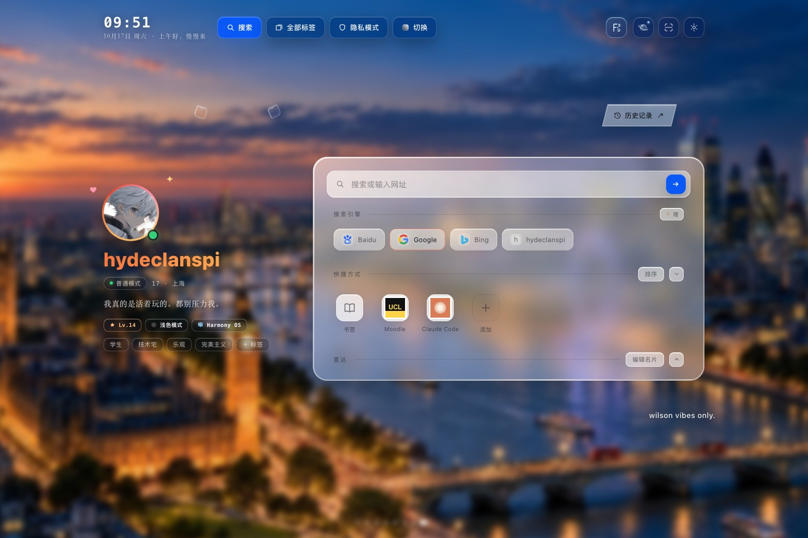

# airhome (personal)

**A personal space for the first page of the internet.**

Designed by **hydeclanspi**. A tablet-first homepage built around warm light, translucent materials, and small interactions that reward attention.



airhome (personal) began as a custom homepage for the Aira browser on HarmonyOS. This edition runs in an ordinary browser: the personal card, wallpapers, search animations, floating objects, and customization are joined by a self-contained browser demonstration layer.

## Experience

- **A personal card.** Avatar, gradient name, signature, tags, and a small daily note. Edit them in place; signature and note histories retain their own moments.
- **Two atmospheres.** London at dusk and an illustrated evening, with adjustable blur, brightness, framing, and weighted random selection.
- **Glass with restraint.** Warm translucent and classic frosted materials, independently selectable for the homepage and panels.
- **Search in motion.** Six selected transitions — 一线入光、微棱、快门、铂丝、穿针、近轨 — with motion preferences, random selection, and an optional playful simulation.
- **代号：交互.** Floating glass objects respond to dragging, motion, collisions, and automatic movement. Their interactions feed local statistics and wallpaper probability.
- **A browser-like workspace.** Search engines, editable shortcuts, bookmarks, demonstration history, and tab cards. Preferences stay in this browser.

## Run locally

Requires Node.js 22 or later. No dependency installation is needed to build or serve the homepage.

```sh
npm start
```

Open `http://127.0.0.1:4173`. To produce a static site:

```sh
npm run build
```

Deploy the contents of `dist/` to any static host. All product asset paths are relative, including when hosted under a project subpath. No backend, API key, analytics service, or account is required. See [deployment notes](docs/DEPLOYMENT.md).

## A few controls worth discovering

| Control | Interaction |
| --- | --- |
| Wallpaper switch | Click to cycle; hold to customize |
| Planet icon | Click to add floating glass; hold for interaction settings |
| Search-engine management | Configure transitions and search behavior |
| Profile editor | Edit the name, signature, tags, and personal details |
| Daily note | Hold to edit and browse its history |
| Shortcut sorting | Rearrange the items you use most |

## Browser demonstration

Search is live: type a query, press Enter or the blue arrow, and the selected transition carries you into Google, Bing, or Baidu. Google and the 360 ms **Lightline / 一线入光** transition are the defaults. Addresses open directly, with no API key or additional confirmation screen.

The host browser panels are demonstrations: a webpage cannot read your actual browser history, manage every browser tab, or enable browser-level private browsing. Example records are labeled in their panels. The privacy switch controls demonstration recording only.

The screenshot's Moodle and Claude Code shortcuts are represented by editable public destinations. The personal search engine has a configurable URL template; no private search service or login session is embedded. Data created during use remains in local browser storage unless you explicitly export or follow a link.

## Project

```text
index.html              Homepage
assets/                 Original interaction systems, styling, and images
web/                    Browser panels and demonstration data adapter
scripts/                Static build, local server, and checks
tests/                  Behavior and browser regression tests
docs/                   Product notes, screenshots, and verification
native/                 Original Aira 5.0 package
```

The interface uses HTML, CSS, JavaScript, and Canvas. It has no UI framework or runtime dependency. Product direction, visual decisions, and iterative acceptance are by hydeclanspi; implementation was developed with AI assistance.

For the original HarmonyOS application, download [the Aira 5.0 homepage ZIP](native/airhome-personal-5.0.0.zip). The web edition and the original package have separate runtime behavior.

See the [product evolution](docs/PRODUCT.md), [verification scope](docs/VERIFICATION.md), [maintenance workflow](docs/MAINTAINING.md), and [asset notes](docs/ASSETS.md). This is an independent personal project, with no affiliation with Aira or Huawei. No blanket redistribution license is granted for the bundled artwork.
