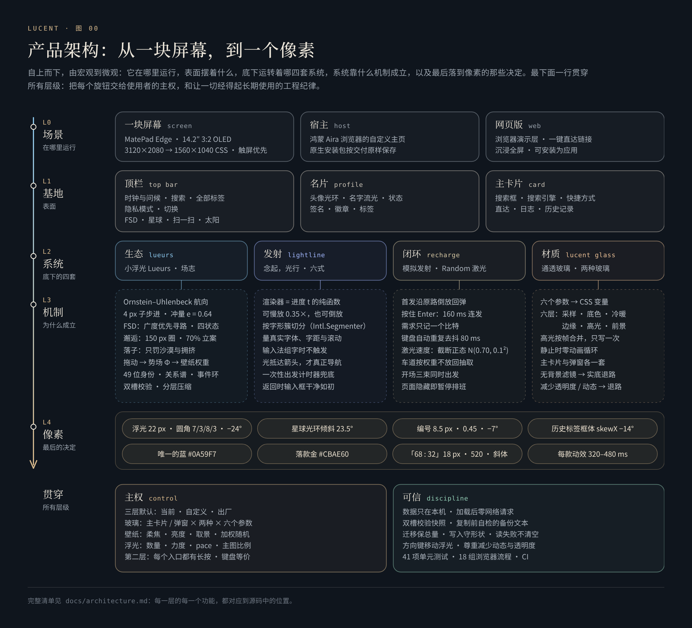

# 产品架构：从一块屏幕，到一个像素

**五层，由宏观到微观；两条主线，贯穿始终。**

[English](en/architecture.md) · [返回 README](../README.md)

---

这一页是灵感台的完整清单：从它运行的那块屏幕，到落在像素上的每一个数。每一层只回答一个问题——

| 层 | 回答的问题 |
|---|---|
| **L0 场景** | 它在哪里运行，由谁托管 |
| **L1 台面** | 表面上有什么，每样东西在哪里 |
| **L2 系统** | 底下运转着哪四套系统，人看到的是什么 |
| **L3 机制** | 这些系统为什么成立 |
| **L4 像素** | 最后落定的那些数 |
| **贯穿** | 主权：哪些东西交给你调；可信：哪些纪律让它经得起长期使用 |

---

## L0 · 场景：它在哪里运行

| | |
|---|---|
| **设备** | 华为 MatePad Edge：14.2 英寸 OLED，3:2，3120×2080，120 Hz，触屏。整套版面以 1560×1040 CSS 像素（2× 设备像素比）为参照。 |
| **宿主** | 鸿蒙上的 Aira 浏览器，以「自定义主页」安装包运行。宿主提供系统搜索、标签后台、隐私模式、历史记录、书签、下载、设置、扫码等入口，以及主题色与本地存储。实机安装包按交付原样保存在 [`product-finale/`](../product-finale/README.md)。 |
| **网页版** | 就是这个仓库。[`src/web/browser-bridge.js`](../src/web/browser-bridge.js) 在浏览器里实现宿主接口，每个宿主入口都有一块可用的演示面板；[`src/web/showcase.js`](../src/web/showcase.js) 提供一键直达链接；[`src/web/immersive.js`](../src/web/immersive.js) 让大屏首次轻点即进入全屏；[`src/web/manifest.webmanifest`](../src/web/manifest.webmanifest) 让它可以安装为全屏启动的应用。 |

## L1 · 台面：表面上有什么

### 顶栏

| 元素 | 轻点 | 长按 |
|---|---|---|
| 时钟与问候 | 等宽时钟，每 20 秒刷新；日期与按时段变化的问候（上午好，慢慢来 · 下午好，保持清醒 · 晚上好，辛苦了） | — |
| 搜索 | 唯一的蓝色主操作，打开宿主的系统搜索 | — |
| 全部标签 | 打开标签后台 | — |
| 隐私模式 | 进入或退出隐私模式（网页版只暂停本地打开记录，不冒充浏览器无痕） | — |
| 切换 | 在 Light → Dark → 随机之间切换壁纸 | 壁纸与玻璃 |
| FSD | 淡蓝巡航 → 暖橙增强 → 关闭；轻点星球后浮现，4.25 秒不点自行淡出 | — |
| 星球 | 添一枚浮光，并唤出 FSD | 代号：交互 |
| 扫一扫 | 系统扫码 | 备份与导出 |
| 太阳 | 设置中心 | 关于 |

### 名片

| 元素 | 内容 |
|---|---|
| 头像 | 104 px（平板横屏），外圈 14 秒一周的锥形光环与一层 6 秒呼吸的光晕，右下角在线状态点 |
| 名字 | 100° 暖色渐变，9 秒一道流光 |
| 状态与简介 | 浏览模式胶囊（普通 / 隐私）与一行简介 |
| 签名 | 一行签名；改过的每一句都进入「历史签名」 |
| 徽章 | 等级、主题（浅色 / 深色 / 跟随系统）、平台（握姿标签） |
| 标签 | 最多 12 个；「＋ 标签」打开名片编辑 |

### 主卡片

| 元素 | 内容 |
|---|---|
| 搜索框 | 回车与箭头走同一条提交；动效抵达箭头才导航；输入法组字时不触发；返回后输入框干净如初 |
| 搜索引擎 | Baidu、Google、Bing 与一个自定义模板；右侧「✧ 理」打开「念起，光行」，搜索引擎设置也在那里 |
| 快捷方式 | 三种形态：自动（站点图标）、装框、首字母牌；首字母牌 28 种底色（「清新」16 色、「沉静」12 色）；长按编辑图标；「编辑排序」之后长按拖动换位；「添加」；段头右侧是「✧ 本地文件架」 |
| 直达 | 书签、下载管理、我的网页、标签后台、搜索设置、用户脚本、设置，宽屏下双列；「编辑排序」时每一行右侧出现 ↑ ↓，顺序存在本机 |
| 折叠 | 快捷方式与直达各自折叠；两段都折叠时进入专注态 |
| 日志 | 卡片右下外侧的一行白字；长按打开签名日志，每一句按秒留档 |
| 历史记录 | 卡片右上方的菱形标签：框体 `skewX(−14°)`，图标与文字直立；打开宿主的历史记录 |

### 本地文件架

5.9.4 起，快捷方式的段头多了一枚「✧ 本地文件架」。它是一张独立的玻璃卡，只读你主动选择的文件夹或文件，不上传，不联网。

| 元素 | 内容 |
|---|---|
| 挂载 | 「选择新路径」挂一个文件夹，「打开文件」直接挑几个文件；可设为默认路径，下次打开先停在摘要卡上，轻点即重新授权。在 ArkWeb 上，文件选择绕过图库与拍照的来源面板，文件夹选择用 `showDirectoryPicker` 并以 `startIn` 直达原处 |
| 摘要与最近 | 中央的摘要卡写着文件夹名、项数、文件夹数、文件数与总大小；最近打开的路径分列两侧，最新的居中、其余左右交替外扩（最多显示 4 个），长按改名 |
| 筛选与列表 | 默认 MD + HTML，另有 HTML、PDF、Markdown、图片、文本/代码、压缩包、音视频与全部类型；文件夹聚成一组、可折叠；名称、类型、时间、大小四列排序，第三次点击取消；列表与网格两种视图 |
| 预览 | HTML 以静态方式就地呈现，脚本与内嵌框架一律剥去，并列出缺失的本地资源与未内联的在线资源；Markdown 由内置渲染器排版（标题、列表与任务列表、带对齐的表格、代码块、引用、链接与图片）；PDF、图片与文本同样就地预览。文本最多读 256 KB，图片 24 MB，音视频 120 MB |
| 新标签页打开 | 把相对资源（每个至多 8 MB）打包进页面，经 blob 地址用一个标准的新标签链接打开，10 秒未响应即提示 |
| 星标与收藏夹 | 每一行右侧一枚星标；右上角的收藏夹按全部 / 文件 / 文件夹筛选、按时间或类型排序，再点一次反转，一页两层、一层至多六本；打开时下层的文件架隐去，收藏卡悬浮在壁纸之上。文件被移走时，提示复制原文件名或移除收藏。收藏至多 200 条，随备份文本一起带走 |

### 版面

- **两栏。** 大屏（≥ 900 px）左侧名片、右侧主卡片；≥ 1240 px 时内容宽 1240 px，名字 38 px。
- **专注态。** 两段都折叠时，卡片下沉到视觉中心，搜索成为唯一的焦点。
- **短屏守卫。** 主卡片在宽屏下垂直居中，屏幕一矮就会上移，浮在它右上方的历史记录标签会顶到顶栏。守卫只把卡片下移到刚好留出 16 px 的间隙；1560×1040 与更高的屏幕不受影响（[`guardCardClearance`](../src/assets/app.js)）。

## L2 · 系统，与 L3 · 机制

四套系统。每一套先写人看到的，再写它为什么成立；机制的公式与源码行，见各自的深度文档。

### 生态 · 小浮光与场志

**人看到的**

- **浮光。** 0–49 枚玻璃透镜：视觉 22 px，触控 44 px；冷暖两种形态；碰撞的那一帧闪过折光；抓住时浮现编号。拨动、拖动、推挤；方向键移动 16 px，Shift 加方向键 48 px。
- **「代号：交互」面板**（长按星球）：浮光数量；碰撞力度（1–24×，可每次启动随机）；自然 pace（0.25–16×）；主图随机比例（Light : Dark）；Drive (FSD)；历史统计；设默认值；说明卡「黑箱里，灵感怎样发生」——七段：一张看不见的地形 · 距离、绕行与碰撞 · 有记忆的航向 · 轻拨之后，安静落定 · 让浮光自己出发 · 落子与星座 · 一点可知的黑箱。
- **历史统计。** 今天 / 7 天 / 30 天 / 1 年 / 全部；Light 倾向、交互次数（拖动、方向键、手动滑轨、添加浮光分别可看）、概率分布、碰撞力度；点选任一时段看详情，上一时段 / 下一时段逐段翻看。
- **场志。** 浮光地形图（26×12，A–Z、A2… 字母坐标）、驾驶志、名册（49 格）、个体档案、密友榜、关系网、三角、最近事件；「碰到浮光时显示其对应编号」开关。
- **设默认值。** 数量、力度、pace、主图比例各自「设为默认值 / 恢复默认值」，或一次保存全部；查询出厂值；FSD「默认开启」——打开灵感台时以淡蓝档自动巡航。
- **备份与导出**（长按扫一扫）：全部数据整理成一段文本，只写剪贴板；「导入备份」把这段文本读回来，校验之后恢复偏好、排序、日志、签名与本地收藏夹。

**为什么成立**

| 机制 | 要点 | 深入 |
|---|---|---|
| 空间 | 35 顶点手绘多边形；避让真实 DOM 30 px；24 px 网格泛洪，只留最大连通腔室（1560×1040 下 325 个安全落点） | [lueurs §1](lueurs.md#1-空间一块被手绘出来的留白) |
| 运动 | Ornstein–Uhlenbeck 航向；速度弛豫（时间常数约 0.77 s，散射后约 1.4 s）；4 px 子步进；软边界 ×0.65 | [§2](lueurs.md#2-运动有记忆的航向) |
| 碰撞 | 等质量冲量，e = 0.64；手中浮光为运动学体；能量只注入一次；速度上限 640 px/s；自然相遇的分离补足；8 向散射评分 | [§3](lueurs.md#3-碰撞在发生的那一刻被感到) |
| 概率 | 势场 Φ；62 / 20 / 13 / 5 的加权；单次 ±0.35；起点连续；只有人的操作写入 | [§4](lueurs.md#4-概率一张看不见的地形) |
| 自治 | ⌈n/5⌉…⌊n/2⌋ 位驾驶员（增强 ×3），每 11.5 s ±20% 重抽；广度优先寻路 + 视线化简；冲刺预判 0.18 s、×1.7、≤ 3.4 rad/s；有上限的马达冲量；18% 接力；密友得舵 | [§5](lueurs.md#5-自治drive-fsd) |
| 邂逅 | 150 px 判定圈，70% 立案，撞撞 / 回避五五开；冷却 9 s / 3 s；全场最多 3 起 | [§6](lueurs.md#6-邂逅让自然相遇成为事件) |
| 落位 | 只惩罚沙漠与拥挤；远距惩罚给沙漠让路（γ = 0.15）；上方 38% 是平台；每枚重抽「心情」 | [§7](lueurs.md#7-落子与星座) |
| 身份 | 49 位固定编制，不放回抽签在场 | [§8](lueurs.md#8-身份四十九位固定居民) |
| 存储 | 双槽轮写、FNV-1a 规范化校验；时 → 日 → 月 → 年 分层压缩；最大余额法迁移；网格守卫；备份文本 LUCENT1 | [chronicle](chronicle.md) |

### 发射 · 念起，光行

**人看到的**

- **搜索。** 写下的字化成一道光，抵达箭头，搜索才出发：六款之一、Random，或关闭动效直接出发。
- **「念起，光行」面板**（轻点「✧ 理」）：开启 / 关闭搜索动效；搜索引擎设置；无限模拟发射循环；预览输入框（「写下一个念头…」）；1× 原速 / 0.35× 慢放；再看一次；「抵达的方式 · SIX GESTURES」六张卡片（编号、名字、拉丁名、一句话、线描字形）；Random；完成。
- **品鉴页。** 四组十六款，可逐帧拖动、慢看、切换晨光与暮色、留下心选：[在线打开](https://hydeclanspi.github.io/Lucent-Next/atelier/)。

**为什么成立**

| 机制 | 要点 | 深入 |
|---|---|---|
| 纯函数渲染 | `renderer(ctx, state, t)`，t ∈ [0, 1]；不读时间、不调用随机数；能慢放、倒放、逐帧测试 | [motion §3](motion.md#3-每一帧都是进度的纯函数) |
| 播放器 | 量真实字体、字距、内边距与滚动；`Intl.Segmenter` 按字形簇切分；一张画布、一个循环；「时长 + 100 ms」兜底，搜索只发出一次 | [§4](motion.md#4-播放器) |
| 提交流程 | 输入法守卫；空白不出发；不重复提交；导航前清空输入框；导航失败原文回填 | [§5](motion.md#5-提交流程) |

### 闭环 · 模拟发射、Random 与绢光

**人看到的**

- **无限模拟发射循环**（「念起，光行」面板右上，只在本次访问有效）：开启后搜索框只发射光，不发出任何搜索。
- **首发回弹**：第一发是一次彩排，沿原路飞出、再倒放回来，字句一个不差地回到原处；之后的每一发，字都随光离开。
- **按住回车**：连发，每发一种姿态（开启 Random 时）。
- **Random**：「Random」铂金字样与金属开关；卡片缝隙里香槟铂金的导流环；奔跑的蓝白激光；开场三束同时出发。
- **绢光与浮金**：循环一打开，两段金色丝绢沿搜索框描边流淌，金尘从上沿升起、从下沿沉落；每发射一次，金尘随之涨落。

**为什么成立**

| 机制 | 要点 | 深入 |
|---|---|---|
| 连发 | 按住 > 280 ms，或两次按下间隔 < 300 ms；每发 160 ms，从「光开始出现」的那一刻起播，只画光路；同一张画布与帧循环 | [motion §7](motion.md#7-模拟发射) |
| 需求 | 动画中再按只记一个比特；抬起后等 80 ms 再判断松手；输入、组字、失焦、隐藏即取消 | [§7](motion.md#7-模拟发射) |
| 激光排班 | 车道取自真实布局，横 0.7 / 纵 0.3；每波 73% / 20% / 7% 为一、二、三束；不放回抽车道；纵向 4/30 逆行；速度 ~ 截断正态 N(0.70, 0.10²)（Box–Muller，\|z\| > 3 重抽）；波间 1.53–3.17 s 且晚于上一波最长一束 90 ms；开场编舞 275 ms | [§6](motion.md#6-random白金环与蓝白激光) |
| 绢光与浮金 | 两段丝绢各占周长 42%，按弧长匀速，十秒一圈，连发时快三倍；金尘同时在场 12–22 粒，每 4–7.65 s 重抽疏密，六成取丝绢最亮处扬起；每发涨到 1.25–1.6 倍（至多 40 粒），再慢慢回落；只读搜索框已有的信号 | [§7](motion.md#7-模拟发射) |

### 材质 · 通透玻璃

**人看到的**（长按「切换」）

- **壁纸。** Light / Dark / 随机（按主图随机比例加权）；柔焦 0–20%；亮度 50–100%（可恢复默认）；两张壁纸各自「调整取景」。
- **玻璃材质。** 「主卡片」与「进阶弹出窗口」各自选择经典磨砂玻璃或暖光液态清璃；「更多调节」里是六个 0–100 的参数：

| 参数 | 界面说明 | 映射 |
|---|---|---|
| 通透度 | 调节玻璃本身的遮罩感 | `--beta-alpha = 1.55 − 0.011·x` |
| 玻璃柔焦 | 调节透过玻璃的背景轮廓 | `--beta-blur = base·(0.4 + 0.012·x)`，主卡片 18 px、弹窗 26 px |
| 暖意 | 从中性清白到温暖的杏色受光 | 调色板向中性灰或暖色插值 |
| 边缘光泽 | 调节亮边与厚度感 | `--beta-edge = 0.2 + 0.016·x` |
| 环境色彩 | 调节透过玻璃的背景颜色浓度 | 饱和度在 100% 与基准之间插值 |
| 触光强度 | 调节接触时的反光，零为关闭 | 跟手高光强度 `x / 50` |

  推荐值、「保存定制设计」、「恢复推荐值」三者分开。

**为什么成立**：六层光学（背景采样 · 底色 · 环境冷暖 · 边缘厚度 · 跟手高光 · 独立前景）；高光按帧合并写入；静止时零常驻动画循环；没有背景滤镜或开启「减少透明度」时退回实底。→ [glass](glass.md)

## L4 · 像素

| 对象 | 数 |
|---|---|
| 浮光（冷） | 22 px，圆角 7 / 3 / 8 / 3 px，旋转 −24°，0.7 px 描边，一道 10 px 的短高光 |
| 浮光（暖） | 圆角 3 / 8 / 3 / 7 px，旋转 18° |
| 编号 | 8.5 px，透明度 0.45，倾斜 −7°，颜色 `rgba(245, 201, 155, .45)`，小帽 `M2.2 1.2 Q8.2 2.8 8.8 8.6` |
| 星球入口 | 光环倾斜 23.5°；球后半圈压暗、球前半圈提亮 |
| FSD 字标 | 23×23 px；高 F 居左，S 右上、D 右下，F 中横末端一粒火星 |
| 历史记录标签 | 框体 `skewX(−14°)`，整体 `scale(0.92)` |
| 颜色 | 主操作 `#0A59F7`；名字 `#FF6A3C → #FFA14E → #FFD07A`；关于标题 `#DFC47E → #C7A347 → #A9822A`；落款 `#CBAE60`；激光 `#69ACFF → #B4DDFF → #FFFFFF`；铂金 `#EEECE3 → #D3C5A2 → #F0EEE6`；增强驾驶 `#E8BE94` / `#865326`；「已开启」`#408C75` |
| 比例数字 | 「68 : 32」18 px，字重 520，斜体 |
| 动效时长 | 一线入光 360 · 微棱 400 · 快门 320 · 铂丝 460 · 穿针 440 · 近轨 480 ms |
| 长按阈值 | 顶栏与日志 480 ms，快捷方式 430 ms，排序模式 240 ms |
| 节奏 | FSD 邀请 4.25 s 淡出；阵容 11.5 s 重抽；自然速度 ×1.164；场志每 4 s 一次脉冲 |

## 贯穿 · 主权

**安静只是起点，深度全部交给你。** 你能调的东西，以及它们存在哪里：

| 范围 | 可以调 |
|---|---|
| 浮光 | 数量、碰撞力度（或每次启动随机）、自然 pace、主图随机比例、FSD 默认开启 |
| 壁纸 | Light / Dark / 随机，柔焦，亮度，每张壁纸的取景 |
| 玻璃 | 两处表面 × 两种玻璃 × 六个参数；推荐值与定制设计 |
| 搜索 | 引擎、自定义模板、六式动效、Random、关闭动效 |
| 名片 | 名字、一行简介、签名、标签、等级、握姿标签 |
| 快捷方式与直达 | 增删、排序、三种形态、28 种底色；直达的先后 |
| 本地文件架 | 挂载哪个文件夹、默认路径、类型筛选、列表或网格、星标收藏与收藏的排序 |
| 版面 | 两段各自折叠，专注态 |

**三层默认**：当前值可以随手试；喜欢的组合存为默认；出厂基线（6 枚、Light 74%、力度 13.7×、pace 2.41×、启动随机关闭）永远可回。所有设置只存在本机，一段备份文本就能带走。

## 贯穿 · 可信

- **隐私。** 页面加载后不连接任何外部服务（唯一的例外：第一次遇到生僻字时，从本站补取那一小块字体）；数据只在本机；备份只经由剪贴板离开。本地文件架只读你主动选择的文件夹或文件，不上传；HTML 预览剥去脚本，只静态呈现。
- **存储纪律。** 双槽轮写与规范化校验；读失败绝不覆盖历史；迁移保总量；写入守形状；复制前自检。
- **无障碍。** 方向键移动浮光；每个长按都有键盘等价；尊重「减少动态」与「减少透明度」；弹窗有焦点陷阱，关闭后焦点归位。
- **性能纪律。** 一个帧循环；空闲约 30 Hz；后台、弹窗、隐藏时整体暂停；静止时玻璃零动画。
- **验证。** 42 项单元测试与 22 组浏览器流程，每次推送在 CI 运行；文档里的图由引擎函数直接渲染，截图、动图与概念影片都在伪时钟下逐帧渲染。→ [验证](VERIFICATION.md)

## 交互全表

| 入口 | 轻点 | 长按 | 键盘 |
|---|---|---|---|
| 切换 | Light → Dark → 随机 | 壁纸与玻璃 | 回车直接打开壁纸与玻璃 |
| FSD | 巡航 → 增强 → 关闭 | — | 回车 / 空格 |
| 星球 | 添一枚浮光，唤出 FSD | 代号：交互 | 回车添加；Shift+Enter、菜单键、Shift+F10 打开面板 |
| 扫一扫 | 系统扫码 | 备份与导出 | Shift+Enter、菜单键、Shift+F10 |
| 太阳 | 设置中心 | 关于 | Shift+Enter、菜单键、Shift+F10 |
| 历史记录 | 历史记录 | — | 回车 |
| 搜索框 | 回车 / 箭头：动效后出发 | 模拟发射开启时按住回车：连发 | — |
| ✧ 理 | 念起，光行 | — | 回车 |
| 快捷方式 | 打开 | 图标编辑；「编辑排序」后长按拖动 | — |
| ✧ 本地文件架 | 打开本地文件架 | — | 回车 |
| 收藏夹（文件架右上） | 打开星标收藏夹 | — | 回车；Esc 返回文件架 |
| 编辑排序 | 进入 / 退出排序：快捷方式可拖动，直达出现 ↑ ↓ | — | 回车 |
| 折叠 | 折叠或展开这一段 | — | — |
| ＋ 标签 | 名片编辑 | — | — |
| 日志 | — | 签名日志 | 回车直接打开 |
| 浮光 | 拨动、拖动、推挤 | 抓住时浮现编号 | 方向键 16 px，Shift 48 px |
| 任意处（大屏，网页版） | 首次轻点进入全屏 | — | F 切换全屏，Esc 退出 |

## 源码地图

| 文件 | 负责 |
|---|---|
| [`src/index.html`](../src/index.html) | 台面的骨架、元信息、应用清单 |
| [`src/assets/app.js`](../src/assets/app.js) · [`app.css`](../src/assets/app.css) | 名片、搜索生命周期、快捷方式与直达排序、壁纸、各面板、备份导出与导入、关于、短屏守卫 |
| [`src/assets/interaction.js`](../src/assets/interaction.js) · [`interaction.css`](../src/assets/interaction.css) | 小浮光引擎 |
| [`src/assets/stats-store.js`](../src/assets/stats-store.js) · [`field-store.js`](../src/assets/field-store.js) · [`stats-panel.js`](../src/assets/stats-panel.js) | 统计、场志与手写 SVG 图表 |
| [`src/assets/glass-material.js`](../src/assets/glass-material.js) · [`glass-material.css`](../src/assets/glass-material.css) | 通透玻璃 |
| [`src/assets/search-motion-renderers.js`](../src/assets/search-motion-renderers.js) · [`search-motion.js`](../src/assets/search-motion.js) · [`search-motion-panel.js`](../src/assets/search-motion-panel.js) | 六式渲染器、播放器、面板与 Random 激光 |
| [`src/assets/search-simulation.js`](../src/assets/search-simulation.js) | 模拟发射与连发 |
| [`src/assets/search-aura.js`](../src/assets/search-aura.js) · [`search-aura.css`](../src/assets/search-aura.css) | 绢光与浮金 |
| [`src/assets/local-shelf.js`](../src/assets/local-shelf.js) · [`local-shelf.css`](../src/assets/local-shelf.css) · [`local-shelf-bootstrap.js`](../src/assets/local-shelf-bootstrap.js) | 本地文件架与星标收藏夹；加载器只占 1.2 KB，文件架在第一次轻点时才载入 |
| [`src/web/`](../src/web/) | 浏览器演示层、一键直达、沉浸全屏、应用清单与图标 |
| [`src/fonts/`](../src/fonts/) | 设备字体：HarmonyOS Sans 与 Noto Sans Mono 的网页切片 |
| [`design/`](../design/) | 设计源文件：十六款品鉴页、应用图标、分享卡片、封面与文档图表 |
| [`scripts/`](../scripts/) | 构建、预览、检查、图表（`figures.mjs`）、媒体录制（`capture/`）、影片与配乐、实机剪辑、字体 |
| [`tests/`](../tests/) | 引擎、渲染器、存储与浏览器测试 |
