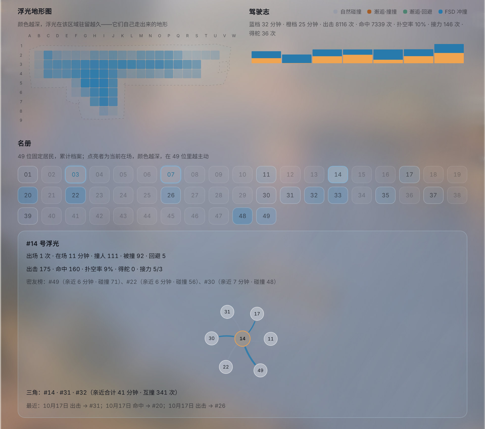
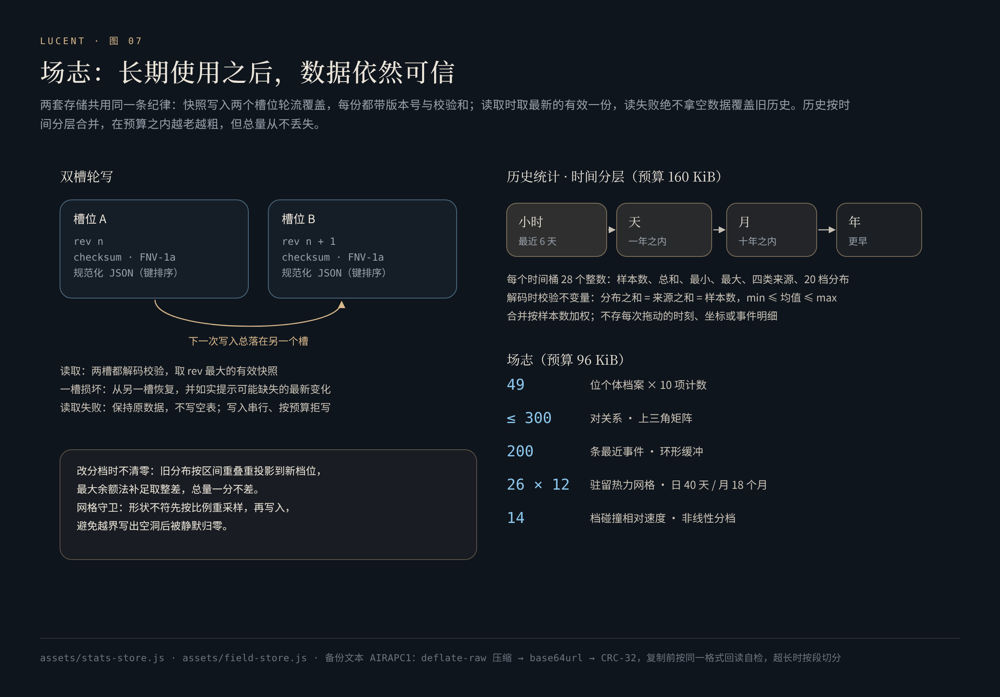
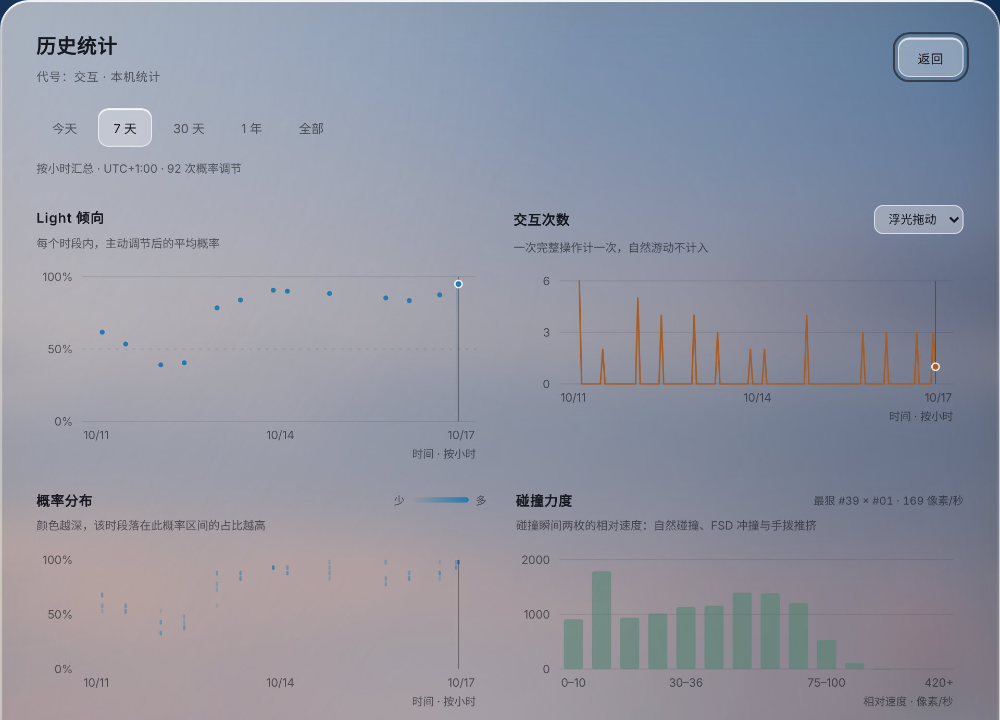

# 场志

**浮光不是无名的。名册在此，故事开始。**

[English](en/chronicle.md) · [返回 README](../README.md)

---

<p align="center"></p>
<p align="center"><sub>本页截图中的数据由真实引擎生成：用伪时钟驱动产品运行一周，期间按会话召唤浮光、开启巡航与增强驾驶、手动拖动若干次。</sub></p>

灵感台的一切数据只留在本机。场志要回答的不是「存了多少」，而是长期使用之后，这些数字是否依然可信、口径是否一致、坏掉一半时能否自己恢复。

## 1. 两层数据，两种口径

| | 历史统计 | 场志 |
|---|---|---|
| 回答的问题 | 我把壁纸往哪边推？推了多少次？ | 四十九位居民各自经历了什么？谁和谁最亲近？ |
| 存什么 | 每个时间桶 28 个整数的聚合 | 49 份个体档案、关系谱、事件环、驻留网格、驾驶时长、力度分布 |
| 不存什么 | 每次拖动的时刻、坐标、事件明细 | 三角关系（读取时即时计算） |
| 预算 | 160 KiB | 96 KiB |
| 源码 | [`stats-store.js`](../assets/stats-store.js) | [`field-store.js`](../assets/field-store.js) |

**统计的语义必须准确。** Light 倾向是「交互产生的概率值」的统计，不是实际抽中 Light 的比例；一次完整拖动算一次操作，不把每个 `pointermove` 或每次碰撞特效算作一次；手动滑轨、方向键、添加浮光各有自己的计数；没有数据的时段留空；合并均值按样本数加权，不把两天的平均数再简单平均。

## 2. 双槽轮写

<p align="center"></p>

两个 store 共用同一条存储纪律（[`stats-store.js` L119-L181](../assets/stats-store.js#L119-L181)、[`field-store.js` L151-L191](../assets/field-store.js#L151-L191)）：

- **快照**：`{ version, checksum, data }`。校验和是 FNV-1a，算在**键排序后的规范化 JSON** 上——同一份数据无论键的顺序如何，校验和都相同。
- **写入**：下一次写入总是落在另一个槽位，版本号 `rev` 递增。写入串行；写入前先按字节预算检查，超出就拒写并如实提示，而不是写一半。
- **读取**：两个槽都解码、校验；取 `rev` 最大的有效快照。一个槽损坏时从另一个槽恢复，并提示「受损快照中的最新变化可能缺失」。
- **读取失败**：保留原数据，**绝不拿空表覆盖历史**。
- **写入期间的新数据**：统计 store 在写入完成后比对版本；如果写入期间又有新记录，再写一轮，直到落盘的就是最新的（[L157-L181](../assets/stats-store.js#L157-L181)）。

解码时还会校验数据本身的不变量（[L45-L61](../assets/stats-store.js#L45-L61)）：每个时间桶都必须满足「20 档分布之和 = 四类来源之和 = 样本数」「最小值 ≤ 平均值 ≤ 最大值」，时间桶不重叠且对齐到自己的单位边界。不满足就当作损坏，而不是带着错误继续画图。

## 3. 越老越粗，但总量不丢

**历史统计**按时间分层合并（[`compact`](../assets/stats-store.js#L74-L93)）：

| 层 | 保留 |
|---|---|
| 小时 | 最近 6 天 |
| 天 | 一年之内 |
| 月 | 十年之内 |
| 年 | 更早 |

合并只是把计数相加、取最小与最大——不丢样本。如果仍超出预算，就强制把整层提升一级再试。时钟被往回拨时，插入已压缩时段的小时数据会并入覆盖它的桶，不会产生重叠。面板切换到更长的时间范围时，如实使用更粗的粒度，不假装还有小时级精度。

**场志**按保留期修剪并量化（[`prune` / `quantize`](../assets/field-store.js#L46-L140)）：驾驶与相遇按日保留 450 天，驻留网格按日保留 40 天、按月保留 18 个月，事件环最多 200 条；计数封顶为 16 位整数，驻留秒数按 4 秒量化为 8 位。

## 4. 改定义时不丢历史

碰撞力度分布一开始是 8 档；后来按真实的速度分布改成 14 档非线性分档——高频的 10–30 px/s 区间每 5 px/s 一档，两端各留一个宽口：

```text
[0, 10) [10, 20) [20, 25) [25, 30) [30, 36) [36, 42) [42, 50) [50, 60) [60, 75) [75, 100) [100, 140) [140, 220) [220, 420) [420, ∞)
```

改分档的那一刻，旧代码会把整张表清零——真机数据回执里，力度分布只剩 138 次，而同期碰撞有 824 次。修复（[`redistributeCounts`](../assets/field-store.js#L85-L113)）：

1. 旧分布的每一档，按与新档位的**区间重叠比例**摊开；最末一档视为无上界。
2. 摊开后取整，用**最大余额法**把取整差补给小数部分最大的档——**总量一分不差**。
3. 迁移后尽快落盘，不让旧形状再被读回。

这不会提高旧数据的分辨率；它做到的是把「整张清零、总量丢失」换成「总量保住、老数据粗一点」。修复本身不往数据里加一个字节：档位定义留在代码里。

同一类问题还有一个**网格守卫**（[`currentGrid`](../assets/field-store.js#L57-L68)）：驻留网格的形状在版本间变过时，旧数组先按比例重采样到 26×12，再写入——直接往越界下标上累加，会写出空洞与 NaN，落盘时静默变成 0。

## 5. 四十九份档案

每一份个体档案是 10 个计数：出场、在场时长、命中、扑空、撞击、被撞、回避、得舵、接力接入、接力交出。关系谱以「小编号,大编号」为键（上三角），每对 6 个计数：接触、双向的撞撞、双向的回避、亲近分钟（两枚相距 92 px 以内的时间）。

| 事件 | 写入 |
|---|---|
| 自然碰撞 `contact` | 双方档案、关系、当日社交、力度分布 |
| 撞撞 / 回避 `bump` / `dodge` | 发起方与对方档案、有方向的关系计数 |
| 冲刺 / 扑空 / 命中 `charge` / `miss` / `autoHit` | 驾驶员档案；命中写入力度分布 |
| 接力 / 得舵 `relay` / `pilot` | 双方档案 |
| 手拨推挤 `push` | 只进力度分布与事件环——那是手劲，不是浮光的性格 |

每 4 秒一次脉冲记录在场时长、亲近分钟、驻留位置与驾驶时长（蓝档 / 橙档）。

## 6. 图表家族

<p align="center"></p>

所有图表都是手写 SVG（[`stats-panel.js`](../assets/stats-panel.js)），没有图表库：

- **Light 倾向**：每个时段主动调节后的平均概率；细折线，线下向横轴淡出。
- **交互次数**：拖动、方向键、手动滑轨、添加浮光可分别查看。
- **概率分布**：每个时段落在 5% 一档的 20 档里的占比，颜色越深越集中。
- **碰撞力度**：碰撞瞬间两枚浮光的**相对速度**（而不是设定力度），14 档；标注最猛烈的一次是谁撞了谁。
- **浮光地形图**：26×12 的驻留热力，用手绘区域的外扩轮廓包住；每一格有字母坐标（第一行 A–Z，第二行 A2–Z2……），点开显示该格占全部驻留的比例。深浅按**分位**而不是绝对值——日子久了每个格子都会被踩深，只有相对深度一直读得出来。
- **驾驶志**：每日蓝档与橙档时长，出击、命中、扑空率、接力、得舵。
- **名册**：49 格，在场者亮框；深浅是「在 49 位里有多主动」的相对名次，四等分——并列时按「主动比例 → 活跃总量 → 编号」排出全序，避免整个并列簇塌进同一档。
- **关系网**：选中一位，它最亲近的 6 位环绕四周；线越粗、站得越远，关系越近。曲线两端用二分法收笔，停在离圆心「半径 + 3」的位置，再用 blossom 公式重算子曲线的控制点——线形不变，只是不再插进圆里。每次打开随机一个起始角：读图规则固定，图本身每一眼都是新的。
- **三角**：与它互亲最强的一组三人，读取时即时计算，不落存储。

所有图表都可以点选查看详情；点空白处收起浮层，事件监听走捕获阶段，不会被图表重绘摘掉。

## 7. 备份与导出

长按右上角的扫一扫，打开「备份与导出」。全部数据离线打包成一段文本，只写剪贴板；之后放在哪里，由你决定。

```text
AIRAPC1:<D|R>:<载荷字符数>:<base64url>:<crc32>
AIRAPC1:P:<i>/<N>:<整串 crc32>:<切片>
```

- `D` 是 `deflate-raw` 压缩后的 UTF-8 JSON，`R` 是没有压缩接口时的未压缩降级。
- **长度与校验都写在文字里**——任何截断、换行折断、编辑器把直引号改成弯引号，粘贴之后都能立刻查出来。
- **复制前自检**：按同一格式回读一遍——长度、CRC、解压、逐字符比对 JSON。任何一环不过，就拒绝复制，宁可让你点「重新整理」，也不交出一份坏数据。
- **分段**：每段不超过 4,000 字，对着聊天应用的单条上限取整；段头带序号与整串校验。
- 每一种失败都写成一句人话并给出下一步：剪贴板被拒绝、没有剪贴板接口、超过 4,000 字、超过 64 K 字、没有压缩接口、单项读取失败、场志读取超时、自检失败、没有可备份的内容。

## 8. 验证

- [`tests/stats-store.test.cjs`](../tests/stats-store.test.cjs)（14 项）：只存聚合；合并保留加权均值、最小最大与分布；键顺序改变不会误报校验失败；读失败不覆盖历史；保存失败保留上一份成功快照、重试不重复计数；两槽恢复；两槽都损坏时不会变成可写的空历史；写入期间的新操作不丢失；半小时时区与时钟回拨不产生重叠；下钻不虚构精度；数十年的日常使用仍在预算之内且总量不丢。
- [`tests/field-store-impact.test.cjs`](../tests/field-store-impact.test.cjs)（6 项）：力度分档与峰值；只有物理碰撞计入；手拨不写个体档案；保存读取往返；没有直方图的旧快照照常加载。
- [`tests/field-store-integrity.test.cjs`](../tests/field-store-integrity.test.cjs)（4 项）：8 档旧分布迁移到 14 档、总量一分不差；旧形状的驻留网格先重采样再写入；损坏槽位回退并如实提示；读失败绝不写空表。
