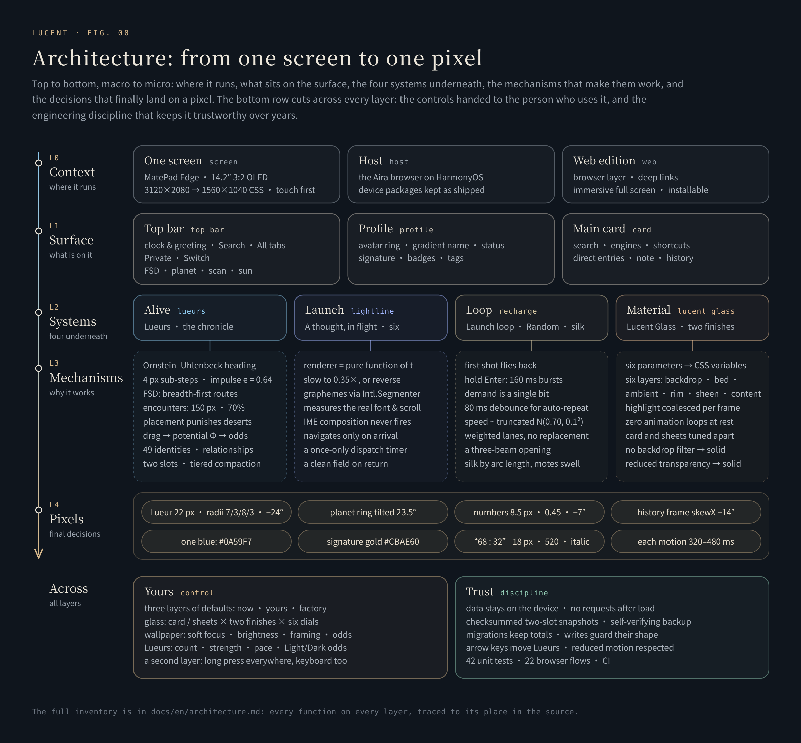

# Architecture: from one screen to one pixel

**Five layers, macro to micro; two threads running through all of them.**

[中文](../architecture.md) · [Back to README](../../README.en.md)

---

This page is Lucent's complete inventory, from the screen it runs on to every number that lands on a pixel. Each layer answers one question:

| Layer | Question |
|---|---|
| **L0 Context** | Where does it run, and who hosts it? |
| **L1 Surface** | What is on the surface, and where? |
| **L2 Systems** | Which four systems run underneath, and what does a person see of them? |
| **L3 Mechanisms** | Why do those systems work? |
| **L4 Pixels** | Which numbers does it all land on? |
| **Across** | Control: what is handed to you. Trust: the discipline that keeps it sound over years. |

---

## L0 · Context: where it runs

| | |
|---|---|
| **Device** | Huawei MatePad Edge: 14.2-inch OLED, 3:2, 3120×2080, 120 Hz, touch. The layout is set on 1560×1040 CSS pixels (device pixel ratio 2). |
| **Host** | The Aira browser on HarmonyOS, which runs Lucent as a package of its 自定义主页 feature. The host provides system search, tabs, private mode, history, bookmarks, downloads, settings and the scanner, plus theme colours and local storage. The device packages are kept as shipped in [`product-finale/`](../../product-finale/README.md). |
| **Web edition** | This repository. [`src/web/browser-bridge.js`](../../src/web/browser-bridge.js) implements the host interface in the browser, with a working demonstration panel behind every host entry; [`src/web/showcase.js`](../../src/web/showcase.js) provides deep links; [`src/web/immersive.js`](../../src/web/immersive.js) takes large screens full screen on the first click; [`src/web/manifest.webmanifest`](../../src/web/manifest.webmanifest) makes it installable as an app that opens full screen. |

## L1 · Surface: what is on it

### Top bar

| Element | Tap | Hold |
|---|---|---|
| Clock and greeting | A monospace clock refreshed every 20 s; the date and a greeting that changes with the hour (good morning, take it slow · good afternoon, stay sharp · good evening, well done today) | — |
| 搜索 Search | The single blue primary action: the host's system search | — |
| 全部标签 All tabs | The tab switcher | — |
| 隐私模式 Private | Enter or leave private mode (the web edition only pauses its local history; it never poses as incognito) | — |
| 切换 Switch | Cycle the wallpaper: Light → Dark → random | Wallpaper and glass |
| FSD | Pale-blue cruise → warm-orange boost → off; appears after a tap on the planet and fades after 4.25 s untouched | — |
| Planet | Add a Lueur and summon FSD | The Interaction panel |
| Scan | The system scanner | Backup and export |
| Sun | Settings | About |

### Profile

| Element | Content |
|---|---|
| Avatar | 104 px on the tablet, a conic ring turning every 14 s and a glow breathing every 6 s, an online dot |
| Name | A 100° warm gradient with a 9 s sheen |
| Status and one-liner | A browsing-mode pill (normal / private) and a one-line introduction |
| Signature | One line; every version is kept in the signature history |
| Badges | Level, theme (light / dark / follow system), platform (the grip label) |
| Tags | Up to 12; "＋ 标签" opens the profile editor |

### Main card

| Element | Content |
|---|---|
| Search | Enter and the arrow share one submission; navigation waits for the motion to reach the arrow; IME composition never fires; the field is clean on return |
| Engines | Baidu, Google, Bing and a custom template; "✧ 理" on the right opens 念起，光行, where engine settings also live |
| Shortcuts | Three forms: automatic (the site icon), framed, or an initial tile in 28 colours (16 "fresh", 12 "calm"); hold to edit the icon; after 编辑排序 (order), hold to drag; add; "✧ 本地文件架", the local shelf, at the right of the head |
| Direct entries | Bookmarks, downloads, saved pages, tabs, search settings, user scripts and settings, in two columns on wide screens; while ordering, each row gains ↑ ↓, and the order is kept on the device |
| Folds | Shortcuts and direct entries fold separately; with both folded, focus mode |
| Note | One line of white text outside the card's lower right; hold to open the note log, every line archived to the second |
| History | A diamond tag above the card's right corner: the frame is `skewX(−14°)`, the icon and text stay upright; opens the host's history |

### The local shelf

Since 5.9.4 the shortcuts' head carries "✧ 本地文件架", the local shelf: a card of glass of its own that reads only the folder or files you choose, uploads nothing and goes online for nothing.

| Element | Content |
|---|---|
| Mount | 选择新路径 mounts a folder; 打开文件 picks a few files directly. A folder can be set as the default: the next time, the shelf waits on its summary card, and a tap grants access again. On ArkWeb, file picking skips the gallery and camera sheet, and folders open through `showDirectoryPicker` with `startIn` at the right place |
| Summary and recents | The summary card in the middle gives the folder's name, its items, folders, files and total size; recent folders stand either side, the newest in the middle and the rest alternating outwards (four at most on screen); hold one to rename it |
| Filter and list | MD + HTML by default, or HTML, PDF, Markdown, images, text and code, archives, audio and video, or everything; folders cluster and fold; name, kind, time and size sort, a third click clears the sort; list or grid |
| Preview | HTML is shown statically in place, with scripts and embedded frames stripped, and lists the local assets it cannot find apart from the online ones it does not inline; Markdown is set by a built-in renderer (headings, lists and task lists, tables with their alignment, code blocks, quotes, links and images); PDF, images and text preview in place too. Text is read up to 256 KB, images up to 24 MB, audio and video up to 120 MB |
| Open in a new tab | Relative assets (up to 8 MB each) are packed into the page, which opens from a blob URL through a standard new-tab link; after 10 s without an answer, the shelf says so |
| Stars and favourites | A star at the end of every row; the favourites, top right, filter by all, files or folders and sort by time or kind (a second tap reverses), two rows to a page and up to six to a row. Opening them hides the shelf card beneath, and the favourites float over the wallpaper. When a file has moved, its original name can be copied, or the favourite removed. Up to 200 favourites, and they travel in the backup text |

### Layout

- **Two columns.** On large screens (≥ 900 px) the profile sits on the left and the main card on the right; from 1240 px the content is 1240 px wide and the name 38 px.
- **Focus mode.** With both sections folded, the card sinks to the visual centre and search is the only focus.
- **Short-screen guard.** On wide screens the card is centred vertically, so on a short screen it rises until the history tag floating above it meets the top bar. The guard lowers the card just enough to keep a 16 px gap; 1560×1040 and taller screens are untouched ([`guardCardClearance`](../../src/assets/app.js)).

## L2 · Systems, and L3 · Mechanisms

Four systems. Each lists what a person sees first, then why it works; formulas and source lines are in the deep dives.

### Alive · Lueurs and the chronicle

**What you see**

- **Lueurs.** 0–49 glass lenses: 22 px to the eye, 44 px to the finger; a cool and a warm form; a refraction flash on the frame of impact; a number that surfaces while one is held. Flick, drag, shove; the arrow keys move one 16 px, Shift + arrow 48 px.
- **The Interaction panel** (hold the planet): count; collision strength (1–24×, optionally redrawn at every launch); natural pace (0.25–16×); the Light : Dark odds; Drive (FSD); history statistics; defaults; and an explainer card, 黑箱里，灵感怎样发生 (*inside the black box, how inspiration happens*), in seven parts: an invisible terrain · distance, winding and collision · a heading with memory · a flick, then a quiet settle · letting the Lueurs set off · stones and constellations · a box you can partly see into.
- **History statistics.** Today / 7 days / 30 days / 1 year / all; Light tendency, interaction counts (drags, arrow keys, the manual slider and added Lueurs each viewable), the probability distribution and collision strength; tap a period for details, step through periods one by one.
- **The chronicle.** Residency terrain (26×12 with A–Z, A2… coordinates), drive log, the 49-cell roster, personal files, closest companions, the relationship web, triangles and recent events; a switch to show each Lueur's number on touch.
- **Defaults.** Count, strength, pace and odds each "set as default / restore default", or all at once; look up the factory values; FSD "on by default" — cruise starts when Lucent opens.
- **Backup and export** (hold the scan icon): all data in one text, written only to the clipboard; 导入备份 (import) reads that text back and, once it checks out, restores preferences, order, notes, signatures and the shelf's favourites.

**Why it works**

| Mechanism | Essentials | Deep dive |
|---|---|---|
| Space | A hand-drawn 35-vertex polygon; 30 px clearance from the real DOM; a 24 px grid flood-filled, only the largest connected chamber kept (325 safe sites at 1560×1040) | [lueurs §1](lueurs.md#1-space-open-room-drawn-by-hand) |
| Motion | Ornstein–Uhlenbeck heading; velocity relaxation (≈0.77 s, ≈1.4 s after a scatter); 4 px sub-steps; a soft boundary at ×0.65 | [§2](lueurs.md#2-motion-a-heading-with-memory) |
| Contact | Equal-mass impulses, e = 0.64; a held lens is kinematic; energy enters once; 640 px/s cap; separation top-up for natural meetings; an eight-direction scatter score | [§3](lueurs.md#3-contact-felt-the-moment-it-happens) |
| Probability | The potential Φ; weights 62 / 20 / 13 / 5; ±0.35 per gesture; continuous from where you are; only people write it | [§4](lueurs.md#4-probability-an-invisible-terrain) |
| Autonomy | ⌈n/5⌉…⌊n/2⌋ drivers (×3 when boosted), redrawn every 11.5 s ±20%; breadth-first routes simplified by line of sight; charges aim 0.18 s ahead at ×1.7 and ≤ 3.4 rad/s; a bounded motor impulse; 18% relay; friends at the wheel | [§5](lueurs.md#5-autonomy-drive-fsd) |
| Encounters | A 150 px circle, 70% become events, bump or dodge at 50 / 50; cooldowns of 9 s / 3 s; at most 3 at once | [§6](lueurs.md#6-encounters-making-natural-meetings-into-events) |
| Placement | Punish only deserts and crowding; the far penalty yields to deserts (γ = 0.15); the upper 38% is a plateau; a fresh "mood" for each lens | [§7](lueurs.md#7-stones-and-constellations) |
| Identity | 49 fixed residents, drawn without replacement | [§8](lueurs.md#8-identity-forty-nine-fixed-residents) |
| Storage | Two checksummed slots (FNV-1a over canonical JSON); hour → day → month → year compaction; largest-remainder migration; a grid guard; the LUCENT1 backup text | [chronicle](chronicle.md) |

### Launch · A thought, in flight

**What you see**

- **Search.** The words you wrote turn into light, reach the arrow, and only then does the search depart — in one of six motions, at random, or with no motion at all.
- **The 念起，光行 panel** (tap "✧ 理"): motion on / off; search-engine settings; the endless simulated-launch loop; a preview field ("write down a thought…"); 1× / 0.35×; replay; "SIX GESTURES", six cards with number, name, Latin name, one line and a line glyph; Random; done.
- **The atelier.** Four families, sixteen studies, scrubbable frame by frame, slow, dawn or dusk, with your own picks: [open it](https://hydeclanspi.github.io/Lucent-Next/atelier/).

**Why it works**

| Mechanism | Essentials | Deep dive |
|---|---|---|
| Pure renderers | `renderer(ctx, state, t)` with t ∈ [0, 1]; no clock, no randomness; slow, reversible, testable frame by frame | [motion §3](motion.md#3-every-frame-is-a-pure-function-of-progress) |
| Player | Measures the real font, spacing, padding and scroll; `Intl.Segmenter` graphemes; one canvas, one loop; a "duration + 100 ms" timer so the search is sent exactly once | [§4](motion.md#4-the-player) |
| Submission | IME guard; blank input never departs; no double submission; the field is cleared before navigation and restored if navigation fails | [§5](motion.md#5-the-submit-flow) |

### Loop · Simulated launch, Random and the silk light

**What you see**

- **The endless simulated-launch loop** (top right of the 念起，光行 panel, for this visit only): the search field launches light and never a search.
- **The first shot flies back**: a rehearsal — out along its path and played back in reverse, every character landing where it was. After that, the words leave with the light.
- **Hold Enter**: bursts, a different gesture for each shot when Random is on.
- **Random**: platinum lettering and a metal switch; champagne-platinum conduits in the gaps between cards; blue-white lasers; a three-beam opening.
- **Silk light and gold motes**: with the loop on, two ribbons of gold silk flow round the search field's outline while gold motes rise from the top edge and sink from the bottom; each launch swells them.

**Why it works**

| Mechanism | Essentials | Deep dive |
|---|---|---|
| Bursts | Hold > 280 ms, or press twice < 300 ms apart; 160 ms per shot from the moment its light appears, path only; one canvas and frame loop | [motion §7](motion.md#7-simulated-launch) |
| Demand | Pressing mid-flight records one bit; a key-up waits 80 ms before counting as release; typing, composing, blur or hiding cancels | [§7](motion.md#7-simulated-launch) |
| Laser scheduling | Lanes from the real layout, horizontal 0.7 / vertical 0.3; waves of one, two or three beams at 73% / 20% / 7%; lanes without replacement; vertical beams reversed 4/30 of the time; speed ~ truncated N(0.70, 0.10²) via Box–Muller, redrawn when \|z\| > 3; waves 1.53–3.17 s apart and ≥ 90 ms after the slowest beam; an opening at 275 ms | [§6](motion.md#6-random-platinum-rings-and-blue-white-lasers) |
| Silk light and gold motes | Two ribbons of 42% of the perimeter each, even by arc length, one lap in 10 s, three times as fast in a burst; 12–22 motes at a time, density redrawn every 4–7.65 s, six in ten lifting from the brightest point of the silk; each launch swells them to 1.25–1.6× (40 at most) before they settle; reads only signals the field already carries | [§7](motion.md#7-simulated-launch) |

### Material · Lucent Glass

**What you see** (hold Switch)

- **Wallpaper.** Light / Dark / random (weighted by the odds); soft focus 0–20%; brightness 50–100% (with a reset); a separate frame for each wallpaper.
- **Glass.** The main card and the sheets each choose Classic Frost or Warm Clear; "more adjustments" opens six dials from 0 to 100:

| Dial | In the interface | Mapping |
|---|---|---|
| Clarity (通透度) | how much the glass itself veils | `--beta-alpha = 1.55 − 0.011·x` |
| Softness (玻璃柔焦) | how much of the background's outline shows through | `--beta-blur = base·(0.4 + 0.012·x)`, base 18 px for the card, 26 px for sheets |
| Warmth (暖意) | from neutral white to a warm apricot light | palette interpolated toward grey or warm |
| Edge (边缘光泽) | the lit rim and the sense of thickness | `--beta-edge = 0.2 + 0.016·x` |
| Colour (环境色彩) | how much of the background's colour comes through | saturation interpolated between 100% and a base |
| Touch (触光强度) | the reflection where you touch; zero turns it off | highlight strength `x / 50` |

  Recommended values, "save my design" and "restore recommended" are kept apart.

**Why it works**: six optical layers (backdrop · bed · ambient · rim · touch sheen · an independent foreground); the highlight is coalesced to one write per frame; zero animation loops at rest; a solid fallback without backdrop filters or with reduced transparency. → [glass](glass.md)

## L4 · Pixels

| Object | Numbers |
|---|---|
| Lueur (cool) | 22 px, radii 7 / 3 / 8 / 3 px, rotated −24°, a 0.7 px rim, one 10 px highlight |
| Lueur (warm) | radii 3 / 8 / 3 / 7 px, rotated 18° |
| Number | 8.5 px, opacity 0.45, tilted −7°, `rgba(245, 201, 155, .45)`, the cap `M2.2 1.2 Q8.2 2.8 8.8 8.6` |
| Planet entry | Ring tilted 23.5°; dimmed behind the sphere, lit in front |
| FSD lettermark | 23×23 px; tall F on the left, S upper right, D lower right, a spark at the end of the F's crossbar |
| History tag | Frame `skewX(−14°)`, the whole tag `scale(0.92)` |
| Colour | Primary `#0A59F7`; name `#FF6A3C → #FFA14E → #FFD07A`; About title `#DFC47E → #C7A347 → #A9822A`; signature `#CBAE60`; lasers `#69ACFF → #B4DDFF → #FFFFFF`; platinum `#EEECE3 → #D3C5A2 → #F0EEE6`; boosted Drive `#E8BE94` / `#865326`; "on" `#408C75` |
| Ratio numerals | "68 : 32" at 18 px, weight 520, italic |
| Motion durations | Lightline 360 · Microprism 400 · Shutter 320 · Platinum filament 460 · Through the eye 440 · Near orbit 480 ms |
| Hold thresholds | 480 ms for the top bar and the note, 430 ms for shortcuts, 240 ms while sorting |
| Rhythm | FSD invitation fades at 4.25 s; line-up redrawn every 11.5 s; natural speed ×1.164; a chronicle pulse every 4 s |

## Across · Control

**Quiet is where it starts; all of the depth is yours.** What you can tune, and where it lives:

| Scope | Yours to tune |
|---|---|
| Lueurs | Count, collision strength (or a fresh draw at every launch), natural pace, the Light/Dark odds, FSD on by default |
| Wallpaper | Light / Dark / random, soft focus, brightness, the frame of each wallpaper |
| Glass | Two surfaces × two finishes × six dials; recommended values and your own design |
| Search | Engines, a custom template, six motions, Random, or no motion |
| Profile | Name, one-liner, signature, tags, level, grip label |
| Shortcuts and direct entries | Add, remove, reorder; three forms; 28 colours; the order of the direct entries |
| The local shelf | Which folder is mounted, the default path, the filter, list or grid, starred favourites and their order |
| Layout | Fold each section; focus mode |

**Three layers of defaults**: try anything now; keep the combinations you like as defaults; the factory baseline (6 Lueurs, Light 74%, strength 13.7×, pace 2.41×, no launch randomization) is always one tap away. Every setting lives on the device and travels in one backup text.

## Across · Trust

- **Privacy.** No request to any other site after load (the one exception: the first time a rare character appears, its small slice of the typeface comes from this site); data stays on the device; the backup leaves only through the clipboard. The local shelf reads only the folder or files you choose and uploads nothing; its HTML preview strips scripts and is static.
- **Storage discipline.** Two slots with canonical checksums; a failed read never overwrites history; migrations keep totals; writes guard their shape; copies verify themselves first.
- **Accessibility.** Arrow keys move Lueurs; every long press has a keyboard equivalent; reduced motion and reduced transparency are honoured; sheets trap focus and return it on close.
- **Performance discipline.** One frame loop; about 30 Hz when idle; fully paused in the background, under a sheet or when hidden; zero glass animation at rest.
- **Verification.** 42 unit tests and 22 browser flows run in CI on every push; the documentation figures are drawn by the engine's own functions, and the screenshots, animations and concept film are rendered frame by frame under a fake clock. → [Verification](../VERIFICATION.md)

## The full interaction table

| Entry | Tap | Hold | Keyboard |
|---|---|---|---|
| 切换 Switch | Light → Dark → random | Wallpaper and glass | Enter opens wallpaper and glass |
| FSD | Cruise → boost → off | — | Enter / Space |
| Planet | Add a Lueur, summon FSD | The Interaction panel | Enter adds; Shift+Enter, menu key or Shift+F10 opens the panel |
| Scan | The scanner | Backup and export | Shift+Enter, menu key or Shift+F10 |
| Sun | Settings | About | Shift+Enter, menu key or Shift+F10 |
| History | History | — | Enter |
| Search field | Enter / arrow: depart after the motion | With simulation on, hold Enter: bursts | — |
| ✧ 理 | 念起，光行 | — | Enter |
| Shortcut | Open | Icon editor; after 编辑排序, hold to drag | — |
| ✧ 本地文件架 Local shelf | Open the local shelf | — | Enter |
| Favourites (the shelf's top right) | Open the starred favourites | — | Enter; Esc returns to the shelf |
| 编辑排序 Order | Enter or leave ordering: shortcuts drag, direct entries gain ↑ ↓ | — | Enter |
| Folds | Fold or unfold a section | — | — |
| ＋ 标签 | The profile editor | — | — |
| Note | — | The note log | Enter opens it |
| Lueurs | Flick, drag, shove | Its number surfaces | Arrow keys 16 px, Shift 48 px |
| Anywhere (large screens, web) | The first click goes full screen | — | F toggles full screen, Esc leaves |

## Source map

| File | Owns |
|---|---|
| [`src/index.html`](../../src/index.html) | The surface's structure, metadata and app manifest link |
| [`src/assets/app.js`](../../src/assets/app.js) · [`app.css`](../../src/assets/app.css) | Profile, search lifecycle, shortcuts and the entries' order, wallpaper, the panels, backup, export and import, About, the short-screen guard |
| [`src/assets/interaction.js`](../../src/assets/interaction.js) · [`interaction.css`](../../src/assets/interaction.css) | The Lueurs engine |
| [`src/assets/stats-store.js`](../../src/assets/stats-store.js) · [`field-store.js`](../../src/assets/field-store.js) · [`stats-panel.js`](../../src/assets/stats-panel.js) | Statistics, the chronicle and the hand-written SVG charts |
| [`src/assets/glass-material.js`](../../src/assets/glass-material.js) · [`glass-material.css`](../../src/assets/glass-material.css) | Lucent Glass |
| [`src/assets/search-motion-renderers.js`](../../src/assets/search-motion-renderers.js) · [`search-motion.js`](../../src/assets/search-motion.js) · [`search-motion-panel.js`](../../src/assets/search-motion-panel.js) | The six renderers, the player, the panel and the Random lasers |
| [`src/assets/search-simulation.js`](../../src/assets/search-simulation.js) | Simulated launch and bursts |
| [`src/assets/search-aura.js`](../../src/assets/search-aura.js) · [`search-aura.css`](../../src/assets/search-aura.css) | Silk light and gold motes |
| [`src/assets/local-shelf.js`](../../src/assets/local-shelf.js) · [`local-shelf.css`](../../src/assets/local-shelf.css) · [`local-shelf-bootstrap.js`](../../src/assets/local-shelf-bootstrap.js) | The local shelf and its starred favourites; the loader is 1.2 KB, and the shelf arrives on its first tap |
| [`src/web/`](../../src/web/) | Browser layer, deep links, immersive full screen, app manifest and icons |
| [`src/fonts/`](../../src/fonts/) | The device's typefaces: web slices of HarmonyOS Sans and Noto Sans Mono |
| [`design/`](../../design/) | Design sources: the sixteen-study atelier, the app icon, the share card, covers and the documentation figures |
| [`scripts/`](../../scripts/) | Build, preview, checks, figures (`figures.mjs`), media capture (`capture/`), the film and its score, device edits, fonts |
| [`tests/`](../../tests/) | Engine, renderer, storage and browser tests |
