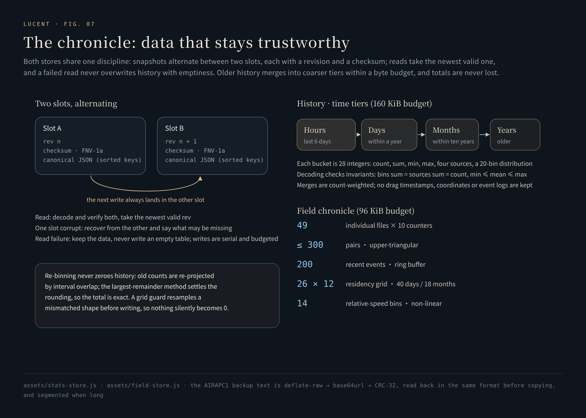

# The field chronicle · 场志

**The Lueurs are not nameless. Here is the roster; this is where the stories start.**

[中文](../chronicle.md) · [Back to README](../../README.en.md)

---

<p align="center"></p>
<p align="center"><sub>The data in these screenshots was produced by the real engine: the product ran for a simulated week under a fake clock, with Lueurs summoned session by session, cruise and boosted Drive switched on, and a few lenses dragged by hand.</sub></p>

All of Lucent's data stays on the device. The chronicle's question is not how much it stores, but whether after long use the numbers can still be trusted, mean the same thing they always did, and recover by themselves when half of them break.

## 1. Two layers, two definitions

| | History statistics | Field chronicle |
|---|---|---|
| The question | Which way do I push the wallpaper, and how often? | What has each of the forty-nine residents been through? Who is closest to whom? |
| What is stored | 28 integers of aggregates per time bucket | 49 personal files, a relationship table, an event ring, a residency grid, driving time, a strength histogram |
| What is not | The moment, coordinates or details of any drag | Triangles (computed on read) |
| Budget | 160 KiB | 96 KiB |
| Source | [`stats-store.js`](../../assets/stats-store.js) | [`field-store.js`](../../assets/field-store.js) |

**The statistics must mean exactly what they say.** Light tendency is a statistic of the probability values produced by interaction, not the share of wallpapers that actually came up Light. One complete drag counts as one operation — not every `pointermove`, not every collision effect. The manual slider, the arrow keys and adding a Lueur each keep their own count. Periods without data stay empty. Merged means are weighted by sample count; two days' averages are never simply averaged again.

## 2. Two slots, written in turn

<p align="center"></p>

Both stores share one storage discipline ([`stats-store.js` L119-L181](../../assets/stats-store.js#L119-L181), [`field-store.js` L151-L191](../../assets/field-store.js#L151-L191)):

- **Snapshot**: `{ version, checksum, data }`. The checksum is FNV-1a over **canonical JSON with sorted keys** — the same data gives the same checksum whatever order its keys arrive in.
- **Write**: the next write always goes to the other slot, with an incremented `rev`. Writes are serialized; the byte budget is checked before writing, and an oversize write is refused and reported, never half-written.
- **Read**: both slots are decoded and verified; the valid snapshot with the highest `rev` wins. If one slot is damaged, the other restores it, with a note that the latest changes in the damaged snapshot may be missing.
- **A failed read**: the existing data is kept — **history is never overwritten with an empty table**.
- **New data during a write**: the statistics store compares versions after a write completes; if more records arrived meanwhile, it writes again, until what is on disk is the latest ([L157-L181](../../assets/stats-store.js#L157-L181)).

Decoding also checks the data's own invariants ([L45-L61](../../assets/stats-store.js#L45-L61)): in every time bucket, "sum of the 20-bin distribution = sum of the four sources = sample count" and "minimum ≤ mean ≤ maximum"; buckets never overlap and are aligned to the boundaries of their own unit. A bucket that fails is treated as damaged, rather than carried into a chart.

## 3. Coarser with age, never lighter

**History statistics** are merged by time tier ([`compact`](../../assets/stats-store.js#L74-L93)):

| Tier | Kept for |
|---|---|
| Hour | The last 6 days |
| Day | Within a year |
| Month | Within ten years |
| Year | Older than that |

Merging adds counts and keeps minima and maxima — no sample is dropped. If the data is still over budget, a whole tier is promoted one level and the check runs again. When the clock is turned back, hourly data that falls inside an already compacted period merges into the bucket covering it, so nothing overlaps. When the panel switches to a longer range it honestly uses the coarser grain, never pretending to hourly precision.

**The chronicle** prunes by retention and quantizes ([`prune` / `quantize`](../../assets/field-store.js#L46-L140)): driving and encounters are kept by day for 450 days; the residency grid by day for 40 days and by month for 18 months; the event ring holds at most 200 entries; counts are capped at 16-bit integers, and residency seconds are quantized to 4 s in 8 bits.

## 4. Changing a definition without losing history

The collision-strength histogram started with 8 bins. Later, following the real distribution of speeds, it became 14 non-linear bins — one every 5 px/s across the busy 10–30 px/s range, with a wide bin at each end:

```text
[0, 10) [10, 20) [20, 25) [25, 30) [30, 36) [36, 42) [42, 50) [50, 60) [60, 75) [75, 100) [100, 140) [140, 220) [220, 420) [420, ∞)
```

At the moment the bins changed, the old code cleared the whole table — an on-device data receipt showed just 138 entries in the histogram while 824 collisions had happened in the same period. The fix ([`redistributeCounts`](../../assets/field-store.js#L85-L113)):

1. Each old bin is spread over the new bins in proportion to **interval overlap**; the last old bin is treated as unbounded.
2. After spreading, counts are rounded, and the **largest-remainder method** gives the rounding difference to the bins with the largest fractional parts — **the total is exactly preserved**.
3. The migrated shape is written back promptly, so the old shape is never read again.

This does not increase the resolution of old data; what it does is trade "cleared, total lost" for "total kept, older data a little coarser". The fix adds not one byte to the data: the bin definitions live in code.

A **grid guard** handles the same class of problem ([`currentGrid`](../../assets/field-store.js#L57-L68)): when the residency grid changed shape between versions, an old array is first resampled proportionally to 26×12 before anything is written — adding to out-of-range indices would leave holes and NaN that silently become 0 on disk.

## 5. Forty-nine files

Each personal file is 10 counters: appearances, time present, hits, misses, impacts, times hit, dodges, times at the wheel, relays received, relays handed over. The relationship table is keyed "smaller id, larger id" (the upper triangle), with 6 counters per pair: contacts, bumps in each direction, dodges in each direction, and minutes close (time the two spent within 92 px of each other).

| Event | Written to |
|---|---|
| Natural collision `contact` | Both files, the pair, the day's social tally, the strength histogram |
| Bump / dodge `bump` / `dodge` | The initiator's and the other's files, the directed pair counters |
| Charge / miss / hit `charge` / `miss` / `autoHit` | The driver's file; hits also go to the strength histogram |
| Relay / taking the wheel `relay` / `pilot` | Both files |
| A hand's shove `push` | Only the strength histogram and the event ring — that is the strength of a hand, not a Lueur's character |

A pulse every 4 seconds records time present, minutes close, residency position and driving time (blue and orange modes).

## 6. A family of charts

<p align="center"></p>

Every chart is hand-written SVG ([`stats-panel.js`](../../assets/stats-panel.js)); there is no chart library:

- **Light tendency**: the mean probability after active adjustment in each period; a thin line that fades toward the axis beneath it.
- **Interaction counts**: dragging, arrow keys, the manual slider and adding Lueurs, each viewable on its own.
- **Probability distribution**: each period's share in each of 20 bins of 5%; the deeper the colour, the more concentrated.
- **Collision strength**: the **relative speed** of the two Lueurs at the moment of impact (not the strength setting), in 14 bins, labelled with who hit whom in the hardest impact.
- **The residency terrain**: residency heat on a 26×12 grid, wrapped in the outward-offset outline of the hand-drawn region; each cell has a letter coordinate (A–Z on the first row, A2–Z2 on the second…) and, when tapped, its share of all residency. Shading follows **quantiles**, not absolute values — with time every cell darkens, and only relative depth stays readable.
- **The drive log**: daily blue and orange driving time; charges, hits, miss rate, relays and times at the wheel.
- **The roster**: 49 cells, framed when present; shade is a resident's relative rank in how active it is among all 49, in quartiles — ties are broken by "share of active events → total activity → id" into a strict order, so a large tie never collapses into one shade.
- **The relationship web**: select a resident and its 6 closest companions ring around it; the thicker the line and the farther out, the closer the bond. Each curve's ends are found by bisection so it stops at "radius + 3" from a centre, and the sub-curve's control point is recomputed with the blossom formula — the same curve, but it never pierces a circle. Every opening starts at a random angle: the reading rules are fixed, while the picture is new at every glance.
- **Triangles**: the trio with the strongest mutual bonds, computed on read and never stored.

Every chart can be tapped for details; tapping empty space dismisses the overlay, and the listener runs in the capture phase so a chart redraw can never detach it.

## 7. Backup and export

Long-press the scan icon at the top right to open backup and export. All data is packed offline into a single text and written only to the clipboard; where it goes after that is up to you.

```text
AIRAPC1:<D|R>:<payload length>:<base64url>:<crc32>
AIRAPC1:P:<i>/<N>:<crc32 of the whole>:<segment>
```

- `D` is UTF-8 JSON compressed with `deflate-raw`; `R` is the uncompressed fallback when no compression interface exists.
- **Length and checksum are written into the text** — any truncation, line-wrap breakage, or an editor turning straight quotes into curly ones is caught the moment it is pasted.
- **Verified before copying**: the text is read back in the same format — length, CRC, decompression, and a character-by-character comparison of the JSON. If any step fails, copying is refused; better to ask you to tap 重新整理 (*prepare again*) than to hand over a broken backup.
- **Segments**: no segment exceeds 4,000 characters, rounded to the single-message limit of chat apps; each segment header carries its index and the checksum of the whole.
- Every failure is one plain sentence with a next step: clipboard refused, no clipboard interface, over 4,000 characters, over 64 K characters, no compression interface, a single item failing to read, the chronicle timing out, self-check failing, nothing to back up.

## 8. Verification

- [`tests/stats-store.test.cjs`](../../tests/stats-store.test.cjs) (14 tests): only aggregates are stored; merging keeps weighted means, minima, maxima and distributions; a change of key order does not fail the checksum; a failed read never overwrites history; a failed save keeps the last good snapshot and a retry does not double-count; recovery from either slot; two damaged slots never become a writable empty history; operations during a write are not lost; half-hour time zones and clocks turned back produce no overlap; drill-down never invents precision; decades of daily use stay within budget with totals intact.
- [`tests/field-store-impact.test.cjs`](../../tests/field-store-impact.test.cjs) (6 tests): strength bins and peak; only physical collisions count; a hand's shove never writes a personal file; save and load round-trip; old snapshots without a histogram load normally.
- [`tests/field-store-integrity.test.cjs`](../../tests/field-store-integrity.test.cjs) (4 tests): a legacy 8-bin distribution migrates to 14 bins with the total exactly preserved; a residency grid of an old shape is resampled before writing; a damaged slot falls back and says so; a failed read never writes an empty table.
