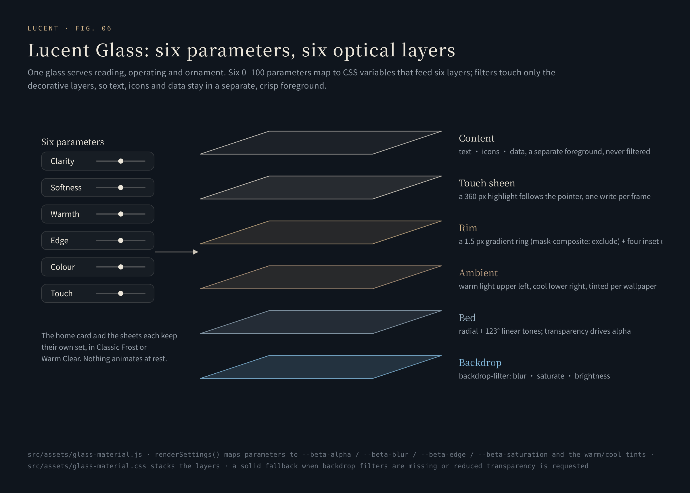

# Lucent Glass and the design language

**Light, clear, sharp — one glass for reading, operating and decorating. The product is named after it: *lucent* means glowing with light, and letting it through.**

[中文](../glass.md) · [Back to README](../../README.en.md)

---

## 1. One glass, three jobs

| Job | Where | Requirement |
|---|---|---|
| Panels you read | The main card, profile editor, Interaction panel, history statistics, backup and export, the local shelf (§9) | A controlled softness and brightness floor in the middle, thickness at the edge, calm text areas |
| Thin glass you operate | Top-bar buttons, FSD, the wallpaper toggle, the skewed history tag | Clearer outlines, thinner faces; selected, focused and pressed must all be legible |
| Lueurs in the open space | The 49 floating lenses | A 22 px pane: a lit edge, a shaded edge, one short highlight; a refraction flash on impact that is gone at once |

A larger blur radius or a lower opacity does not by itself make more convincing glass. What decides the material is controlling three things separately: light through the middle, thickness at the edge, and protection for the text.

## 2. Six parameters, six optical layers

The main card and the sheets each keep their own settings and come in two finishes: **Classic Frost** (经典磨砂玻璃) or **Warm Clear** (暖光液态清璃). All six dials run 0–100 with 50 as the design midpoint ([`glass-material.js`](../../src/assets/glass-material.js#L40-L59)):

| Dial | Mapping | 0 / 50 / 100 |
|---|---|---|
| Clarity (通透度) | `--beta-alpha = 1.55 − 0.011·x`, applied to the opacity of tint and reflections | 1.55 / 1.00 / 0.45 |
| Softness (玻璃柔焦) | `--beta-blur = base·(0.4 + 0.012·x)`, base 18 px for the card, 26 px for sheets | 0.4× / 1.0× / 1.6× |
| Warmth (暖意) | The palette interpolates toward neutral grey (cool) or toward warm (R+2, G−1, B−6) | neutral / original / warm |
| Edge (边缘光泽) | `--beta-edge = 0.2 + 0.016·x`, applied to the rim and inner lines | 0.2 / 1.0 / 1.8 |
| Colour (环境色彩) | Saturation interpolates between 100% and a base; light card 132%, light sheets 124%, dark 124% / 122% | 100% / base / 2×base − 100% |
| Touch (触光强度) | Pointer highlight strength `x / 50` | 0 / 1 / 2 |

The six layers, bottom to top ([`glass-material.css`](../../src/assets/glass-material.css)):

1. **Backdrop sampling**: `backdrop-filter: blur() saturate() brightness()`, brightness ×1.13 in light and ×0.88 in dark — one necessary blur, never a second one stacked on top.
2. **Base tint**: an off-centre radial layer (46% 45%) plus a 123° linear layer; three tones follow the warmth parameter, their opacity follows transparency.
3. **Ambient light**: a warm light at the upper left (a 72%×52% ellipse), a cool light at the lower right (70%×62%), and a 116° face reflection. Light and dark wallpapers use different warm and cool tones, so the glass picks up the sky of the wallpaper behind it.
4. **Edge thickness**: a 1.5 px gradient rim — seven stops along 130°, brightest at the upper left, second brightest at the lower right, dimmer in between — hollowed out with `mask-composite: exclude` so only a ring remains; then four inner lines: 1 px bright at the top, 1 px faint at the left, 1 px dark at the bottom, and a very faint 2 px inner glow. Because the ring is never uniformly bright, the glass reads as thick.
5. **Pointer highlight**: a 360 px radial highlight that follows the pointer and fades in over 230 ms.
6. **Content**: text, icons and data live in their own foreground (`z-index: 1`); filters only touch the decorative layers, so text is always sharp.

Left: Warm Clear · Right: Classic Frost

## 3. Event-driven, zero at rest

- On pointer enter, move and press, only the coordinates are recorded and the layer is marked dirty; `transform` is written at most once per frame ([`flush` / `track`](../../src/assets/glass-material.js#L116-L150)). A mouse lights the glass only with a precise, hover-capable pointer; on touch, the highlight follows only the finger that is down.
- Leaving, cancelling, scrolling, blurring, resizing or hiding the page puts it out at once; at rest there is **no permanent animation loop at all**.
- In sheets the highlight is painted straight onto the sheet's own background (`--beta-touch-x/y`): a background has no layout box, so the highlight stays put while scrolling and the scrollable area keeps its size.
- Sheets replace their children when they change pages; a `MutationObserver` cleans up stale highlight layers and keeps exactly one; unloading the page disconnects every observer and listener ([L199-L240](../../src/assets/glass-material.js#L199-L240)).

**Fallbacks**: without backdrop filters the glass falls back to a 96% opaque solid; with reduced transparency it uses the solid as well; with reduced motion there is no pointer highlight.

## 4. Layout

The design reference is a 1560×1040 tablet in landscape; narrow screens have their own arrangement.

- **Left: the profile card.** A 104 px avatar (on the tablet) inside a ring of conic gradient (warm orange to cherry pink) turning once every 14 s, with a glow that breathes every 6 s; the name in a 100° warm gradient with a 9 s sheen; then the status pill, the one-line signature, badges (level, theme, platform) and tags.
- **Right: the main card.** Search, search engines, shortcuts and direct entries, each foldable; at its lower right, a one-line daily note (*wilson vibes only.*), long-press to edit, archived to the second.
- **Above the card's right corner: the history tag.** Only the frame is skewed by −14° (`skewX`); the icon and text stay upright.
- **The top bar.** A clock and greeting at the left (上午好，慢慢来 — *good morning, take it slow*), four action pills of which only 搜索 (Search) is blue; at the right, four icons: FSD, the planet, scan and the sun.

## 5. Icons

Every icon is a vector line drawing; system emoji are never used.

- **The planet entry**: a glass sphere with a ring tilted 23.5° — the same as Earth's axial tilt. The half of the ring behind the sphere is dimmed and the half in front is brightened, so the entry has a front and a back.
- **The FSD lettermark**, drawn as a mark: a tall F on the left, S at the upper right and D at the lower right, and a single spark of an "active Lueur" at the end of the F's crossbar; 23×23 px, inheriting the blue or orange state colour at runtime.
- **Six motion glyphs**: each search motion has a line glyph at the right of its card — a line, a prism, a shutter, interwoven filaments, the eye of a needle, two close arcs — drawn in gold, with the arriving stroke in blue.
- **The number cap**: the one-stroke arc over a resident's number when it is held (`M2.2 1.2 Q8.2 2.8 8.8 8.6`).
- **Three shortcut forms**: automatic (the site icon), framed (the icon set on a pale plate), and an initial tile. Initial tiles come in 28 colours in two families — 16 "fresh" and 12 "calm" — with the letter colour chosen by luminance: Rec.601 weighted luminance above 0.62 gets dark text, anything else white.
- **The signature**: the lower right of the About window carries the author's handwritten signature. Strokes are cut out by alpha from their darkness, with the gold baked into the image — one for the light theme, one for the dark.

## 6. Colour

Every colour has one job and is never borrowed for another:

| Colour | Value | Used only for |
|---|---|---|
| HarmonyOS blue | `#0A59F7` | The single primary action: 搜索 in the top bar and the search arrow |
| Warm gold | Name gradient `#FF6A3C → #FFA14E → #FFD07A`; About title `#DFC47E → #C7A347 → #A9822A`; signature `#CBAE60` | Identity: the name, the avatar ring, the About title and signature |
| Ice blue | Planet `#BCE5F8`; lasers `#69ACFF → #B4DDFF → #FFFFFF` | The environment, the Lueurs and Random's lasers |
| Platinum | `#EEECE3 → #D3C5A2 → #F0EEE6` | Only with Random on: its lettering and switch |
| Warm orange | `#E8BE94` (dark) / `#865326` (light) | Boosted Drive, and nothing else |
| Mint | `#408C75` | "On" |
| Pale apricot | `rgba(245, 201, 155, .45)` | Lueur numbers |

Changing the search accent does not recolour the whole product; the warm name gradient and the engine outlines stay as they are, on purpose.

## 7. Type and copy

- **Type that matches the device**: the interface, titles and poetic names (念起，光行, 落子与星座) are set in HarmonyOS Sans, Latin names (*Lightline*, *Near orbit*) in its italic, and numbers, readouts and English eyebrows (*A THOUGHT, IN FLIGHT*, *SIX GESTURES*) in the monospaced Noto Sans Mono — as they appear on the MatePad Edge.
- **Numbers are typeset**: the ratio `68 : 32` is set at 18 px, weight 520, in italic. HarmonyOS Sans has no true italic, and the slight slant the browser synthesizes became this line's character.
- **Copy is reviewed like a feature**: a name must read at once, like 备份文本 (*backup text*); whether "look up the factory values" changes the current state must be predictable. The panel's explainer, 黑箱里，灵感怎样发生 (*inside the black box, how inspiration happens*), covers probability, collisions, Drive and placement in seven restrained paragraphs. The About window describes the product in just two:

> 灵感台是一张属于你的工作台：时钟与问候开场，个签替你自我介绍，日志记录每刻所念所想，搜索、快捷方式与直达各就各位，壁纸在明暗之间呼吸。
>
> 四十九枚浮光在留白里安身，各自有名；它们相遇、碰撞、结伴巡游，故事都记进场志。不上传、不追踪，一切只留在悄然之间。

*Lucent is a workbench that is yours: a clock and a greeting to open, a signature that introduces you, a daily note for every passing thought; search, shortcuts and direct entries each in their place; a wallpaper breathing between light and dark. Forty-nine Lueurs live in the open space, each with a name; they meet, collide and roam together, and every story goes into the chronicle. Nothing uploaded, nothing tracked — everything stays quietly here.*

## 8. Wallpaper

- **Two skies**: Light is London at night, Dark is an illustrated dusk. Either can be fixed, or drawn at random weighted by the odds the Lueurs set.
- **Soft focus**: 0–20%, about 1.2 px of blur per 1% (up to 24 px); Light defaults to 4%, Dark to sharp.
- **Brightness**: 50%–100%. The Dark original is already darkened to 74% at the factory, and the slider is computed relative to the original, so it is never darkened twice.
- **Framing**: each wallpaper has its own frame, computed from the current screen ratio and re-laid on rotation or resize; the bitmap itself is never rewritten.

The wallpaper's light or dark and the interface's light or dark theme are two independent things.

## 9. The local shelf: reading panes inside the glass

From 6.0.3 the local shelf's card is made to Warm Clear's recipe, and the wallpaper's sky comes through it. Inside the card, the list and the preview are two reading panes that sample the wallpaper for themselves: they even it out and lift it, and keep its colour. With the favourites open, the liquid porcelain glass is as it was.

**The same optics** ([L3475-L3536](../../src/assets/local-shelf.css#L3475-L3536)). The card follows the layers of §2: backdrop sampling `blur(30px) saturate(150%) brightness(1.14)`; an off-centre radial bed and a 123° linear layer; a warm light at the upper left, a cool one at the lower right and a 116° face reflection; a 1.5 px gradient rim along 130° with four inner lines. One layer is added: a 180° reading band, a little brightness under the title at the top and the status line at the foot, clear in between. The mask behind the card is 30% (44% in dark), setting the card apart from the home page.

**The glass is painted underneath.** The card does not sample its backdrop itself; its glass is painted on its `::before` (`z-index: −1`). An element with `backdrop-filter` becomes the Backdrop Root of its descendants: their own `backdrop-filter` sees only what that element paints, never the wallpaper behind it. With the sampling moved to the pseudo-element the card is no longer a backdrop root, and the reading panes sample the wallpaper, seen through the card's glass. Measured on the same list pane at the same point: with the card sampling for itself the pane received (225, 173, 163); with the glass on `::before`, (255, 209, 173), the wallpaper's own warm colour at that spot.

**Reading panes: even, lifted, still coloured** ([L3538-L3562](../../src/assets/local-shelf.css#L3538-L3562)). The list, the preview, the summary card and the recent folders each sample again: `blur(28px) contrast(0.85) saturate(115%) brightness(1.28)`, with a 20 px blur for the summary and the recent folders.

- `contrast(0.85)` draws the wallpaper's highlights and shadows towards the middle, so the light under the text varies less;
- `brightness(1.28)` lifts the evened result, so dark text sits on a light ground;
- `saturate(115%)` adds only a little, so the warmth of the sunset and the cool of the sky stay in the pane;
- the pane's own tint is thin: along 158°, an 18% warm white at the upper left, 10% in the middle and a 14% cool white at the lower right.

The dark theme goes the other way: `blur(14px) saturate(150%) brightness(0.78)` under a 20–30% deep blue tint ([L3564-L3621](../../src/assets/local-shelf.css#L3564-L3621)).

**The ink follows the glass** ([L3623-L3647](../../src/assets/local-shelf.css#L3623-L3647)). On clear glass the lightest grey reads too faint: the subtitle and the footer count take the second ink; the list's kind, time and size and the inactive column heads take a step between the two, `rgba(22, 24, 31, .56)`, or `rgba(238, 241, 248, .58)` in dark; the status line's green and red are each one step deeper.

**Fallbacks** as for the main card: without backdrop filters, or with reduced transparency, the `::before` becomes a 96% solid ([L3649-L3657](../../src/assets/local-shelf.css#L3649-L3657)).

**Measured.** At a 1418 × 945 viewport, on both factory wallpapers (Light, London at night; Dark, an illustrated dusk), in light and dark themes; each run of text against 3 px of background above and below it, WCAG contrast, the range across the wallpapers:

| Text | 6.0.2 frosted card | 6.0.3 |
|---|---|---|
| File names in the list | 10.6–11.1 | 7.0–8.6 |
| File name in the preview | 11.8 | 12.5–13.1 |
| Kind and time columns | 2.6 | 3.0–3.2 |
| Inactive column heads | 2.6 | 3.2–3.3 |
| Sorted column head (gold) | 3.8 | 3.1 |
| Subtitle | 2.6 | 3.5–3.9 |
| Status line | 2.4–2.5 | 2.6–2.9 |
| Footer count | 2.3 | 3.7–3.8 |
| Summary card figures | 2.6–2.7 | 2.6–2.7 |
| Dark: file names in the list | 15.2–15.5 | 15.0–16.0 |
| Dark: kind and time columns | 4.2 | 6.0–6.1 |
| Dark: footer count | 4.3 | 6.7–6.9 |

The list's file names give up some contrast and stay above 7; most secondary text rises, the summary card's figures hold, and the gold column head drops one step. In the gaps between the list's columns, the mean saturation rises from 0.05 to 0.21 on the Light wallpaper and from 0.02 to 0.08 on the Dark one, with mean brightness between 0.70 and 0.81. The method is in [VERIFICATION](../VERIFICATION.md).
