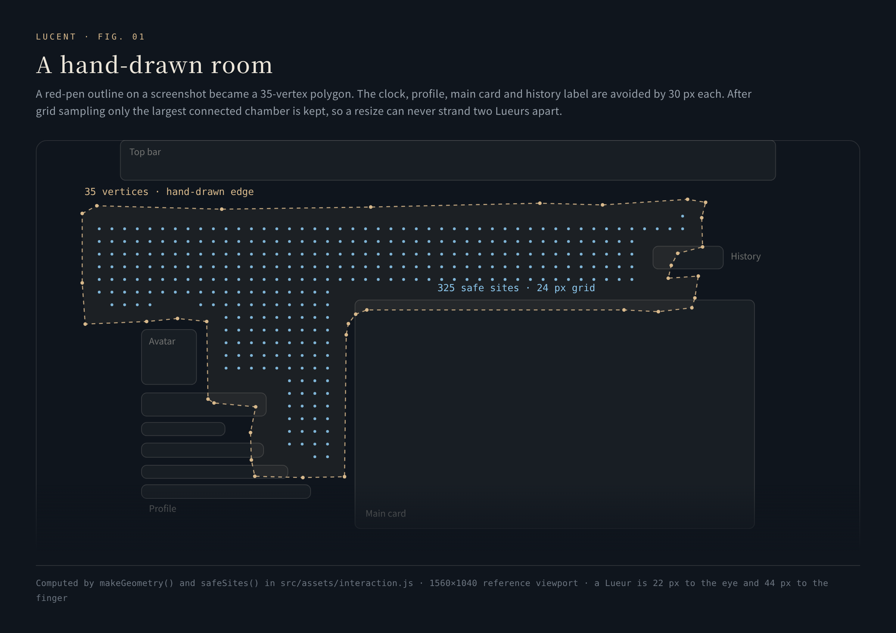
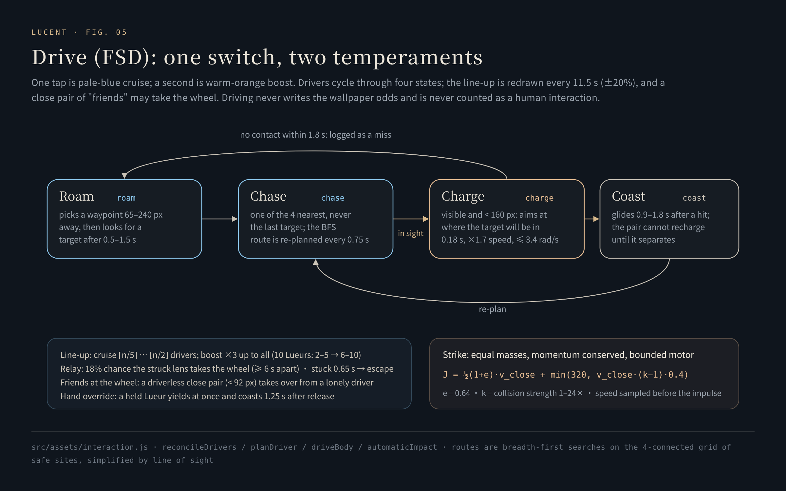
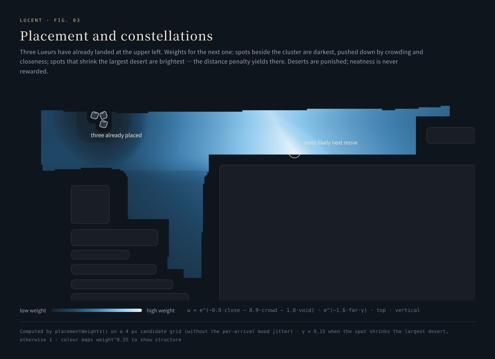

# Lueurs · 小浮光

**Codename: Interaction — from two floating lenses to a small world that moves, meets, and keeps a record.**

[中文](../lueurs.md) · [Back to README](../../README.en.md)

Lueurs are glass lenses in the empty space of the homepage: 22 px to the eye, 44 px to the finger, up to 49 of them. You can drag them, flick them, shove them; on their own they drift, meet and chase one another; and the way you drag them changes the Light/Dark weight of the next wallpaper.

Their standard comes from one sentence of mine: **"HarmonyOS's texture, as I define it, is inspiration and sharpness at once."** The objects should be small, light, liquid-clear and never loud; but edges, movement and the timing of feedback must be exact — a collision should be felt on the frame of contact, not arrive late after you let go.

The whole engine is [`src/assets/interaction.js`](../../src/assets/interaction.js): about 1,100 lines, no dependencies. Every section below is anchored to source lines, and every invariant is checked by [`tests/lueurs-engine.test.cjs`](../../tests/lueurs-engine.test.cjs), which calls the engine's functions directly.

<p align="center"></p>
<p align="center"><sub>Nine Lueurs drifting freely, at double speed. Recorded under a fake clock, frame by frame: every frame is the engine's real state at an exact virtual time.</sub></p>

---

## 1. Space: open room, drawn by hand

<p align="center"></p>

The original request was a red circle on a screenshot. Instead of being replaced by a roughly-right rectangle, it was turned into coordinates:

- **A 35-vertex polygon**, recorded on a 1560×1040 reference viewport and scaled to the real one at runtime ([`REGION`](../../src/assets/interaction.js#L10), [`makeGeometry`](../../src/assets/interaction.js#L178-L191)).
- **Clearance from the real DOM**: the clock and buttons, the avatar and profile card, the main card and the history tag are each inflated by 30 px — half of a 44 px touch target plus 8 px of breathing room ([`CLEARANCE`](../../src/assets/interaction.js#L28)). The distance to the polygon's own edge is held to 30 px as well.
- **Safe sites**: a 24 px grid (two lens diameters plus 2 px) is flood-filled four-connected, and **only the largest connected chamber is kept** ([`safeSites`](../../src/assets/interaction.js#L244-L272)). After a resize, a late font load or a longer profile, Lueurs can never be split between two pockets that do not connect. At 1560×1040 the space holds 325 safe sites.
- **Timing of entry**: the profile card and the main card animate in; the engine waits until those animations end and the rectangles settle before the first placement ([`refresh`](../../src/assets/interaction.js#L883-L920)), or the clearance would measure the wrong positions.

## 2. Motion: a heading with memory

Left alone, a Lueur does not re-roll its direction every frame. It runs a five-stage pipeline ([`tick`](../../src/assets/interaction.js#L749-L819)):

**① Heading: an Ornstein–Uhlenbeck mean-reverting process.** The turn rate decays exponentially and noise enters with √Δt:

```math
\omega \leftarrow \omega\, e^{-1.8\,\Delta t} + 1.6\,\xi\sqrt{\Delta t},\qquad \theta \leftarrow \theta + \omega\,\Delta t,\qquad \xi \sim U(-\tfrac12, \tfrac12)
```

Direction therefore has memory and inertia, and turns are unhurried ([L787-L788](../../src/assets/interaction.js#L787-L788)).

**② Velocity relaxation.** Velocity approaches the cruising velocity along the heading exponentially, with a time constant of about 0.77 s — slowed to about 1.4 s right after a scatter so the turn is softer ([L789-L792](../../src/assets/interaction.js#L789-L792)):

```math
\mathbf v \leftarrow \mathbf v + \big(\mathbf c(\theta)\cdot p - \mathbf v\big)\big(1 - e^{-k\,\Delta t}\big),\qquad k = 1.3\ \text{or}\ 0.7
```

The horizontal component of the cruise vector is 4/3 of the vertical one — the open space is a horizontal band, so the swimming should stretch sideways too ([`MOTION`](../../src/assets/interaction.js#L12)). `p` is the user's natural pace, 0.25×–16×.

**③ Sub-stepped movement.** Each frame's displacement is cut into steps of at most 4 px, each checked for legality and contact ([`advance`](../../src/assets/interaction.js#L193-L211)). At any frame rate and any drag speed, nothing passes through another lens or out of bounds.

**④ Contact response** — see the next section.

**⑤ A soft boundary.** When a step would leave the region, the lens first tries to slide along x or along y alone (sliding is less intrusive than bouncing); if both are blocked, that velocity component reverses and is damped to 0.65, and the heading resets ([L796-L801](../../src/assets/interaction.js#L796-L801)).

Altogether: **a damped, correlated random walk with inertia, memory and an awareness of its neighbours.**

## 3. Contact: felt the moment it happens

The first round of on-device feedback reshaped the whole motion system: a press on the touchscreen showed a white frame; while one lens was held, the other should not freeze; a hit should not wait until release to appear. The rules now:

**Equal-mass impulses with restitution e = 0.64** ([`resolveImpact`](../../src/assets/interaction.js#L72-L81)). When two free lenses collide:

```math
J = \tfrac12 (1+e)\, v_{\text{rel}}\cdot\mathbf n,\qquad \mathbf v_a \mathrel{-}= J\mathbf n,\quad \mathbf v_b \mathrel{+}= J\mathbf n
```

Momentum is conserved exactly and the normal relative velocity reverses to −0.64 of itself — the test checks 2,000 random collisions one by one.

- **A held lens is kinematic.** The one under your finger pushes but never yields: it hands the other the impulse multiplied by the collision strength k (1–24×). A lens drifting into it bounces off, but never moves your finger ([L670-L681](../../src/assets/interaction.js#L670-L681)).
- **Settle with this moment's velocity.** While dragging, a collision uses the velocity of the current `pointermove`, not the previous one ([L960-L962](../../src/assets/interaction.js#L960-L962)); leftover velocity after an 80 ms pause is cleared, so a release never flings.
- **Energy enters once.** Only an active push — a hand, or a charging driver — adds energy; between free lenses the impulse passes on once at the original restitution, so **a chain of collisions is never amplified step by step**. Speed is capped at 640 px/s and non-finite values are zeroed ([`limitVelocity`](../../src/assets/interaction.js#L67-L71)).
- **Natural meetings must separate.** With strength at 24, natural collisions still only flashed and the Lueurs stayed jammed together — proof that "a hard flick" and "a meeting that breaks up" are different things. So a new slow contact gets its separation speed topped up:

```math
v_{\text{sep}} = 14 + 7\cdot\max\big(1,\ k\cdot s\big),\qquad s = 0.30,\ 0.36,\ 0.42\quad(\text{2, 3, ≥4 lenses nearby})
```

The more crowded, the stronger the urge to disperse; pairs already separating fast get no extra energy; a 0.28 s cooldown prevents jitter ([`naturalResponse`](../../src/assets/interaction.js#L47-L61)).

- **Scattering by a weighted deflection cost.** After a collision, a lens tries eight deflections {0, ±0.6, ±1.2, ±2.1, π} around the direction away from its neighbours. Each candidate scores "clearance 24 px ahead (capped at 100) − 7 × |deflection|", and the best wins ([`scatterHeading`](../../src/assets/interaction.js#L530-L556)). With three or more lenses around, a little sideways velocity is added toward the open side.
- **Pick the nearest one.** When two lenses touch, their invisible 44 px touch areas overlap; a press selects the visible lens closest to the fingertip, not whichever sits on top in the DOM ([L933-L937](../../src/assets/interaction.js#L933-L937)).

## 4. Probability: an invisible terrain

<p align="center"></p>

The idea came from the gradient-descent picture in a statistical-learning class: let the movement of a hand decide the next wallpaper's balance of light and dark. It became an invisible terrain Φ ([`potential`](../../src/assets/interaction.js#L213-L219)):

```math
\Phi(u,v) = 0.66\,(u-\tfrac12) - 0.25\,(v-\tfrac12) + 0.10\sin\!\big(2\pi u + 1.1\sin\pi v\big) + 0.075\cos\!\big(2.8\pi v - \tfrac12\pi u\big)
```

One main slope makes the feel learnable; two sinusoidal ripples keep it a little unpredictable up close. While dragging, the change in the odds is a weighted sum of four terms ([`modelProbability`](../../src/assets/interaction.js#L233-L242)):

```math
\Delta = 0.62\,\Delta\Phi + 0.20\,\frac{\Delta d}{\text{span}} + 0.13\,\mathrm{clamp}\!\Big(\frac{\vartheta}{1.5\pi}, -2, 2\Big) + 0.05\,\Delta\Phi_{\text{partner}}
```

```math
P = \mathrm{clamp}\Big(P_0 + \mathrm{clamp}(\Delta, \pm 0.35),\ \min(0.05, P_0),\ \max(0.95, P_0)\Big)
```

- **ΔΦ**: the height travelled on the terrain; **Δd**: the change in distance to a reference lens; **ϑ**: the angle wound around that reference — unwrapped with `atan2(sin, cos)`, so one full circle accumulates exactly 2π (tested to 1e−9, [`sampleModel`](../../src/assets/interaction.js#L225-L231)); **ΔΦ_partner**: how far the lens you hit moved on the terrain.
- **The reference is chosen when the gesture starts**, so it does not jump if another lens becomes nearest mid-drag.
- **Continuous from where you are**: after setting the odds to 0% or 100% by hand, a drag does not first snap back to 5% or 95%. One gesture changes the odds by at most ±0.35; the steepest point of the terrain is about 0.0026 per pixel — no cliffs.
- **Only a person writes probability** — by dragging, or by moving a lens with the arrow keys. Drifting, Drive and encounters never do. The change commits on release; `68 : 32` is a drawing weight, not a promise of 68 Light wallpapers in the next hundred.

This is not machine learning: the weights are a hand-designed mapping. Gradient descent lent the imagery — terrain, inertia, convergence — not a trained model. My words at the time: "I don't need a model I fully understand; a black box is fine." So the panel carries a card, 黑箱里，灵感怎样发生 (*inside the black box, how inspiration happens*), that explains each layer in a few restrained paragraphs.

## 5. Autonomy: Drive (FSD)

<p align="center"></p>

Tap the planet and an FSD button slides in on the left, fading away if left untouched for 4.25 s. One tap is pale-blue cruise, a second is warm-orange boost, a third turns it off. The chosen Lueurs become drivers — bumper cars, the catfish that keeps the field moving.

- **The line-up** ([`autoBounds` / `rageBounds`](../../src/assets/interaction.js#L83-L94)): cruise picks a random ⌈n/5⌉ to ⌊n/2⌋ drivers, at least one; boost triples that, capped at the whole field (with 10 lenses, 2–5 becomes 6–10). It is redrawn every 11.5 s (±20%); paused time is frozen, not made up.
- **Routing**: safe sites form a four-connected grid whose edges exist only with line of sight; routes between targets use breadth-first search and are then pulled straight by line of sight, keeping only necessary corners ([`navigationGrid` / `routeBetween`](../../src/assets/interaction.js#L281-L317)).
- **Chasing**: a target is chosen at random among the 4 nearest, never the previous one — meetings are frequent but the guidance is never perfect ([`planDriver`](../../src/assets/interaction.js#L436-L455)). The route is recomputed every 0.75 s.
- **Charging**: when the target is visible and within 160 px, the driver charges at where the target will be in 0.18 s, at 1.7× speed, turning no faster than 3.4 rad/s, with a small time-varying offset so a charge sometimes misses ([`driveBody`](../../src/assets/interaction.js#L486-L528)). No hit within 1.8 s counts as a miss.
- **Impact**: equal mass, recoil on both sides; on top of the restitution impulse comes a bounded motor impulse ([`resolveAutoImpact`](../../src/assets/interaction.js#L151-L160)):

```math
J = \tfrac12(1+e)\,v_{\text{close}} + \min\big(320,\ v_{\text{close}}\,(k-1)\cdot 0.4\big)
```

  The relative speed is sampled before the impulse and written to the chronicle's strength histogram. A pair is not recharged until it has separated.
- **Relay**: the lens that was hit takes the wheel with probability 18% (at least 6 s between relays). **The close friend takes the wheel** (密友得舵): two driverless lenses that stay within 92 px of each other can take over from a lone driver, keeping the number of drivers unchanged ([`reconcileDrivers`](../../src/assets/interaction.js#L383-L414)).
- **Unsticking and yielding**: a driver that barely moves for 0.65 s escapes toward a waypoint 65–240 px away; a lens you grab gives up driving at once and coasts for 1.25 s after release before rejoining.

## 6. Encounters: making natural meetings into events

When two freely drifting Lueurs enter the circle, an encounter is adjudicated ([`scanEncounters`](../../src/assets/interaction.js#L557-L594)):

| Parameter | Value |
|---|---|
| Circle | 150 px (about 6.8 body lengths) |
| Becomes an event | 70% |
| Bump / dodge | 50 / 50 |
| Bump | rush the other at 2.4× cruise speed for 1.4 s |
| Dodge | leave along one of 5 legal deflections at 1.7× speed for 1.3 s |
| Cooldown | 9 s after an event; 3 s if none |
| Concurrent events | at most 3 in the field |
| Scan rate | every 0.18 s |

The circle was 110 px at first, with a 9 s cooldown. In use, I felt that "the 70% doesn't seem to happen." A probe script showed the adjudication was right; the bottleneck was **the chance to meet at all**: placement works hard to spread the Lueurs out, so two of them came within 110 px only a dozen times a minute. The fix was to supply more chances: the circle grew to 150 px (about 1.86× the area) and the cooldown after a non-event shrank to 3 s. It left a method behind: **"what a parameter is" and "under what conditions it even gets a chance to act" are two different questions.**

Encounters only happen between Lueurs in their natural state; they never write odds and never count as interaction.

## 7. Stones and constellations

<p align="center"></p>

Each time the homepage opens, the Lueurs are placed one by one by weighted lottery ([`placeBody`](../../src/assets/interaction.js#L842-L881), [`placementWeights`](../../src/assets/interaction.js#L95-L143)). The aim is neither uniform nor clustered, but a field that holds itself up:

```math
w(s) = \exp\!\big(-0.8\,\text{close} - 0.9\,\text{crowd} - 1.8\,\text{void}^{+}\big)\cdot \exp\!\big(-1.6\,\text{far}\cdot\gamma\big)\cdot \text{top}(s)\cdot \text{vertical}(s)
```

- **close**: how far the nearest neighbour falls below 120 px — closeness can be tolerated now and then, so its penalty is the mildest; **far**: how far the nearest neighbour lies beyond 220 px; **crowd**: neighbours within 76 px, minus one; **void⁺**: after this placement, how far the largest remaining desert (the point farthest from any lens) exceeds 220 px — the heaviest penalty.
- **The far penalty makes way for deserts**: if a candidate clearly shrinks the largest desert, the far penalty counts only 15% (γ = 0.15). This came from a "case conference": a candidate that fills a desert is necessarily far from the group, so the two penalties multiplied each other away on the very same candidate, and the gap-filling rule had never actually worked.
- **The top edge is a plateau, not a slope**: the upper 38% of the region is weighted ×2 with a 48 px cosine feather; in the upper half, every bit of added vertical spread earns up to 35% more. My words at the time: "I never said the higher the better — just don't let too many sink down; it looks collapsed."
- **Mood**: before each placement a fresh set of jitters is drawn — close 0.85–1.15, far 0.85–1.30, desert 0.90–1.15, top 0.85–1.15; with probability 35%–80% (lower when the desert is large) the placement enters a "settlement draw" and lands in a 120–220 px ring around an anchor, with anchors weighted by isolation so a lone lens tends to attract company. This randomness keeps placement from settling into a few fixed forms.

In one line: **punish deserts, never reward tidiness.** Over 12 rounds of 8 lenses, the median empty radius fell from about 345 px to 250 px, and the worst case from 651 px to 387 px. The target distribution was summed up as: stretched wide, denser above, grained vertically, clusters and singles together, friends now and then, every round different, drama where it is dense.

## 8. Identity: forty-nine fixed residents

`#01–#49` are a fixed cast. Each visit draws n of the 49 without replacement ([`drawIdentity`](../../src/assets/interaction.js#L1006-L1011)) — not the first n. Only when you grab a lens does its number surface: 8.5 px rounded numerals at 0.45 opacity, tilted −7°, with a one-stroke cap at its upper right (`M2.2 1.2 Q8.2 2.8 8.8 8.6`). The badge went through five versions; the goal was "nearly invisible unless you look."

Every resident's appearances, time present, hits, times hit, dodges, driving and relays are written to [the field chronicle](chronicle.md).

## 9. Lifecycle and performance discipline

- **One frame loop.** Every frame while dragging or driving (≥ 15 ms per frame), about 30 Hz when idle (32 ms); a single frame's Δt is capped at 50 ms ([L754-L755](../../src/assets/interaction.js#L754-L755)).
- **Stop when it should.** When the page is hidden or left, a sheet opens or the host is not ready, everything pauses and any gesture ends; coming back from the background re-measures the layout; returning from the back-forward cache re-places the field ([`syncState`](../../src/assets/interaction.js#L821-L831)).
- **Follow the layout.** Window resizes, scrolling, font loads and changes in the card's size (`ResizeObserver`) trigger a re-measure and, when needed, a re-placement.
- **Accessibility.** Each Lueur is a button: the arrow keys move it 16 px, Shift + arrow 48 px, through the same probability model; with reduced motion the frame loop stops and Drive is off.

## 10. Parameters and three layers of defaults

| Parameter | Range | Curve |
|---|---|---|
| Number of Lueurs | 0–49 | Piecewise power: 8·(2t)^1.3 on the first half of the slider, 49·t^2.6 on the second — the middle is 8, because most of the time you stay with small numbers |
| Collision strength | 1–24× | Logarithmic slider; "randomize on launch" draws log-uniformly, so every multiplicative interval is equally likely |
| Natural pace | 0.25–16× | Logarithmic slider, 0.25·64^t |
| Wallpaper odds | 0–100% | Light : Dark drawing weight |

Current values, custom defaults and the factory baseline are three separate layers: try anything now, keep a combination you like, and always be able to return to the factory baseline (2 Lueurs, Light 71%, strength 11.6×, pace 2.41×, randomize on launch off).

## 11. Verification

[`tests/lueurs-engine.test.cjs`](../../tests/lueurs-engine.test.cjs) holds 13 tests, all calling the engine's functions directly:

- 2,000 random collisions conserve momentum and reverse the normal velocity by e = 0.64; a held lens never recoils
- Natural collisions top up separation only for slow contacts, fast chains get no energy; the FSD impulse is bounded
- Speed is capped at 640 px/s and non-finite values become zero
- 300 random moves: every step ≤ 4 px and every position inside the legal region
- Safe sites form one connected chamber; every segment of 120 random routes has line of sight
- The probability model starts continuously and changes by a bounded amount per gesture; one full circle accumulates 2π
- The potential has the right main slope and is smooth; placement weights punish the cluster's side and favour the largest desert
- Driver line-up bounds, and slider curves that round-trip

These tests prove the rules themselves; they do not replace the feel under a finger. That came from on-device feedback, version after version, across 109 versions.
