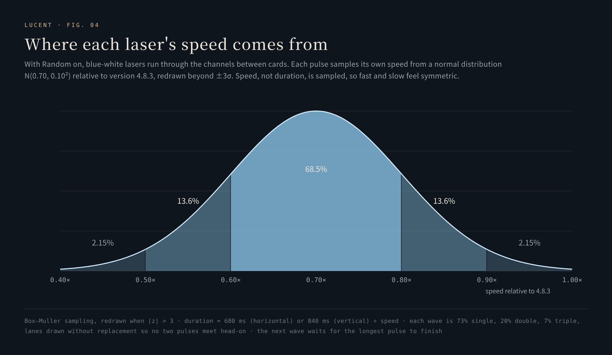

# 念起，光行 · A thought, in flight

**A line of text, becoming a beam of light.**

[中文](../motion.md) · [Back to README](../../README.en.md) · [The atelier, live](https://hydeclanspi.github.io/Lucent-Next/atelier/)

---

The moment of a search is usually nothing at all: press Enter and the page is gone. Lucent treats that moment as something to design. It starts from the words you just wrote, passes through a transformation with cause and effect, and ends at the blue arrow that actually hands the search over. Only when the light reaches the arrow does the search depart.

Every motion completes within 320–480 ms.

## 1. The atelier: six from sixteen

Before anything entered the product, there was a standalone [atelier](https://hydeclanspi.github.io/Lucent-Next/atelier/) of sixteen studies in four families:

| Family | Four studies |
|---|---|
| The speed of light | Lightline · Focal point · Microprism · Shutter |
| The order of letters | Letterflow · Quiet attraction · Paperlight · Afterimage |
| The breath of materials | Platinum filament · Through the eye · Liquid caustic · Silk of dusk |
| The spirit of the Lueurs | Comet seed · Near orbit · A narrow passage · Final stroke |

In the atelier you can play with Enter or the arrow, replay each study on its own, type once into every card, scrub the main stage frame by frame, slow to 0.35×, switch between dawn and dusk, walk through them in order, and keep your own picks. With reduced motion, a short fade replaces every study.

Six were chosen for the product and **kept their atelier numbers**: 01 · 03 · 04 · 09 · 10 · 14.

## 2. The six

| No. | Name | Duration | In a line | What happens |
|:-:|---|:-:|---|---|
| 01 | 一线入光 *Lightline* | 360 ms | Words become light, arriving as a single line. | The text is first pressed vertically into a baseline, then flies to the arrow with a cubic ease-in, while three layers of beam are drawn — a 4.2 px glow, a 1.15 px core and a 0.42 px ink line — the beam's head arriving with an ease-out |
| 03 | 微棱 *Microprism* | 400 ms | Cool and warm split apart, and meet at the end. | Each character separates into an ice-blue and a warm-gold dispersion channel, offset in opposite directions, which converge at the arrow; a small prism opens and closes at the end |
| 04 | 快门 *Shutter* | 320 ms | One exposure, and a clean departure. | The line is cut into three horizontal slices that start 3.5% apart, sheared by a pulse and squeezed 93% vertically, like the blades of a shutter sweeping across |
| 09 | 铂丝 *Platinum filament* | 460 ms | Fine filaments of light, woven gently in. | Each character draws out its own filament along a sine-arched path into the arrow, alternating above and below; every third filament is thicker and warm |
| 10 | 穿针 *Through the eye* | 440 ms | Drawn into a thread, through a glint of light. | The text is squeezed to 2.6% of its height and stretched 10% wide, then threaded along a quadratic Bézier curve through the "eye" of the arrow; each segment's length follows the width of its character |
| 14 | 近轨 *Near orbit* | 480 ms | Two close arcs, meeting at the arrow. | Characters fly on two half-ellipse orbits, above and below in turn, shrinking to 2%, with every third trailing a tail of light |

All six share an ending: a cross-shaped glint at the arrow, and a gold ring around the arrow that rises and falls within the final 30% of the motion (`--search-arrival = 0.75·sin(π·(p − 0.7)/0.3)`).

## 3. Every frame is a pure function of progress

A renderer's signature is `renderer(ctx, state, t)` with `t ∈ [0, 1]` ([`search-motion-renderers.js`](../../src/assets/search-motion-renderers.js)):

- `t ≤ 0` draws the text as it was; `t ≥ 1` draws nothing — the canvas is clean at the hand-off.
- Renderers never read the time and never call a random function. The same `t` always draws the same frame.
- Easing uses only a few primitives: `smoothstep`, cubic ease-in and ease-out, an interval map `phase(t, a, b)`, and a sine envelope.

That buys three things directly: **slowing down** (0.35× simply divides the duration by 0.35); **reversing** (the first simulated shot flies back along its path — see section 7); and **frame-by-frame testing** — [`tests/motion-renderers.test.cjs`](../../tests/motion-renderers.test.cjs) uses a recording 2D context to draw the six renderers twice each across 3 texts × 1,201 progress points = 21,618 states, asserting that every coordinate is finite, `save` / `restore` balance, the two passes issue identical drawing commands, the first frame is the original text, the last is empty, and burst mode draws only the light path, never the text. The atelier's sixteen renderers went through the same check at the time, over 38,784 progress states.

## 4. The player

[`search-motion.js`](../../src/assets/search-motion.js) places an animation safely over the real search field:

- **Measure the real text.** It reads the field's computed font, letter spacing, padding and current horizontal scroll; only characters visible inside the field take part.
- **Split by grapheme.** Chinese, emoji and combining characters are split with `Intl.Segmenter('zh', { granularity: 'grapheme' })`, so an emoji is never broken in two ([L44-L45](../../src/assets/search-motion.js#L44-L45)).
- **One canvas, one loop.** The canvas covers the field and extends 54 px above and below to leave room for the light; device pixel ratio is capped at 2.
- **Never block the search.** A renderer error, a hidden page or an unloading page ends the animation at once and hands control back; and a timer at "duration + 100 ms" stands behind it all — even if a host WebView pauses frame callbacks while navigating, the search is sent exactly once ([L89-L93](../../src/assets/search-motion.js#L89-L93)).
- **With reduced motion**, nothing plays; the search simply departs.

## 5. The submit flow

Enter and the arrow go through the same form submission ([`bindMainSearch`](../../src/assets/app.js#L4809-L4908)):

- Enter during IME composition goes to the input method and never triggers a search; empty input never departs; a submission in flight is never repeated.
- Navigation happens only when the animation ends; just before it, the field's value and default value are cleared, so it is clean when you come back; if navigation fails, the text returns to the field.
- The motion can be turned off (搜索直接出发, *search departs directly*) or set to Random, a different motion each time.

## 6. Random: platinum rings and blue-white lasers

Turn on Random and the area where you choose a card becomes a circuit board:

- **Platinum lettering and a metal switch.** The word *Random* is three gradients clipped into the text — a 135° platinum base, a 45° diagonal reflection, and a 3×2 px elliptical highlight; the switch track is a brushed gradient from gold to platinum.
- **Champagne conduits.** In every gap between two cards run two 1 px champagne dashed lines (`#B49560 → #FFF2CF → #FFFFFF`) with a 1.4 px ice-blue halo, flowing with a 1.1 s period horizontally and 1.3 s vertically. Phases are offset by card index (−0.43 s, −0.79 s), so the circuit never moves in lockstep.
- **Blue-white lasers.** Pulses of light 1.3 × 100 px (`#69ACFF → #B4DDFF → #FFFFFF`) with a blue glow, running only in the channels between cards.

Scheduling the lasers is a small algorithm of its own ([`scheduleLaser`](../../src/assets/search-motion-panel.js#L86-L150)):

1. **Lanes from the real layout.** Before each wave, lanes are computed from the cards' actual positions: horizontal lanes between rows, vertical lanes between columns. With two columns, horizontal lanes share a weight of 0.7 and vertical lanes 0.3; with one column there are only horizontal lanes.
2. **Wave size.** One beam 73% of the time, two 20%, three 7% — never more than there are lanes.
3. **Lanes without replacement.** Lanes are drawn by weighted roulette and removed once chosen, so two beams in one wave never meet head-on in the same channel.
4. **Direction.** Horizontal beams go either way, fifty-fifty; vertical beams run upward with probability 4/30 only.
5. **Speed.** Each beam is sampled independently from a truncated normal N(0.70, 0.10²) relative to version 4.8.3, generated with the Box–Muller transform and redrawn when |z| > 3. What is sampled is a speed, not a duration: duration = 680 ms (horizontal) or 840 ms (vertical) ÷ speed. About 68.5% land in 0.60–0.80, 27.2% in 0.50–0.60 or 0.80–0.90, and 4.3% at the two ends.
6. **Wait for the last wave to land.** The next wave leaves after 1.53–3.17 s, and never earlier than 90 ms after the slowest beam of the previous wave ends.
7. **An opening choreography.** 275 ms after Random turns on, three lanes leave at once: the vertical gap top to bottom, the second horizontal gap right to left, the first horizontal gap left to right.

Scheduling pauses while the page is hidden; with reduced motion neither conduits nor lasers appear.

## 7. Simulated launch

Random and the simulated launch together: the first shot is a rehearsal and comes back; with Enter held, each shot takes a different gesture and the words leave with the light.

A launcher that only sends you away is a door. At the top right of the panel sits a switch for an endless simulated-launch loop — an easter egg that lasts only for this visit ([`search-simulation.js`](../../src/assets/search-simulation.js)). With it on, the homepage's search field launches light and never sends a search, and the base closes the loop on itself:

- **The first shot flies back.** If the field is empty, a random line rises in over 180 ms (one of them is 念起，光行). The first shot is a rehearsal: it flies out along its path and plays back in reverse, and every character lands exactly where it was — the dividend of renderers being pure functions. Every shot after it takes the words away with the light.
- **Hold Enter for bursts.** Hold for more than 280 ms, or press twice less than 300 ms apart, and it bursts: each shot is 160 ms, starting from the moment this motion's light first appears, drawing only the light path and never the text — the same canvas and the same frame loop, with no re-measuring, no detaching nodes and no toggling of read-only state during a burst.
- **Demand is one bit.** Pressing again while a shot is in flight records only "one more", never an ever-growing queue.
- **Honest about keyboards.** Some keyboards emit pairs of keydown and keyup while auto-repeating, so after a keyup it waits 80 ms before deciding the key was really released. Typing, composing, losing focus or hiding the page cancels at once; leaving the page or returning from the back-forward cache ends the mode.

This controller touches no storage and calls no host interface.

## 8. Verification

- [`tests/motion-renderers.test.cjs`](../../tests/motion-renderers.test.cjs): determinism of the six renderers over 21,618 states, the first and last frames, and burst mode.
- [`tests/browser.cjs`](../../tests/browser.cjs): Lightline plays before navigation; queries with Chinese, spaces, symbols and emoji are encoded correctly; the field is empty after returning; Enter during composition and blank input never navigate; with reduced motion the search departs directly.
