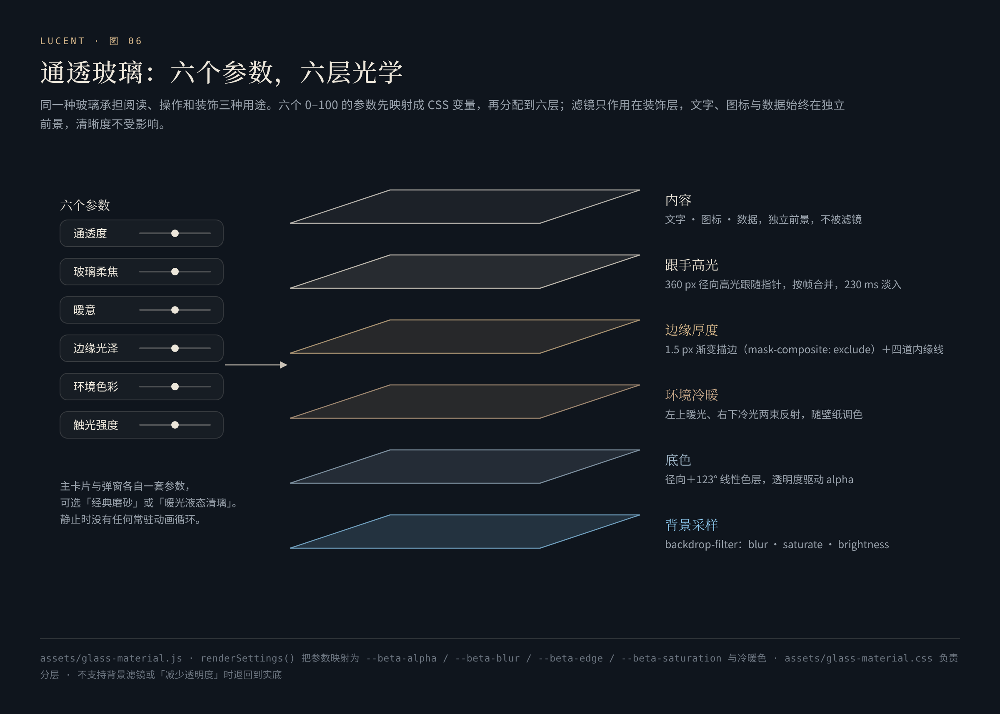
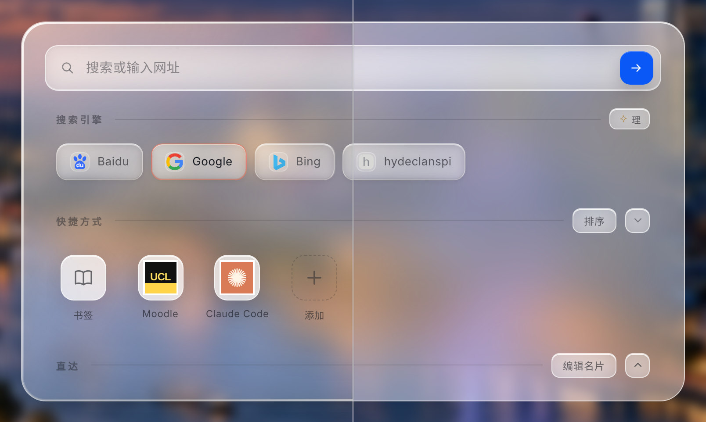

# 通透玻璃与设计语言

**轻盈、通透、犀利——同一种玻璃，承担阅读、操作与装饰。产品的名字也来自它：Lucent，意为透光、生辉。**

[English](en/glass.md) · [返回 README](../README.md)

---

## 1. 一种玻璃，三种用途

| 用途 | 在哪里 | 要求 |
|---|---|---|
| 承载阅读的面板 | 主卡片、名片编辑、代号：交互、历史统计、备份与导出 | 中心保留可控的柔化与亮度底，边缘体现厚度，文字区域安定 |
| 承担操作的薄玻璃 | 顶栏按钮、FSD、壁纸开关、历史记录菱形标签 | 轮廓更清楚、面更薄；选中、焦点、按下三种状态都可辨认 |
| 留白里的浮光 | 49 枚小浮光 | 22 px 的薄片：受光边、背光边、一道短线高光；碰撞时一闪即逝的折光 |

更大的模糊半径或更低的透明度，并不会自动产生更真实的玻璃。真正决定质感的，是把中心透光、边缘厚度与文字保护分开控制。

## 2. 六个参数，六层光学

主卡片与弹窗各自一套参数，可选「经典磨砂玻璃」或「暖光液态清璃」。六个参数都是 0–100，50 为设计中点；下表的参数名与界面一致（[`glass-material.js`](../assets/glass-material.js#L40-L59)）：

| 参数 | 映射 | 0 / 50 / 100 |
|---|---|---|
| 通透度 | `--beta-alpha = 1.55 − 0.011·x`，作用于底色与反射的不透明度 | 1.55 / 1.00 / 0.45 |
| 玻璃柔焦 | `--beta-blur = base·(0.4 + 0.012·x)`，主卡片 base 18 px、弹窗 26 px | 0.4× / 1.0× / 1.6× |
| 暖意 | 调色板向中性灰（冷）或向暖色（R+2、G−1、B−6）插值 | 中性 / 原色 / 暖 |
| 边缘光泽 | `--beta-edge = 0.2 + 0.016·x`，作用于描边与内缘线 | 0.2 / 1.0 / 1.8 |
| 环境色彩 | 饱和度在 100% 与基准之间插值；浅色主卡 132%、弹窗 124%，深色 124% / 122% | 100% / 基准 / 2×基准−100% |
| 触光强度 | 跟手高光强度 `x / 50` | 0 / 1 / 2 |

六层自下而上（[`glass-material.css`](../assets/glass-material.css)）：

1. **背景采样**：`backdrop-filter: blur() saturate() brightness()`，浅色亮度 ×1.13、深色 ×0.88——一次必要的柔化，不叠加第二次。
2. **底色**：一个偏离中心（46% 45%）的径向色层 + 一道 123° 的线性色层，三个色调随冷暖参数调色，不透明度由透明度参数驱动。
3. **环境冷暖**：左上角一束暖光（72%×52% 椭圆）、右下角一束冷光（70%×62% 椭圆）、再加一道 116° 的面反光。浅色壁纸与深色壁纸用不同的冷暖色，让玻璃「接到」壁纸里的天光。
4. **边缘厚度**：1.5 px 的渐变描边——七个色标沿 130° 排开，左上最亮、右下次亮、中段收暗——用 `mask-composite: exclude` 挖空中心，只留一圈；再加四道内缘线：顶 1 px 亮线、左 1 px 弱亮线、底 1 px 暗线、内圈 2 px 的极淡光晕。整圈不同等亮度，厚度由此而来。
5. **跟手高光**：直径 360 px 的径向高光跟随指针，淡入 230 ms。
6. **内容**：文字、图标、数据留在独立前景（`z-index: 1`），滤镜只作用在装饰层——文字永远清晰。

左：暖光液态清璃 · 右：经典磨砂玻璃

## 3. 事件驱动，静止时为零

- 指针进入、移动、按下时只记录坐标并标记「脏」；一帧最多写一次 `transform`（[`flush` / `track`](../assets/glass-material.js#L116-L150)）。鼠标只有在支持悬停的精确指针下才点亮；触屏只跟随按下的那根手指。
- 离开、取消、滚动、失焦、缩放、页面隐藏时立刻熄灭；静止时**没有任何常驻动画循环**。
- 弹窗的高光画在弹窗自己的背景上（`--beta-touch-x/y`），而不是一个子元素——背景没有布局盒，滚动时不会把高光带进边缘，也不会撑大可滚动区域。
- 弹窗换页时会替换子节点，`MutationObserver` 负责清理旧的高光层、只保留一份；页面卸载时断开所有观察者与监听（[L199-L240](../assets/glass-material.js#L199-L240)）。

**退路**：浏览器不支持背景滤镜时退回 96% 不透明的实底；系统开启「减少透明度」时同样使用实底；开启「减少动态效果」时不显示跟手高光。

## 4. 版面

1560×1040 的平板横屏是设计参照，窄屏有独立的排布。

- **左：名片。** 104 px 头像（平板横屏），外围一圈 14 秒旋转的锥形渐变光环（`conic-gradient`，暖橙到樱粉）与一层 6 秒呼吸的光晕；名字是 100° 的暖色渐变，9 秒流光；下方依次是状态胶囊、签名、徽章（等级、主题、平台）与标签。
- **右：主卡片。** 搜索框、搜索引擎、快捷方式、直达四段，每段可折叠；右下角一行日志（「wilson vibes only.」），长按编辑，按秒留档。
- **主卡片右上：历史记录菱形标签。** 只有框体按 −14° 斜切（`skewX`），图标和文字保持直立。
- **顶栏。** 左侧时钟与问候（「上午好，慢慢来」），四枚操作胶囊，唯一的蓝色是「搜索」；右侧是 FSD、星球、扫一扫、太阳四枚图标。

## 5. 图标

所有图标都是线描矢量，不使用系统 emoji。

- **星球入口**：玻璃球体加一圈倾斜 23.5° 的光环——和地轴倾角相同；光环在球后的半圈压暗，在球前的半圈提亮，入口由此有了前后。
- **FSD 字标**：不是打印出来的三个字母。高 F 居左，S 在右上、D 在右下，F 的中横末端点一粒「主动浮光」火星；23×23 px，运行时继承蓝 / 橙两种状态色。
- **六款动效字形**：每款搜索动效在卡片右侧有一枚线描字形——一线、棱镜、快门、交织的光丝、针眼、两道近弧——主体用金色，抵达的那一笔用蓝色。
- **编号小帽**：抓住浮光时编号右上角的一笔弧线（`M2.2 1.2 Q8.2 2.8 8.8 8.6`）。
- **快捷方式三种形态**：自动（站点图标）、装框（图标放进一块浅色底板）、首字母牌。首字母牌有 28 种底色，分「清新」16 色与「沉静」12 色两组；字色按底色的亮度自动选择——Rec.601 加权亮度高于 0.62 用深字，否则用白字。
- **落款**：「关于」窗口右下角是作者的亲笔签名。笔画按深浅取 alpha 抠出，金色直接烤进图片，浅色与深色主题各一枚。

## 6. 颜色

颜色各司其职，不被挪作他用：

| 颜色 | 值 | 只用于 |
|---|---|---|
| 鸿蒙蓝 | `#0A59F7` | 唯一的主操作：顶栏「搜索」与搜索箭头 |
| 暖金 | 名字渐变 `#FF6A3C → #FFA14E → #FFD07A`；关于标题 `#DFC47E → #C7A347 → #A9822A`；落款 `#CBAE60` | 身份：名字、头像光环、关于窗口标题与落款 |
| 冰蓝 | 星球 `#BCE5F8`；激光 `#69ACFF → #B4DDFF → #FFFFFF` | 环境、浮光与 Random 的激光 |
| 铂金 | `#EEECE3 → #D3C5A2 → #F0EEE6` | 只在 Random 开启时出现：字样与开关 |
| 暖橙 | `#E8BE94`（深色）/ `#865326`（浅色） | 只属于增强驾驶 |
| 薄荷 | `#408C75` | 「已开启」 |
| 淡杏 | `rgba(245, 201, 155, .45)` | 浮光编号 |

修改搜索强调色不会重新着色整个产品；暖色的名字渐变与引擎描边是有意保留的。

## 7. 字体与文案

- **字体分工**：宋体写标题与诗意的名字（「念起，光行」「落子与星座」），等宽体写编号、读数与英文眉题（「A THOUGHT, IN FLIGHT」「SIX GESTURES」），Georgia 斜体写拉丁名（*Lightline*、*Near orbit*），HarmonyOS Sans 承担界面。
- **数字是排出来的**：比例「68 : 32」用 18 px、字重 520、斜体——HarmonyOS Sans 没有真斜体，浏览器合成的那一点倾斜成了这行数字的性格。
- **文案与功能同级审查**：「备份文本」而不是「存档串」；「查询出厂值」是否会改变当下的状态，必须让人预期得到。面板里的说明卡「黑箱里，灵感怎样发生」用七段克制的文字讲清楚概率、碰撞、驾驶与落位；「关于」窗口的产品自述只有两段：

> 灵感台是一张属于你的主页：时钟与问候开场，个签替你自我介绍，日志记录每刻所念所想，搜索、快捷方式与直达各就各位，壁纸在明暗之间呼吸。
>
> 四十九枚浮光在留白里安身，各自有名；它们相遇、碰撞、结伴巡游，故事都记进场志。不上传、不追踪，一切只留在悄然之间。

## 8. 壁纸

- **两种天光**：Light 是伦敦夜景，Dark 是一幅黄昏插画；可固定一张，也可以按小浮光调出的比例加权随机。
- **柔焦**：0–20%，每 1% 约 1.2 px 模糊（最多 24 px）；Light 默认 4%，Dark 默认清晰。
- **亮度**：50%–100%。Dark 原图在出厂时已压暗到 74%，亮度滑轨以原图为基准换算，不会二次压暗。
- **取景**：两张壁纸各有独立的取景框，按当前屏幕比例计算可见区域，转屏或改变窗口后重新铺设；位图本身从不被改写。

壁纸的明暗与界面的浅色 / 深色是两件独立的事。
