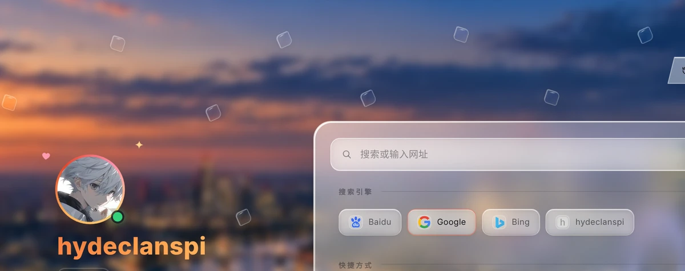
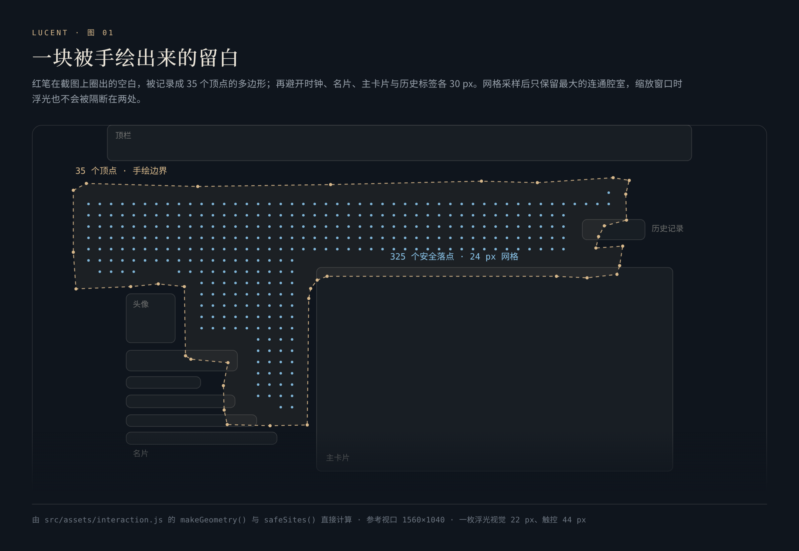
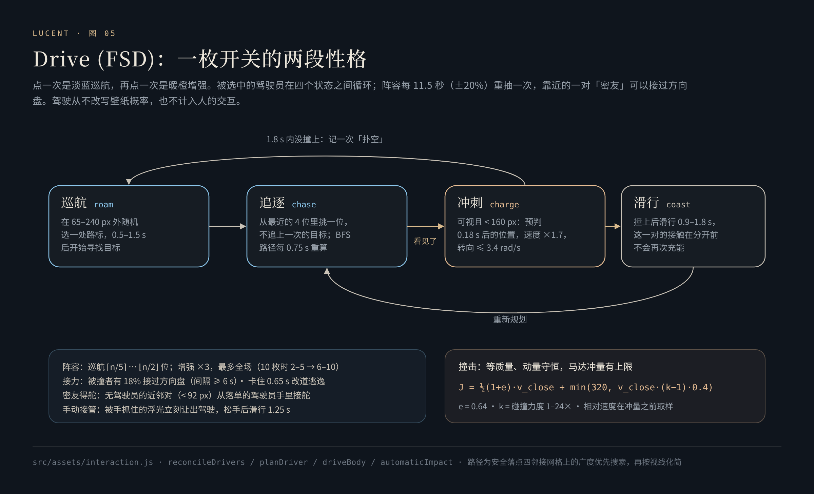
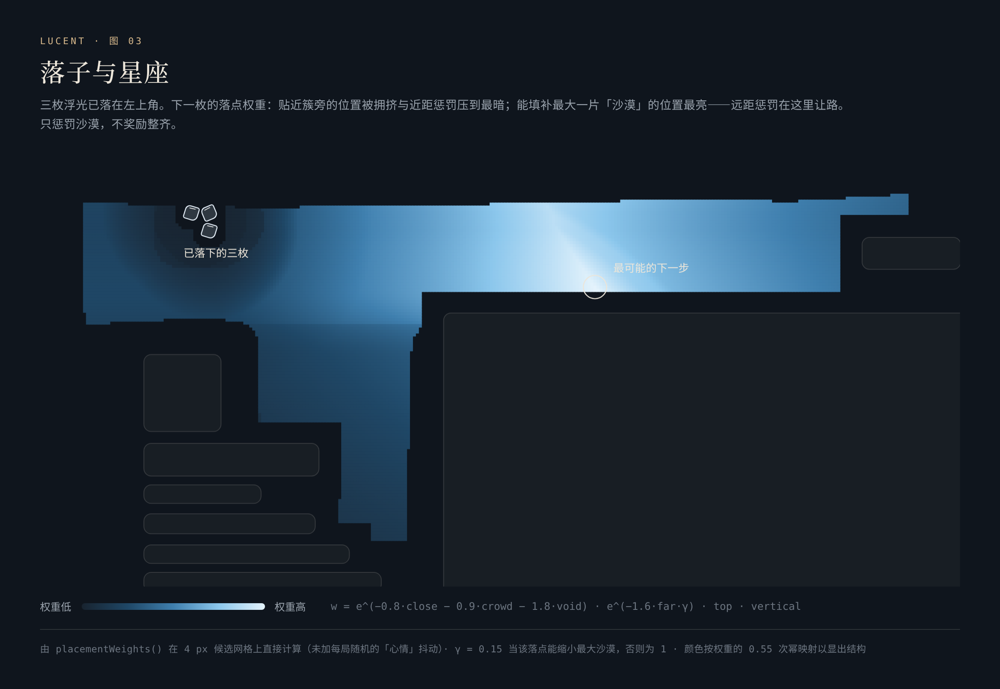

# 小浮光 · Lueurs

**代号：交互 —— 从两枚浮光，到一座会运动、会相遇、会留下记录的小世界。**

[English](en/lueurs.md) · [返回 README](../README.md)

小浮光是灵感台留白里的玻璃透镜：视觉 22 px，触控 44 px，最多 49 枚。你可以拖动、拨动、推挤它们；它们自己漂游、相遇、追逐；拖动的过程会改变下一张壁纸的 Light / Dark 权重。

它的判断标准来自一句话：**「鸿蒙的质感，我定义为灵感与犀利并存。」** 物体要小、要轻、液态通透、不夺目；但边缘、动作与反馈的时机必须清楚——碰撞要在接触的那一帧就被感到。

整个引擎在 [`src/assets/interaction.js`](../src/assets/interaction.js)，约 1,100 行，无依赖。下文每一节都锚定到源码行；所有不变量都由 [`tests/lueurs-engine.test.cjs`](../tests/lueurs-engine.test.cjs) 直接调用引擎函数验证。

<p align="center"></p>
<p align="center"><sub>九枚浮光，自然漂游，两倍速延时。录制时用伪时钟逐帧推进：每一帧都是引擎在一个精确虚拟时刻的真实状态。</sub></p>

---

## 1. 空间：一块被手绘出来的留白

<p align="center"></p>

最初的需求是一张截图上的红笔圈。它没有被「差不多的矩形」替代，而是被坐标化：

- **35 个顶点的多边形**，记录在 1560×1040 的参考视口上，运行时按实际视口缩放（[`REGION`](../src/assets/interaction.js#L10)、[`makeGeometry`](../src/assets/interaction.js#L178-L191)）。
- **避让真实 DOM**：时钟与按钮、头像与名片、主卡片、历史标签，各外扩 30 px——44 px 触控目标的一半，再留 8 px 呼吸（[`CLEARANCE`](../src/assets/interaction.js#L28)）。到多边形边界的距离同样不小于 30 px。
- **安全落点**：以 24 px（两枚浮光的直径再加 2 px）为网格采样，四邻接泛洪，**只保留最大的连通腔室**（[`safeSites`](../src/assets/interaction.js#L244-L272)）。缩放窗口、字体加载完成或名片变长之后，浮光不会被隔断在两个互不相通的区域里。在 1560×1040 下，这块留白有 325 个安全落点。
- **入场时机**：名片和主卡片有入场动画；引擎等这些动画结束、矩形稳定之后才第一次落位（[`refresh`](../src/assets/interaction.js#L888-L925)），否则避让会量到错误的位置。

## 2. 运动：有记忆的航向

自然状态下，浮光的方向有记忆：每一帧都走过一条五层管道（[`tick`](../src/assets/interaction.js#L754-L824)）：

**① 航向：Ornstein–Uhlenbeck 均值回归。** 转向率带有指数遗忘，噪声按 √Δt 注入：

```math
\omega \leftarrow \omega\, e^{-1.8\,\Delta t} + 1.6\,\xi\sqrt{\Delta t},\qquad \theta \leftarrow \theta + \omega\,\Delta t,\qquad \xi \sim U(-\tfrac12, \tfrac12)
```

方向因此有记忆、有惯性，转弯从容（[L787-L788](../src/assets/interaction.js#L792-L793)）。

**② 速度弛豫。** 速度以指数方式靠近航向上的巡航速度，时间常数约 0.77 s；刚刚散射之后放慢到约 1.4 s，让转向更柔（[L789-L792](../src/assets/interaction.js#L794-L797)）：

```math
\mathbf v \leftarrow \mathbf v + \big(\mathbf c(\theta)\cdot p - \mathbf v\big)\big(1 - e^{-k\,\Delta t}\big),\qquad k = 1.3\ \text{或}\ 0.7
```

巡航向量的水平分量是垂直分量的 4/3——留白是一条横向的带，游动也应当横向舒展（[`MOTION`](../src/assets/interaction.js#L12)）。`p` 是用户可调的自然 pace，0.25×–16×。

**③ 子步进移动。** 每一帧的位移被切成不超过 4 px 的小步，每一步检查合法性与接触（[`advance`](../src/assets/interaction.js#L193-L211)）。无论帧率高低、拖动多快，都不会穿过另一枚浮光或越过边界。

**④ 接触响应**，见下一节。

**⑤ 软边界。** 某一步越界时先尝试沿 x 或 y 单轴滑行（切向滑动比弹跳更不打扰）；若被挡住，对应速度分量反向并衰减为 0.65 倍，航向随之重置（[L796-L801](../src/assets/interaction.js#L801-L806)）。

合起来，这是一个**有惯性、有记忆、有邻里意识的带阻尼相关随机游走**。

## 3. 碰撞：在发生的那一刻被感到

第一轮真机反馈改变了整个运动系统：触屏按下有白框；按住一枚时另一枚不该静止；撞击不应等到松手才迟到地出现。现在的规则是：

**等质量冲量，恢复系数 e = 0.64**（[`resolveImpact`](../src/assets/interaction.js#L72-L81)）。两枚自由浮光相撞时：

```math
J = \tfrac12 (1+e)\, v_{\text{rel}}\cdot\mathbf n,\qquad \mathbf v_a \mathrel{-}= J\mathbf n,\quad \mathbf v_b \mathrel{+}= J\mathbf n
```

动量严格守恒，法向相对速度反向为原来的 −0.64 倍——测试对 2,000 组随机碰撞逐一核对。

- **手中的浮光是运动学体。** 被抓住的那一枚只推不退，它把冲量乘上碰撞力度 k（1–24×）交给对方；漂来的浮光撞上它会被弹开，但永远不会推动你的手指（[L670-L681](../src/assets/interaction.js#L675-L686)）。
- **用这一刻的速度结算。** 拖动时，碰撞使用当前这一次 `pointermove` 的速度（[L960-L962](../src/assets/interaction.js#L965-L967)）；停手超过 80 ms 的残余速度会被清零，松手不会突然弹飞。
- **能量只注入一次。** 只有主动的推（手或冲刺中的驾驶员）提供能量；自由浮光之间只以原有的恢复系数传递一次，**链式碰撞永远不会被逐级放大**。速度上限 640 px/s，非有限值直接归零（[`limitVelocity`](../src/assets/interaction.js#L67-L71)）。
- **自然相遇要能散开。** 力度调到 24，自然碰撞仍然只有折光、浮光簇拥着堵在一起——这说明「手拨撞得狠」不等于「自然相遇会散开」。于是新接触时给慢速的一对补足分离速度：

```math
v_{\text{sep}} = 14 + 7\cdot\max\big(1,\ k\cdot s\big),\qquad s = 0.30,\ 0.36,\ 0.42\quad(\text{邻域内 2、3、≥4 枚})
```

越拥挤越倾向散开；已经分离得够快的不再加能量；0.28 s 冷却防止抖动（[`naturalResponse`](../src/assets/interaction.js#L47-L61)）。

- **散射：加权偏转角成本。** 碰撞后，浮光在远离邻居的基准方向周围试探 8 个偏转角 {0, ±0.6, ±1.2, ±2.1, π}，每个候选的得分是「前方 24 px 处的净空（封顶 100）− 7 × |偏转角|」，取最高者（[`scatterHeading`](../src/assets/interaction.js#L530-L556)）。三枚以上时，再沿开阔一侧加一点侧向速度。
- **选中最近的那一枚。** 两枚相接时 44 px 的隐形触控区会重叠；按下时选择离指尖最近的可见浮光，与 DOM 的层叠顺序无关（[L933-L937](../src/assets/interaction.js#L938-L942)）。

## 4. 概率：一张看不见的地形

<p align="center"></p>

最初的设想来自统计学习课上梯度下降的那张图：让手的运动决定下一张壁纸的明暗比例。它被做成一张看不见的地形 Φ（[`potential`](../src/assets/interaction.js#L213-L219)）：

```math
\Phi(u,v) = 0.66\,(u-\tfrac12) - 0.25\,(v-\tfrac12) + 0.10\sin\!\big(2\pi u + 1.1\sin\pi v\big) + 0.075\cos\!\big(2.8\pi v - \tfrac12\pi u\big)
```

一条主坡向让手感可以学会；两项正弦扰动让局部有一点难以预料。拖动时，比例的变化是四项的加权和（[`modelProbability`](../src/assets/interaction.js#L233-L242)）：

```math
\Delta = 0.62\,\Delta\Phi + 0.20\,\frac{\Delta d}{\text{span}} + 0.13\,\mathrm{clamp}\!\Big(\frac{\vartheta}{1.5\pi}, -2, 2\Big) + 0.05\,\Delta\Phi_{\text{partner}}
```

```math
P = \mathrm{clamp}\Big(P_0 + \mathrm{clamp}(\Delta, \pm 0.35),\ \min(0.05, P_0),\ \max(0.95, P_0)\Big)
```

- **ΔΦ**：在地形上走过的高度差；**Δd**：与参照浮光的距离变化；**ϑ**：绕参照浮光累积的转角——用 `atan2(sin, cos)` 展开，绕一圈恰好积累 2π（测试精确到 1e−9，[`sampleModel`](../src/assets/interaction.js#L225-L231)）；**ΔΦ_partner**：对方被撞开后在地形上的位移。
- **参照浮光在手势开始时选定**，拖动途中最近的那一枚换了也不跳变。
- **起点连续**：手动把比例设为 0% 或 100% 后再拖动，不会先跳回 5% 或 95%。单次手势的变化被限制在 ±0.35；地形最陡处每像素约 0.0026，没有悬崖。
- **只有人的操作会写入概率**——拖动，或用方向键移动。自然漂浮、自动驾驶与邂逅都不写；松手时提交；`68 : 32` 是抽取权重：每一次都按它抽签，一百次里抽中 Light 的次数围绕 68 上下浮动。

这里的权重是手工设计的映射：梯度下降借来的，是地形、惯性与收敛的想象。我当时的原话是：「我并没有打算要一个我彻底理解的模型，是个 black box 也无妨。」于是面板里有一张「黑箱里，灵感怎样发生」的说明卡，用克制的文字讲清楚每一层。

## 5. 自治：Drive (FSD)

<p align="center"></p>

点一下星球，左侧浮出一枚 FSD 按钮，4.25 秒不点就淡出。点一次是淡蓝巡航，再点一次是暖橙增强，第三次关闭。被选中的浮光成为「驾驶员」，像碰碰车一样成为场上的鲶鱼。

- **阵容**（[`autoBounds` / `rageBounds`](../src/assets/interaction.js#L83-L94)）：巡航时随机 ⌈n/5⌉ 到 ⌊n/2⌋ 位，至少一位；增强时 ×3，溢出取全场（10 枚时从 2–5 位变为 6–10 位）。每 11.5 秒（±20%）重抽一次，暂停时冻结、不补跳。
- **寻路**：安全落点构成四邻接网格，边只在两点之间有视线时存在；目标之间做广度优先搜索，再按视线把路径拉直，只保留必要的拐点（[`navigationGrid` / `routeBetween`](../src/assets/interaction.js#L281-L317)）。
- **追逐**：在最近的 4 位里随机挑一位，不追上一次的目标——相遇足够频繁，又不会完美制导（[`planDriver`](../src/assets/interaction.js#L436-L455)）。路径每 0.75 s 重算。
- **冲刺**：目标可见且在 160 px 内时进入冲刺，瞄准它 0.18 s 后的位置，速度 ×1.7，转向率不超过 3.4 rad/s，再叠加一点随时间变化的偏角，让冲刺偶尔失手（[`driveBody`](../src/assets/interaction.js#L486-L528)）。1.8 s 内没撞上，记一次「扑空」。
- **撞击**：等质量、双方都有反冲；在恢复系数冲量之外加一份有上限的马达冲量（[`resolveAutoImpact`](../src/assets/interaction.js#L151-L160)）：

```math
J = \tfrac12(1+e)\,v_{\text{close}} + \min\big(320,\ v_{\text{close}}\,(k-1)\cdot 0.4\big)
```

  相对速度在施加冲量之前取样，写入场志的力度分布。同一对在分开之前不会再次充能。
- **接力**：被撞的浮光有 18% 的概率接过方向盘（两次接力至少间隔 6 s）。**密友得舵**：一对靠近（< 92 px）而都没有驾驶权的浮光，可以从一位落单的驾驶员手里接舵，总人数不变（[`reconcileDrivers`](../src/assets/interaction.js#L383-L414)）。
- **脱困与让位**：0.65 s 几乎没动就换一个 65–240 px 外的路标逃逸；被手抓住的浮光立刻让出驾驶，松手后滑行 1.25 s 再归队。

## 6. 邂逅：让自然相遇成为事件

两枚自然漂游的浮光进入判定圈，就进行一次「邂逅判定」（[`scanEncounters`](../src/assets/interaction.js#L557-L594)）：

| 参数 | 值 |
|---|---|
| 判定圈 | 150 px（约 6.8 个身位） |
| 立案概率 | 70% |
| 撞撞 / 回避 | 五五开 |
| 撞撞 | 以 2.4 倍巡航速度扑向对方，持续 1.4 s |
| 回避 | 在 5 个合法偏角中选一个离开方向，以 1.7 倍速度驶离 1.3 s |
| 冷却 | 立案后 9 s；未立案 3 s |
| 并发上限 | 全场 3 起 |
| 扫描频率 | 每 0.18 s |

最初判定圈是 110 px，冷却 9 s。实测时我觉得「70% 好像没有兑现」。探针脚本证明判定逻辑没有错——瓶颈在**进圈的机会**：落位系统全力把浮光散开，两枚要在 110 px 内相遇，一分钟只有十来次机会。修法是给相遇足够的机会供给：判定圈放大到 150 px（面积约 ×1.86），未立案的冷却缩到 3 s。这一次留下了一条方法论：**「一个参数是多少」与「这个参数在什么条件下才有机会生效」是两个问题。**

邂逅只发生在自然状态的浮光之间；不写概率、不计交互。

## 7. 落子与星座

<p align="center"></p>

每次回到灵感台，浮光逐枚加权抽签落位（[`placeBody`](../src/assets/interaction.js#L847-L886)、[`placementWeights`](../src/assets/interaction.js#L95-L143)）。目标是一盘「撑得起来」的局面，疏密有致，处处有人：

```math
w(s) = \exp\!\big(-0.8\,\text{close} - 0.9\,\text{crowd} - 1.8\,\text{void}^{+}\big)\cdot \exp\!\big(-1.6\,\text{far}\cdot\gamma\big)\cdot \text{top}(s)\cdot \text{vertical}(s)
```

- **close**：最近邻小于 120 px 的程度——近距离可以被偶尔容忍，所以惩罚最轻；**far**：最近邻大于 220 px 的程度；**crowd**：76 px 内邻居数减一；**void⁺**：这一步落下之后，场上剩下的最大「沙漠」（离最近浮光最远的那一点）超过 220 px 的程度——最重的惩罚。
- **远距惩罚给沙漠让路**：如果这一步能明显缩小最大的沙漠，远距惩罚只按 15% 计（γ = 0.15）。这一条来自一次「病历会诊」：能填沙漠的候选必然离大部队远，两项惩罚在同一个候选上互相乘杀，补空白的规则其实从未生效。
- **上沿是一块平台**：区域上方 38% 的高度内整体 ×2，边界用余弦羽化 48 px；上半区每拉开一点纵向跨度，再有最多 35% 的奖励。我当时的原话是：「我从来没说要越靠顶越好，只是不要太多下陷进去不好看，塌了。」
- **心情**：每一枚落位前都重抽一组抖动——近距 0.85–1.15、远距 0.85–1.30、沙漠 0.90–1.15、上沿 0.85–1.15；以 35%–80% 的概率（沙漠越大越低）进入「聚落抽签」，在一个锚点周围 120–220 px 的光环里落子；锚点按孤立度加权，落单的浮光更容易招来同伴。这些随机性防止落位陷入几种固定形式。

一句话：**只惩罚沙漠，不奖励整齐。** 在 8 枚 × 12 局的抽样里，空洞半径的中位数从约 345 px 降到 250 px，最坏情况从 651 px 降到 387 px。最终的分布形状被概括成一句话：横向撑满、上厚下疏、纵向有纹、簇星共存、密友偶现、局局不同、戏随密处。

## 8. 身份：四十九位固定居民

`#01–#49` 是固定编制。每次回到灵感台，从 49 位里不放回地随机抽 n 位在场（[`drawIdentity`](../src/assets/interaction.js#L1011-L1016)）。抓住一枚，它的编号才会浮现：8.5 px 圆体数字，透明度 0.45，倾斜 −7°，右上角一顶一笔画成的小帽（`M2.2 1.2 Q8.2 2.8 8.8 8.6`）。这枚徽章前后改了五个版本，目标是「不仔细看就几乎看不见」。

每一位居民的出场、在场时长、出击与命中、撞击与被撞、回避、得舵、接力，以及你亲手操控的 Manual 出击，都写进[场志](chronicle.md)。

## 9. 生命周期与性能纪律

- **一个帧循环。** 拖动或驾驶时逐帧（≥ 15 ms 一帧），空闲时降到约 30 Hz（32 ms 一帧）；单帧 Δt 封顶 50 ms（[L754-L755](../src/assets/interaction.js#L759-L760)）。
- **该停就停。** 页面隐藏、离开、弹窗打开、宿主未就绪时整体暂停并结束手势；从后台回来重新测量布局；从往返缓存返回时重新落位（[`syncState`](../src/assets/interaction.js#L826-L836)）。
- **跟随布局。** 窗口缩放、滚动、字体加载、名片尺寸变化（`ResizeObserver`）都会触发重新测量与必要的重新落位。
- **无障碍。** 每枚浮光是一个按钮：方向键移动 16 px、Shift 加方向键 48 px，走同一个概率模型；「减少动态效果」开启时停止帧循环、关闭自动驾驶。

## 10. 参数与三层默认

| 参数 | 范围 | 曲线 |
|---|---|---|
| 浮光数量 | 0–49 | 分段幂函数：滑轨前半 8·(2t)^1.3，后半 49·t^2.6——正中间是 8 枚，因为大多数时候只会停在小数字上 |
| 碰撞力度 | 1–24× | 对数滑轨；「每次启动随机」时按对数均匀分布抽取，每个倍数区间等宽 |
| 自然 pace | 0.25–16× | 对数滑轨 0.25·64^t |
| 主图随机比例 | 0–100% | Light : Dark 抽取权重 |

当前值、自定义默认与出厂基线分三层管理：当下可以试，喜欢的组合可以留下，出厂基线（2 枚、Light 71%、力度 11.6×、pace 2.41×、启动随机关闭）始终可回。

## 11. 验证

[`tests/lueurs-engine.test.cjs`](../tests/lueurs-engine.test.cjs) 共 13 项，全部直接调用引擎函数：

- 2,000 组随机碰撞动量守恒，法向速度按 e = 0.64 反向；手持浮光不反冲
- 自然碰撞只给慢速接触补足分离速度，快速连锁不加能量；FSD 冲量有界
- 速度封顶 640 px/s，非有限值归零
- 300 次随机移动：每一步 ≤ 4 px，每一个位置都在合法区域内
- 安全落点构成单一连通腔室；120 条随机路线每一段都有视线
- 概率模型起点连续、单次变化有界；绕行一圈积累 2π
- 势场主坡向正确且平滑；落位权重惩罚簇旁、偏爱最大沙漠
- 驾驶阵容边界、滑轨曲线往返一致

这些测试证明规则本身；触屏上的手感，来自 111 个版本里一次次的真机反馈。
