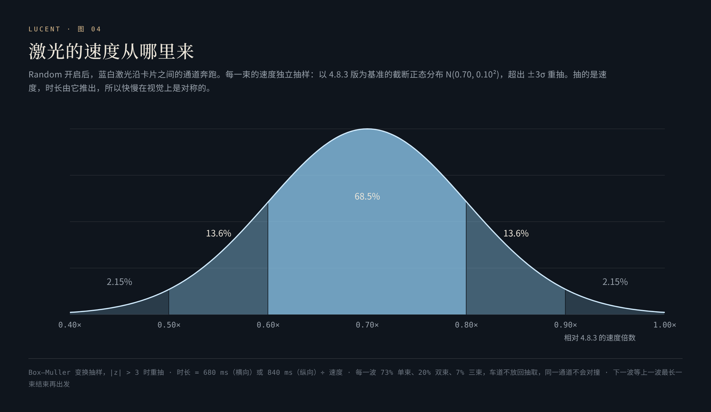

# 念起，光行

**A thought, in flight —— 一行文字，成为一道光。**

[English](en/motion.md) · [返回 README](../README.md) · [在线品鉴页](https://hydeclanspi.github.io/Lucent-Next/atelier/)

---

搜索的那一瞬间，通常什么也不发生：按下回车，页面跳走。灵感台把这一瞬间当作一个可以设计的对象——起态是你亲手写下的字，中间发生有因果的变形，终点是那枚真正承担交接的蓝色箭头。光抵达箭头之后，搜索才出发。

每一款都在 320–480 ms 之内完成。

## 1. 品鉴：十六选六

在进入产品之前，先做了一个独立的[品鉴页](https://hydeclanspi.github.io/Lucent-Next/atelier/)，四组十六款：

| 组 | 四款 |
|---|---|
| 光的速度 | 一线入光 · 焦点 · 微棱 · 快门 |
| 字的秩序 | 字序 · 引力 · 折页 · 余像 |
| 材料的呼吸 | 铂丝 · 穿针 · 液光 · 薄暮 |
| 浮光的灵性 | 流星核 · 近轨 · 微门 · 收笔 |

品鉴页可以回车或点箭头播放、独立重播、共享同一段输入、在主舞台上逐帧拖动、0.35× 慢看、切换晨光与暮色、顺次品鉴，也可以留下自己的「心选」。系统开启「减少动态效果」时，改用短暂淡出。

最终精选六款进入产品，**保留它们在品鉴页里的编号**：01 · 03 · 04 · 09 · 10 · 14。

## 2. 六款

| 编号 | 名字 | 时长 | 一句话 | 发生了什么 |
|:-:|---|:-:|---|---|
| 01 | 一线入光 *Lightline* | 360 ms | 字句成光，一线抵达。 | 字先被纵向压成一条基线，再以三次缓入飞向箭头；同时画出三层光束——4.2 px 的光晕、1.15 px 的光芯、0.42 px 的墨线——光头以缓出抵达 |
| 03 | 微棱 *Microprism* | 400 ms | 冷暖微分，在终点合一。 | 每个字分出冰蓝与暖金两道色散通道，沿相反方向错开，再在箭头处会合；一枚小棱镜在终点开合 |
| 04 | 快门 *Shutter* | 320 ms | 一瞬曝光，利落出发。 | 整行文字被裁成三条水平切片，依次错开 3.5% 起跑，按脉冲斜切、纵向压扁 93%，像快门帘幕扫过 |
| 09 | 铂丝 *Platinum filament* | 460 ms | 纤细光丝，轻轻织入。 | 每个字抽出自己的光丝，沿正弦拱起的路径织向箭头，上下交替；每第三根是更粗的暖色 |
| 10 | 穿针 *Through the eye* | 440 ms | 抽成一线，穿过微光。 | 字被压扁到 2.6% 的高度、横向拉长 10%，再沿二次贝塞尔曲线穿入箭头的「针眼」；每根线段的长度随字宽变化 |
| 14 | 近轨 *Near orbit* | 480 ms | 两道近弧，在箭头会合。 | 字沿上下两道半椭圆轨道交替飞行，缩小到 2%，每第三个字拖一道尾光 |

六款共用一个结尾：箭头处一枚十字形的微光，和箭头外圈一道在最后 30% 时间里亮起又退去的金色环（`--search-arrival = 0.75·sin(π·(p − 0.7)/0.3)`）。

## 3. 每一帧都是进度的纯函数

渲染器的签名是 `renderer(ctx, state, t)`，`t ∈ [0, 1]`（[`search-motion-renderers.js`](../src/assets/search-motion-renderers.js)）：

- `t ≤ 0` 画出原样的文字；`t ≥ 1` 什么也不画——交接时画布是干净的。
- 渲染器内部不读时间、不调用随机数。同一个 `t` 永远画出同一帧。
- 缓动只用几种原语：`smoothstep`、三次缓入 / 缓出、区间映射 `phase(t, a, b)`、正弦包络。

这件事带来三个直接的好处：**能慢放**（0.35× 只是把时长除以 0.35）；**能倒放**（模拟发射的第一发会沿原路回弹，见第 6 节）；**能逐帧测试**——[`tests/motion-renderers.test.cjs`](../tests/motion-renderers.test.cjs) 用一个记录式的 2D 上下文，把六款渲染器在 3 段文字 × 1,201 个进度点 = 21,618 个状态下各画两遍，断言坐标全部有限、`save` / `restore` 配平、两遍的绘制指令完全一致、首帧是原文、末帧为空，以及连发模式只画光路、不画字。品鉴页的十六款渲染器当时也做过同样的检查，覆盖 38,784 个进度状态。

## 4. 播放器

[`search-motion.js`](../src/assets/search-motion.js) 负责把一段动画安全地放进真实的搜索框：

- **量真实的字。** 读取输入框的计算字体、字距、内边距与当前横向滚动；只有在输入框可见范围内的字参与动画。
- **按字形簇切分。** 中文、emoji 与组合字符用 `Intl.Segmenter('zh', { granularity: 'grapheme' })` 切分，不会把一个 emoji 拆成两半（[L44-L45](../src/assets/search-motion.js#L44-L45)）。
- **一张画布，一个循环。** 画布覆盖搜索框并上下各外扩 54 px 给光留出空间，设备像素比封顶 2。
- **永远不会卡住搜索。** 渲染器抛错、页面隐藏、页面卸载都会立刻结束动画并交还控制；另有一个「时长 + 100 ms」的计时器兜底——即使宿主 WebView 在导航时暂停了帧回调，搜索也一定且只会发出一次（[L89-L93](../src/assets/search-motion.js#L89-L93)）。
- **系统要求减少动态效果时**，不播放，直接出发。

## 5. 提交流程

回车与箭头走同一条表单提交（[`bindMainSearch`](../src/assets/app.js#L5197-L5296)）：

- 输入法组字时的回车只提交给输入法，不触发搜索；空白内容不出发；动画进行中不重复提交。
- 动画结束才真正导航；导航之前清空输入框的当前值与默认值，从浏览器返回时输入框干净如初；若导航失败，原文回到输入框。
- 动画可以关闭（「搜索直接出发」），也可以开启 Random——每次随机选一款。

## 6. Random：白金环与蓝白激光

打开 Random，选择卡片的那一块区域会变成一块电路板：

- **铂金字样与金属开关。** 「Random」字样由三层渐变裁进文字——一层 135° 的铂金底色、一道 45° 的斜向反光、一点 3×2 px 的椭圆高光；开关轨道是金到铂的拉丝渐变。
- **香槟导流环。** 每两张卡片之间的缝隙里，各有两道 1 px 的香槟色虚线（`#B49560 → #FFF2CF → #FFFFFF`），外加一圈 1.4 px 的冰蓝光晕；横向 1.1 s、纵向 1.3 s 一个周期流动。按卡片序号错开相位（−0.43 s、−0.79 s），整块电路不会齐步走。
- **蓝白激光。** 1.3 × 100 px 的光脉冲（`#69ACFF → #B4DDFF → #FFFFFF`），带一层蓝色辉光，只在卡片之间的通道里奔跑。

激光的排班是一个小算法（[`scheduleLaser`](../src/assets/search-motion-panel.js#L86-L150)）：

1. **从真实布局取车道。** 每一波出发前，都从卡片的实际位置算出车道：行与行之间是横向车道，列与列之间是纵向车道。双列时，横向车道合计权重 0.7，纵向 0.3；单列时只有横向。
2. **每一波的规模。** 73% 单束、20% 双束、7% 三束，不超过车道数。
3. **不放回抽车道。** 按权重轮盘抽取，抽中的车道从候选中移除——同一波里两束永远不会在同一条通道里迎面相撞。
4. **方向。** 横向五五开；纵向只有 4/30 的概率逆行。
5. **速度。** 每一束独立抽样：以 4.8.3 版为基准的截断正态分布 N(0.70, 0.10²)，用 Box–Muller 变换生成，|z| > 3 时重抽。抽的是速度，时长由它推出：时长 = 680 ms（横向）或 840 ms（纵向）÷ 速度。约 68.5% 落在 0.60–0.80，27.2% 落在 0.50–0.60 或 0.80–0.90，4.3% 落在两端。
6. **等上一波落地。** 下一波在 1.53–3.17 s 之后出发，且不早于上一波最长那一束结束后 90 ms。
7. **开场编舞。** 打开 Random 后 275 ms，三条车道同时出发：竖缝自上而下、第二道横缝自右向左、第一道横缝自左向右。

页面隐藏时暂停排班；系统开启「减少动态效果」时，导流环与激光都不出现。

## 7. 模拟发射

开启 Random 与模拟发射：第一发是彩排，回到原处；按住回车之后，每一发换一种姿态，字随光离开。

灵感台也是一个让人愿意停留的地方。面板右上角有一枚「无限模拟发射循环」开关——一个只在这一次访问里有效的彩蛋（[`search-simulation.js`](../src/assets/search-simulation.js)）。打开之后，搜索框只发射光，搜索留在原地，光在台上自成闭环：

- **第一发会回弹。** 如果输入框是空的，先浮现一句随机的话（其中一句是「念起，光行」），180 ms 升起；第一发是一次彩排，沿原路飞出再倒放回来，文字一个不差地回到原处——这正是渲染器为纯函数的回报。之后的每一发，字都随光离开。
- **长按回车连发。** 按住超过 280 ms，或两次按下间隔小于 300 ms，就进入连发：每一发 160 ms，从这一款「光开始出现」的那一刻起播，只画光路、不画字；同一张画布、同一个帧循环，连发过程中不重新测量、不分离节点、不切换只读状态。
- **需求只保留一个比特。** 动画进行中再按，只记下「还要一发」，队列始终只有一格。
- **对键盘诚实。** 有些键盘在自动重复时会发出成对的按下 / 抬起；抬起后等 80 ms 再判断是否真的松手。输入、组字、失焦、页面隐藏都会立刻取消；离开页面或从往返缓存返回，模式即失效。

这个控制器不碰任何存储，也不调用宿主接口。

**绢光与浮金。** 循环开着的时候，搜索框还会镶上一圈金（[`search-aura.js`](../src/assets/search-aura.js)）。一张画布贴在搜索框身后，画在玻璃之上、文字之下：

- **绢光。** 两段丝绢各占周长的 42%，相隔半圈，沿圆角矩形按弧长匀速绕行，十秒一圈，圆角与直边一样快。连发时绕行加快到三倍；每一道光抵达箭头，丝绢都被轻推一下。
- **浮金。** 金尘从上沿缓缓升起、从下沿轻轻沉落，同时在场 12–22 粒，每 4–7.65 秒重抽一次数量与上下的比例（上沿占 55–68%）；六成新的金尘在三个候选位置里取丝绢最亮的一处，所以多半从丝绢正经过的地方扬起。每一发开始时，金尘涨到当时的 1.25–1.6 倍（至多 40 粒），1.6 秒后再慢慢回落。
- **只读，不改。** 它只读搜索框上已有的信号——飞行中、连发、发射键上光束抵达的进度——发射逻辑一行未动。浅色玻璃上金色沉一点，深色玻璃上提亮并以加色混合；减少动态效果时，丝绢静止成一圈，金尘不出现。

## 8. 验证

- [`tests/motion-renderers.test.cjs`](../tests/motion-renderers.test.cjs)：六款渲染器 21,618 个状态的确定性、首末帧与连发模式。
- [`tests/browser.cjs`](../tests/browser.cjs)：一线入光在导航之前播放；中文、空格、符号与 emoji 的查询被正确编码；返回后输入框为空；组字中的回车与空白输入从不导航；减少动态效果时直接出发。
