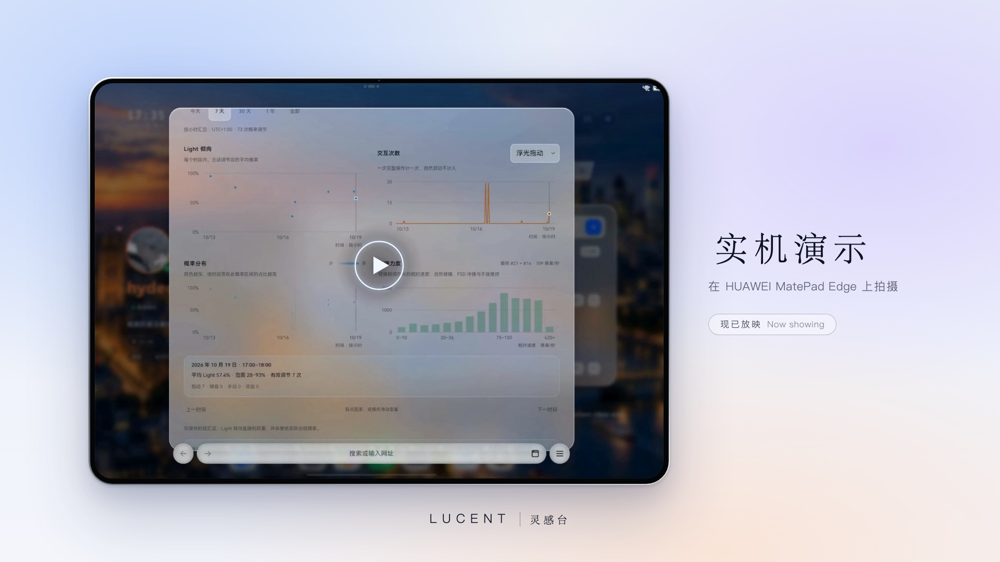

<h1 align="center">影片与演示 · Film and demos</h1>

  概念影片、实机演示与动效品鉴，都在这一页。 
  The concept film, the on-device film and the motion atelier, on one page.

<a href="../README.md">灵感台</a> &nbsp;·&nbsp; <a href="../README.en.md">Lucent</a> &nbsp;·&nbsp; <a href="../Live-web.md">在线体验与一键直达 · Live and deep links</a>

---

## 概念影片 · The concept film

**[在浏览器中观看 · Watch in the browser](https://hydeclanspi.github.io/Lucent-Next/film/)** &nbsp;·&nbsp; [MP4（2560 × 1440，60 帧，有声 · 60 fps, with sound）](../Lucent-Film.mp4)

一分四十八秒，请打开声音；每一帧画面、每一个声音都由代码生成。网页版点「播放影片」开始：空格暂停，← / → 跳五秒，M 静音，R 从头播放，F 全屏；地址后加 `?t=42`，从第 42 秒开始。源码在 [film/](film/)；配乐由 `python3 scripts/film-score.py` 合成，渲染成视频用 `node scripts/film.mjs`。

One minute forty-eight seconds; sound on. Every frame and every sound is made in code. In the browser, press Play: Space pauses, ← / → skip five seconds, M mutes, R replays, F goes full screen; add `?t=42` to start at 42 seconds. The source is in [film/](film/); `python3 scripts/film-score.py` composes the score, and `node scripts/film.mjs` renders the film to video.

## 实机 · On the device

**[在浏览器中观看 · Watch in the browser](https://hydeclanspi.github.io/Lucent-Next/device/)** &nbsp;·&nbsp; [MP4（2560 × 1440，60 帧，有声 · 60 fps, with sound）](device/lucent-on-device.mp4)

在 HUAWEI MatePad Edge 上录下的五十四秒：一次搜索和它的一线入光，念起，光行，浮光的设置与历史统计，壁纸，名片与备份；最后是绕着搜索框流淌的绢光与浮金，和两栏收起后的专注态。安静的段落加速播放，右上角标着倍速；配乐取自概念影片的后半段。剪辑由 `scripts/device-edit.py` 完成，镜头、倍速与配乐的接缝都是脚本顶部的表。

Fifty-four seconds recorded on the HUAWEI MatePad Edge: a search and its Lightline, the six ways to arrive, the Lueurs' settings and their history, the wallpapers, the card and the backup; and last, the silk light and gold motes flowing round the search field, and focus with both sections folded. The quiet stretches run faster, each marked with its speed; the music is the second half of the concept film's score. `scripts/device-edit.py` makes the edit, with the camera, the speeds and the music's joins as tables at the top of the script.

## 十六款动效品鉴 · Sixteen motion studies

**[hydeclanspi.github.io/Lucent-Next/atelier](https://hydeclanspi.github.io/Lucent-Next/atelier/)**：光的速度、字的秩序、材料的呼吸、浮光的灵性，四组十六款，可逐帧拖动、0.35× 慢看；六款由此进入产品。源码在 [design/atelier/](../design/atelier/)。

The speed of light, the order of letters, the breath of materials, the spirit of the Lueurs: sixteen studies in four sets, to scrub frame by frame or watch at 0.35×; six of them went into the product. The source is in [design/atelier/](../design/atelier/).

## 素材 · Media

[media/](media/) 收着 README 与文档里的截图和动图，每一张都由脚本生成：界面在伪时钟下逐帧录制（`scripts/capture/`），任何机器上得到同样的画面；影片的封面与预告取自渲染好的影片（`scripts/film-media.mjs`）；实机动图剪自 MatePad Edge 的录屏（`scripts/device-clip.py`）。做法见[维护](../docs/MAINTAINING.md)。

[media/](media/) holds the screenshots and animations in the README and the docs, each one made by a script: the interface is captured frame by frame under a fake clock (`scripts/capture/`), so it comes out the same on any machine; the film's cover and teaser come from the rendered film (`scripts/film-media.mjs`); the on-device animation is cut from a MatePad Edge recording (`scripts/device-clip.py`). See [Maintaining](../docs/MAINTAINING.md).
